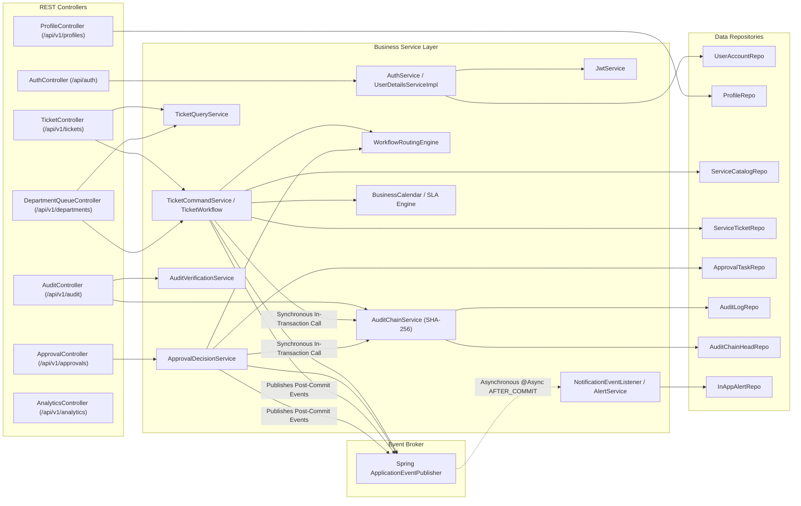
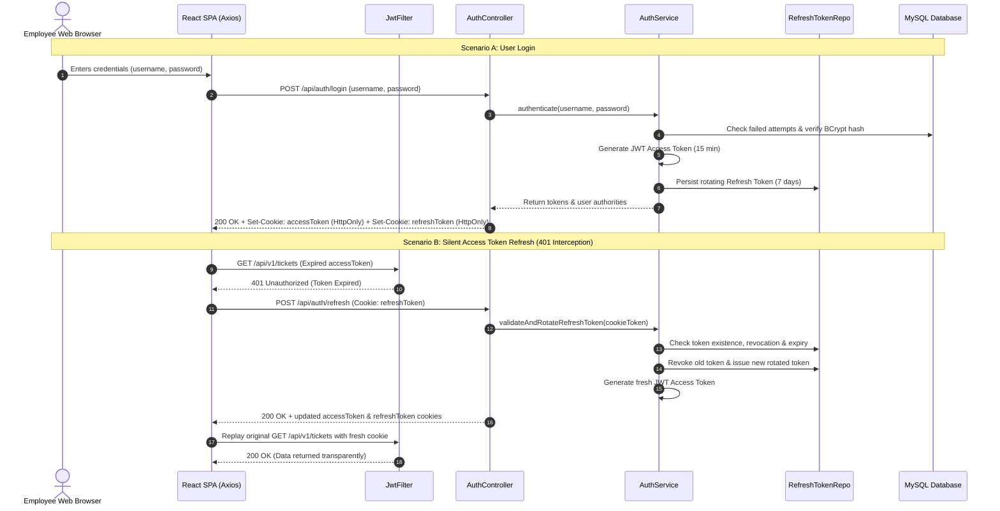
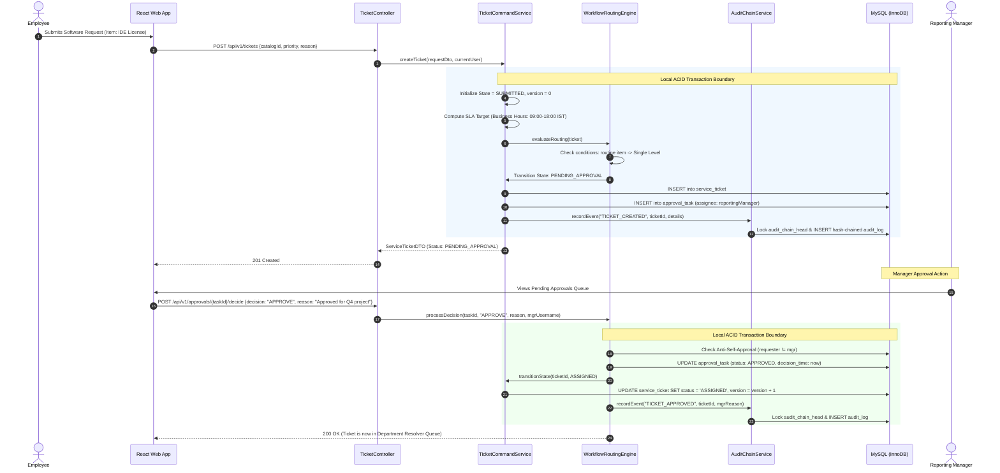
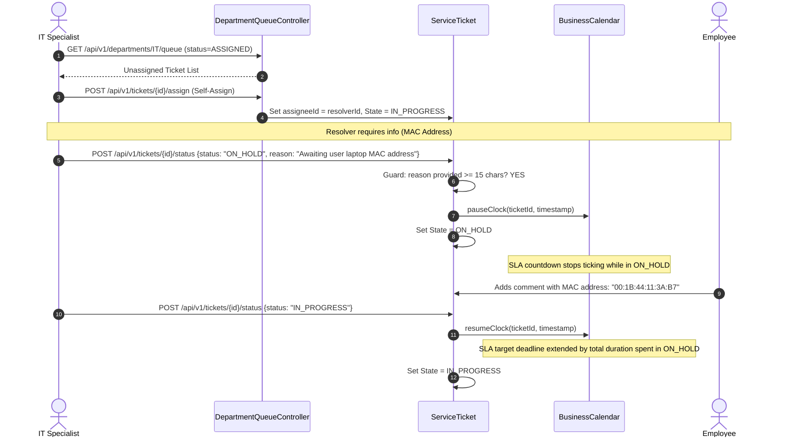
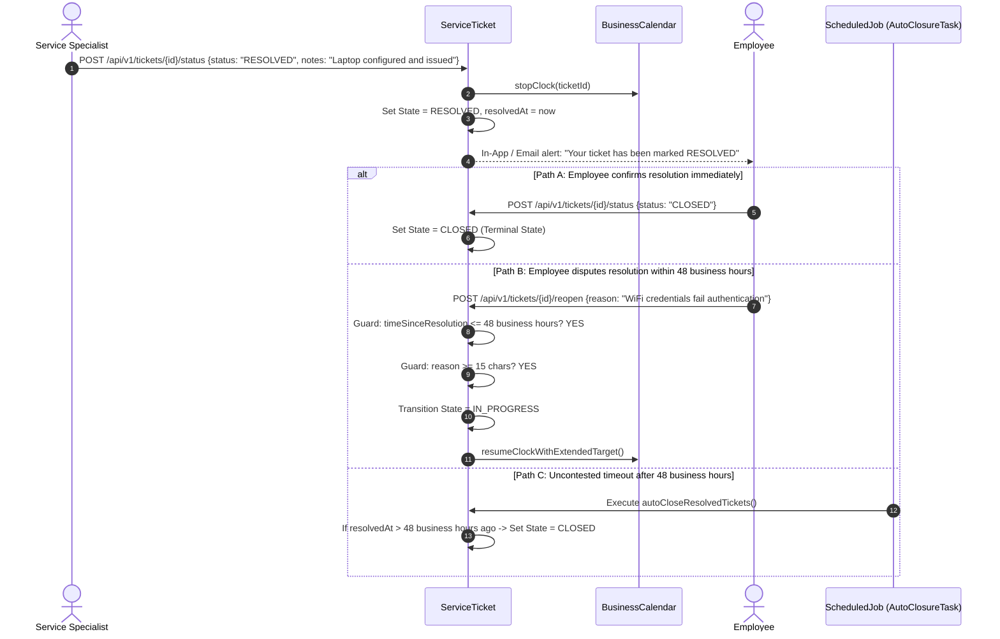
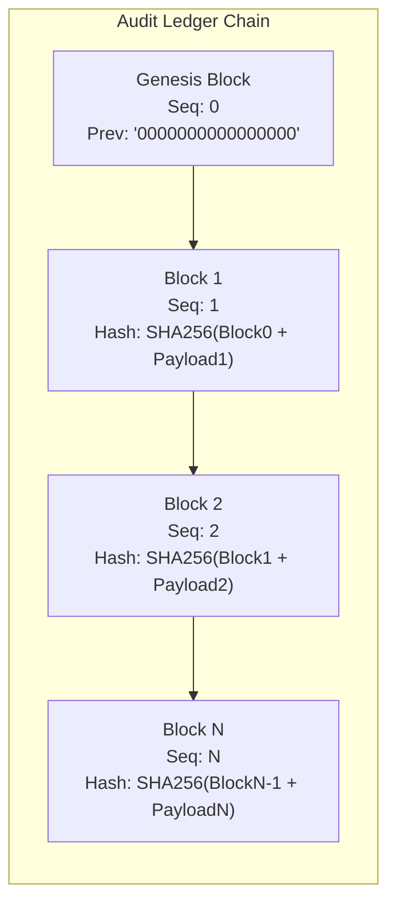

# High-Level Design (HLD) Document
## EMPORA — Employee Services & Workflow Platform
**One platform. Connected operations.**

*A platform for managing employee services, approvals, cross-department workflows and organisational operations.*

**Document ID:** EMPORA-HLD-001  
**Version:** 2.0.0  
**Date:** November 2026  
**Status:** Approved Architecture Baseline  
**Author:** Principal Software Architect, Senior Java Engineer & Enterprise Systems Lead  

---

## 1. Executive Summary & Architectural Vision

The **EMPORA Employee Services & Workflow Platform** is an enterprise operations platform developed to eliminate informal, untracked, and insecure internal service requests across organizations (100–1,000+ employees). By centralizing request management across IT, HR, Facilities, and Finance into an auditable digital platform, EMPORA delivers deterministic workflows, SLA tracking, transparent multi-level managerial approvals, and cryptographically verified audit trails.

### 1.1 Strictly Gated Enterprise Portal Architecture
EMPORA is architected strictly under the **Strictly Gated Enterprise Portal** security policy (Option 2):
* In compliance with enterprise privacy, banking, and defense standards, **no operational details, service names, SLA timelines, equipment catalogs, or software lists are visible without authentication**.
* Any unauthenticated guest accessing protected endpoints (such as `/api/v1/catalog`, `/api/v1/tickets`, `/api/v1/departments/**`) receives `401 Unauthorized`.
* Unauthenticated web traffic lands exclusively on the secure login screen. All service discovery and lifecycle interaction require an authenticated organizational session.

### 1.2 Technology Baseline & Engineering Stack
* **Backend Runtime:** **Java 25 LTS** (`Eclipse Adoptium Temurin 25.0.2+10-LTS`) across development, testing, and production container stages (`eclipse-temurin:25-jre-alpine`).
* **Backend Framework:** **Spring Boot 3.5.16** with **Spring Security 6.4+**, using stateless JWT access tokens in HttpOnly cookies, rotating refresh tokens, and Double-Submit CSRF protection (`XSRF-TOKEN` cookie + `X-XSRF-TOKEN` header).
* **Persistence Tier:** **MySQL 8.0+** (InnoDB Storage Engine) with deterministic Flyway schema migrations (`V1` to `V4`) maintaining strict foreign keys and relational integrity.
* **Frontend Architecture:** **React 18** Single Page Application with clean component hierarchy, Tailwind CSS design tokens, and Axios interceptors with automated silent refresh handling.
* **Testing Harness:** JUnit 5, MockMvc, Testcontainers MySQL (`mysql:8.0.45`), Jest + React Testing Library, and Playwright E2E.
* **Project Directory Organization:**
  * `springapp/backend/`: Complete Spring Boot Java backend (`pom.xml`, `src/main`, `src/test`).
  * `springapp/frontend/`: Complete React 18 frontend (`package.json`, `src/`, `public/`).

---

## 2. C4 Model – Level 2: Container Architecture Diagram

```mermaid
graph TD
    subgraph Browser Client [Enterprise Web Client]
        ReactSPA["React 18 SPA (JavaScript / CSS Tokens)<br/>Axios / Silent JWT Refresh / CSRF Guard<br/>Located in: springapp/frontend"]
    end

    subgraph EMPORA Host Boundary [Port 8080 - springapp/backend]
        subgraph Web Security Tier
            CsrfFilter["CsrfCookieFilter<br/>Double-Submit Cookie & Header Token"]
            JwtFilter["JwtFilter<br/>Stateless JWT Cookie & Claims Resolver"]
            RestControllers["Spring MVC REST Controllers<br/>(/api/auth/*, /api/v1/*)"]
        end

        subgraph Application Domain Modules [Modular Monolith]
            IAMModule["com.examly.springapp.service (IAM)<br/>Identity, Auth, Cookies & Session"]
            ProfileModule["com.examly.springapp.service (Profile)<br/>Employee Master, Designation & Salary"]
            TicketModule["com.examly.springapp.service (Ticket)<br/>11-State FSM, Priority & Assignment"]
            WorkflowModule["com.examly.springapp.service (Workflow)<br/>1-Level & 2-Level Approval Routing"]
            AuditModule["com.examly.springapp.service (Audit)<br/>SHA-256 Continuous Hash Chaining"]
            SlaModule["com.examly.springapp.service (SLA & Calendar)<br/>BusinessCalendar (09:00-18:00 IST)"]
            NotifyModule["com.examly.springapp.service (Notification)<br/>In-App Alerts & Mail Relay"]
        end

        subgraph Persistence & Infrastructure Tier
            SpringDataJPA["Spring Data JPA / Hibernate 6.6+"]
            HikariCP["HikariCP Pool (Max: 10, Min-Idle: 5)"]
            FlywayEngine["Flyway Migration Engine (V1..V4)"]
            MailSender["Spring JavaMailSender"]
        end
    end

    subgraph External Infrastructure
        MySQLServer[("MySQL 8.0+ Database Server<br/>(empora_db / InnoDB Engine)")]
        MailpitServer["Mailpit / SMTP Relay<br/>(Port 1025 / 587)"]
    end

    ReactSPA -->|HTTPS REST / JSON with Cookies| CsrfFilter
    CsrfFilter --> JwtFilter
    JwtFilter --> RestControllers

    RestControllers --> IAMModule
    RestControllers --> ProfileModule
    RestControllers --> TicketModule
    RestControllers --> WorkflowModule
    RestControllers --> AuditModule
    RestControllers --> SlaModule
    RestControllers --> NotifyModule

    TicketModule --> SpringDataJPA
    WorkflowModule --> SpringDataJPA
    AuditModule --> SpringDataJPA
    ProfileModule --> SpringDataJPA
    IAMModule --> SpringDataJPA
    SlaModule --> SpringDataJPA

    SpringDataJPA --> HikariCP
    FlywayEngine --> HikariCP
    HikariCP -->|JDBC / TLS (Port 3306)| MySQLServer

    NotifyModule --> MailSender
    MailSender -->|SMTP / TLS| MailpitServer
```

---

## 3. C4 Model – Level 3: Component Architecture Diagram



---

## 4. End-to-End Request Lifecycle & Security Workflows

### 4.1 Authentication & Silent Token Refresh Flow
Stateless JWT access tokens are valid for 15 minutes. Long-lived refresh tokens are stored in an `HttpOnly`, `SameSite=Lax` cookie and verified against the database.



---

### 4.2 Routine Service Ticket Submission & Manager Approval
Routine requests (e.g. software license, HR letter) follow the default single-level workflow.



---

### 4.3 High-Impact Request & Conditional Two-Level Approval
Capital hardware requests or expenses exceeding ₹10,000, as well as privileged access requests, automatically trigger a secondary approval level.


---

### 4.4 Department Resolver Assignment & SLA Pausing (`ON_HOLD`)
Resolvers claim tickets, execute technical fulfillment, and manage pauses awaiting employee dependencies.



---

### 4.5 Ticket Resolution, 48-Hour Dispute Window, or Auto-Closure
Resolvers mark work complete; employees have 48 business hours to dispute or accept resolution.



---

## 5. 11-State Ticket Lifecycle State Machine (FSM)


### 5.1 Formal State Transition & Permission Matrix

| Current State | Permitted Next State | Trigger / Event | Authorized Role(s) | SLA Action | Required Guard Conditions |
| :--- | :--- | :--- | :--- | :--- | :--- |
| `SUBMITTED` | `PENDING_APPROVAL` | Routing engine evaluation | System | Starts | Approval rule requires managerial review. |
| `SUBMITTED` | `ASSIGNED` | Auto-approval rule | System | Starts | Pre-approved catalog item. |
| `SUBMITTED` | `CANCELLED` | User withdrawal | `EMPLOYEE` (Owner) | Stops | Cancellation allowed before work begins. |
| `PENDING_APPROVAL` | `PENDING_SECONDARY_APPROVAL`| Primary approval | `MANAGER` | Active | Request is high-impact / $> ₹10,000$ / privileged. |
| `PENDING_APPROVAL` | `ASSIGNED` | Primary approval | `MANAGER` | Active | Routine request; ticket enqueued for department. |
| `PENDING_APPROVAL` | `REJECTED` | Manager rejection | `MANAGER` | Stops | Mandatory rejection reason $\ge 15$ characters. |
| `PENDING_APPROVAL` | `CANCELLED` | User withdrawal | `EMPLOYEE` (Owner) | Stops | Allowed while awaiting approval. |
| `PENDING_SECONDARY_APPROVAL` | `ASSIGNED` | Secondary approval | `DEPT_HEAD` | Active | Dept Head sign-off granted. |
| `PENDING_SECONDARY_APPROVAL` | `REJECTED` | Secondary rejection | `DEPT_HEAD` | Stops | Mandatory rejection reason $\ge 15$ characters. |
| `PENDING_SECONDARY_APPROVAL` | `CANCELLED` | User withdrawal | `EMPLOYEE` (Owner) | Stops | Allowed while awaiting secondary approval. |
| `ASSIGNED` | `IN_PROGRESS` | Resolver claims/starts | `IT_SPECIALIST`, `HR_SPECIALIST`, `FACILITIES_SPECIALIST`, `FINANCE_SPECIALIST`, `ADMIN` | Active | Assignee ID must be populated. |
| `ASSIGNED` | `CANCELLED` | User withdrawal | `EMPLOYEE` (Owner) | Stops | Allowed because work has not yet started. |
| `IN_PROGRESS` | `ON_HOLD` | Resolver pauses work | Department Specialists, `ADMIN` | **PAUSES** | Mandatory hold reason $\ge 15$ chars. Cancellation prohibited. |
| `IN_PROGRESS` | `RESOLVED` | Work fulfilled | Department Specialists, `ADMIN` | **STOPS** | Fulfillment notes provided. |
| `ON_HOLD` | `IN_PROGRESS` | Resolver resumes work | Department Specialists, `ADMIN` | **RESUMES**| SLA target extended by duration in `ON_HOLD`. |
| `ON_HOLD` | `CANCELLED` | User withdrawal | `EMPLOYEE` (Owner) | Stops | Permitted while in hold state. |
| `RESOLVED` | `CLOSED` | Employee confirmation | `EMPLOYEE` (Owner) | Stopped | Employee verifies request satisfaction. |
| `RESOLVED` | `CLOSED` | Scheduled auto-closure | System Scheduler | Stopped | 48 business hours elapsed with no dispute. |
| `RESOLVED` | `IN_PROGRESS` | Dispute / Reopen | `EMPLOYEE` (Owner) | **RESUMES**| Dispute within 48 business hours; reason $\ge 15$ chars. |
| `REJECTED` | *(Terminal)* | None | None | None | Immutable terminal state. |
| `CANCELLED`| *(Terminal)* | None | None | None | Immutable terminal state. |
| `CLOSED`   | *(Terminal)* | None | None | None | Immutable terminal state. |

---

## 6. Role-Based Access Control (RBAC) & Domain Security Boundaries

EMPORA enforces strict least-privilege access across 11 discrete enterprise roles:

| Role Identifier | Portal Scope & Allowed Operations | Blocked Operations / Guard Invariants |
| :--- | :--- | :--- |
| `EMPLOYEE` | Browse Catalog, Submit Requests, View Own Tickets, Cancel (Pre-Work/On-Hold), Reopen (48h Window), View Own Profile. | Blocked from viewing other users' tickets, internal comments, employee salaries, and resolving/assigning tickets. |
| `MANAGER` | All `EMPLOYEE` permissions + View & Decide Direct Report Approvals. | Blocked from approving own tickets (`AntiSelfApprovalException`), viewing departmental queues outside authority, or viewing employee salaries outside HR. |
| `DEPT_HEAD` | All `MANAGER` permissions + Tier-2 Approval for High-Impact / $> ₹10,000$ Requests. | Blocked from self-approval and mutating tickets outside their departmental jurisdiction. |
| `IT_SPECIALIST` / `IT_ADMIN` | View IT Department Queue, Claim, Update Status (`IN_PROGRESS`, `ON_HOLD`, `RESOLVED`), Add Internal Notes. | Blocked from accessing HR salary details, Finance internal vouchers, or approving managerial workflows. |
| `HR_SPECIALIST` / `HR_ADMIN` | View HR Queue, Resolve HR Tickets, Access Employee Master, View & Update Compensation / Salary Data. | Blocked from IT root operations, Finance approvals, or altering cryptographic audit records. |
| `FINANCE_SPECIALIST` / `FINANCE_ADMIN` | View Finance Queue, Authorize Invoices, Review Budget / High-Cost Requests. | Blocked from employee salary editing unless assigned HR cross-role; blocked from modifying audit chain. |
| `FACILITIES_SPECIALIST` / `FACILITIES_ADMIN` | View Facilities Queue, Manage Physical Access, Desk & Equipment Requests. | Blocked from confidential HR, IT server management, and Finance transactions. |
| `SECURITY_ADMIN` | Review Security Incidents, Manage MFA Policies, Lock Accounts, Audit Access Logs. | Blocked from bypassing approval workflows or tampering with audit hash continuity. |
| `COMPLIANCE_OFFICER` | Review Operational Compliance, Policy Adherence, Audit Trail Integrity. | Read-only across departmental tickets; blocked from executing operational changes. |
| `AUDITOR` | Read-only inspection of Audit Ledger, System Logs, Verification Reports, and SLA Metrics. | **STRICTLY BLOCKED from all mutating operations** (`POST`, `PUT`, `PATCH`, `DELETE` receive `403 Forbidden`). |
| `ADMIN` / `SUPER_ADMIN` | Full System Administration, Role Assignment, Catalog Management, Departmental Configuration. | Cannot tamper with cryptographic audit chain without triggering algorithmic tamper alarms. |

### 6.1 Domain-Specific Security Enforcements
1. **Internal Resolver Comments Privacy:**
   - `TicketComment.isInternal == true` is reserved strictly for department specialists and administrators.
   - When serialized for `EMPLOYEE` or `MANAGER`, internal comments are filtered from the response JSON payload.
2. **Employee Compensation & Salary Protection:**
   - `Profile.salary` is restricted exclusively to `HR_ADMIN`, `HR_MANAGER`, and `ADMIN`.
   - Responses to `EMPLOYEE`, `MANAGER`, `IT_SPECIALIST`, and other non-HR roles mask or omit the salary field.
3. **Anti-Self-Approval Enforcement (`BR-005`):**
   - If a manager submits a service ticket, they cannot approve their own request. Attempted approval throws `AntiSelfApprovalException` and returns `403 Forbidden`.

---

## 7. Continuous Cryptographic Audit Ledger Architecture

To guarantee regulatory compliance (SOX, ISO 27001, SOC 2), EMPORA implements a tamper-evident audit ledger using SHA-256 continuous hash chaining:



* **Atomic Hash Chaining:** Every state mutation, approval decision, and role change synchronously writes to `audit_log` within the active transaction.
* **Concurrency Control:** `audit_chain_head` uses pessimistic locking (`SELECT ... FOR UPDATE`) to prevent race conditions during concurrent state transitions.
* **Tamper Verification:** The `AuditVerificationService` iteratively recalculates the hash chain:
  $$\text{Hash}_n = \text{SHA-256}(\text{Seq}_n + \text{Hash}_{n-1} + \text{Timestamp}_n + \text{Actor} + \text{Action} + \text{PayloadHash})$$
  Any direct modification in MySQL triggers an immediate validation mismatch identifying the tampered sequence number.

---

## 8. Business Calendar & SLA Engine

1. **Organization Timezone:** Standardized on `Asia/Kolkata` (Indian Standard Time, UTC+05:30). Entity timestamps are stored in UTC.
2. **Working Calendar:**
   * Operating window: Monday through Friday, **09:00 to 18:00 IST** (9 business hours/day, 45 hours/week).
   * **Weekend Exclusion:** Saturdays and Sundays freeze the SLA timer.
   * **Corporate Holidays:** Gazetted holidays are excluded from business hour accumulation.
3. **Three Lifecycle Clocks:**
   * **Resolution SLA Clock:** Ticks from `SUBMITTED` to `RESOLVED`. Pauses in `ON_HOLD`. Automatically extends target deadline upon resume.
   * **48-Business-Hour Dispute Window:** Ticks from `RESOLVED` during business hours. Reopening permitted when `now <= reopenDeadline` with reason $\ge 15$ characters.
   * **Scheduled Auto-Closure Timer:** Runs hourly (`@Scheduled`). Automatically transitions tickets from `RESOLVED` to `CLOSED` after the 48-hour dispute window expires.
