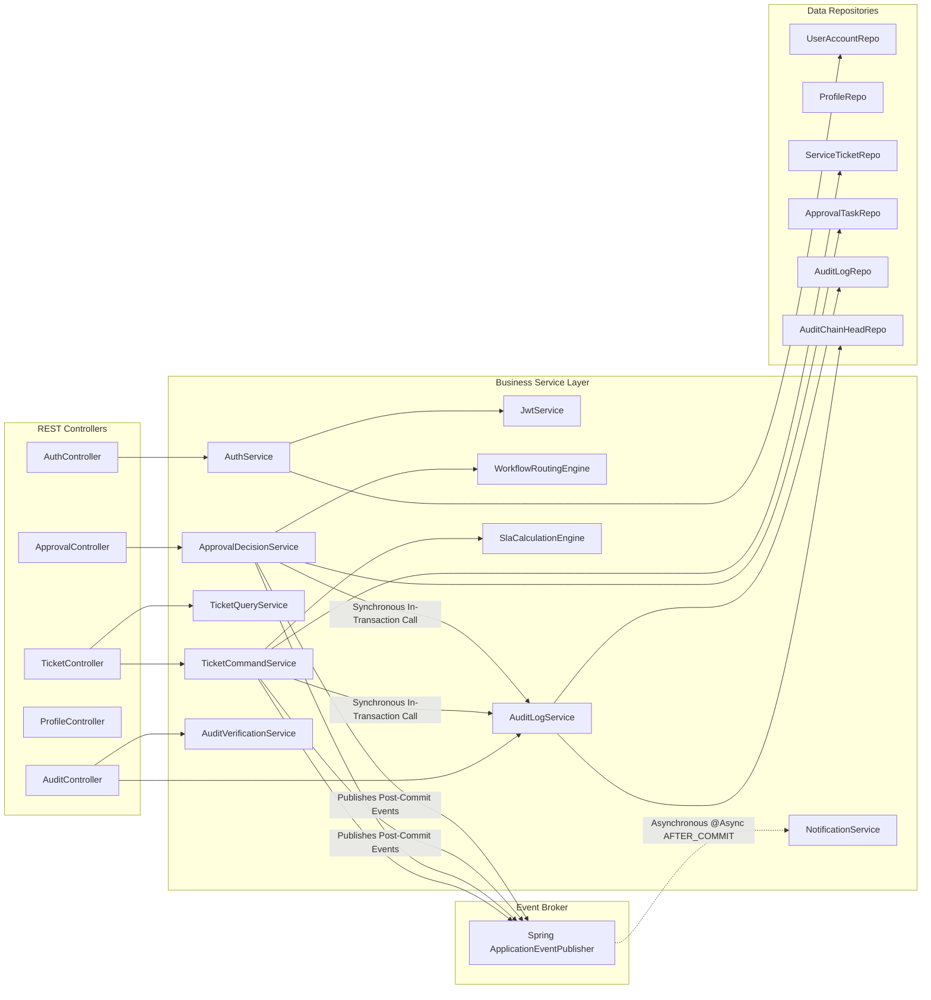
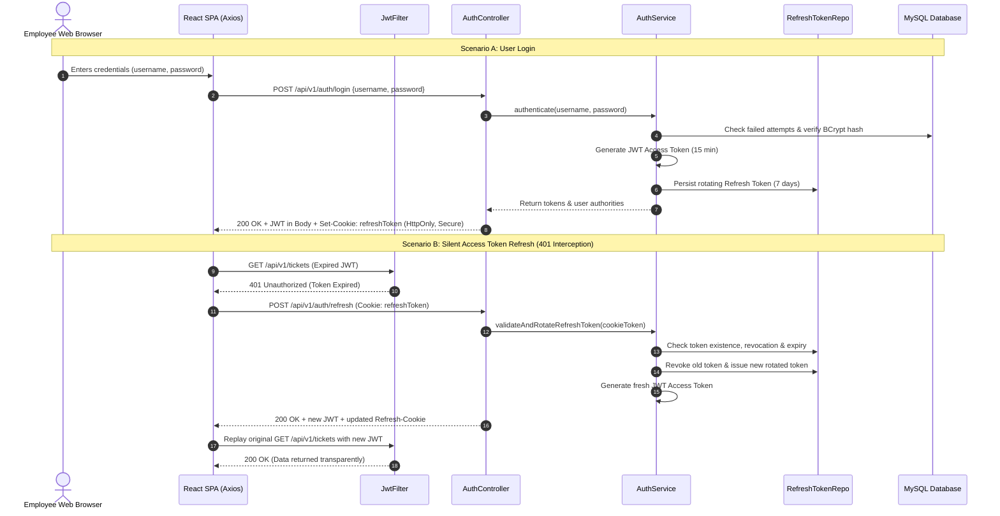
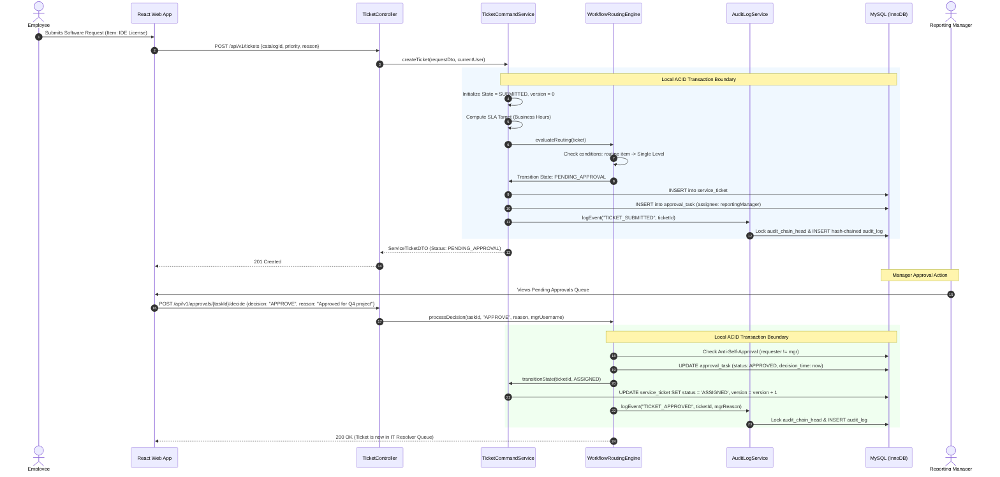
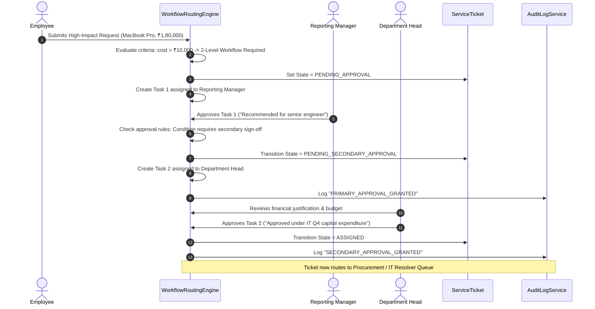
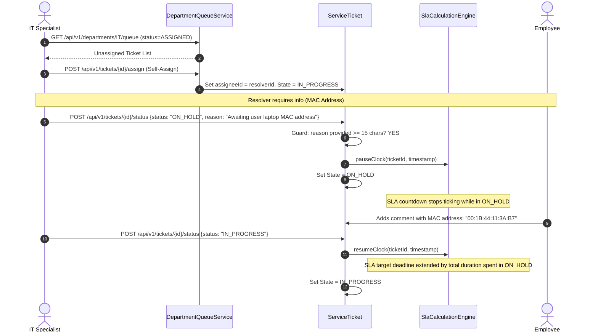
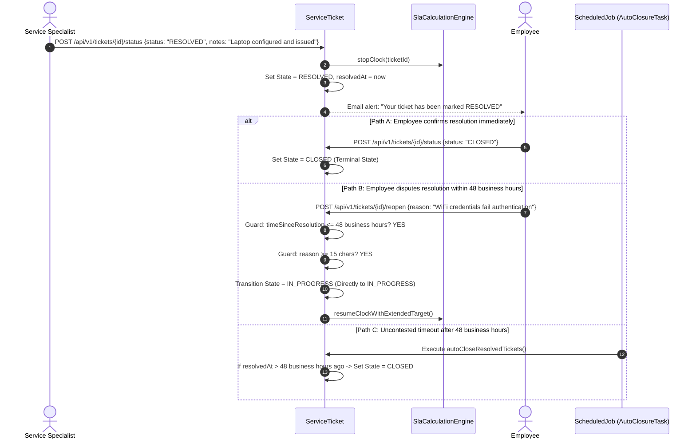
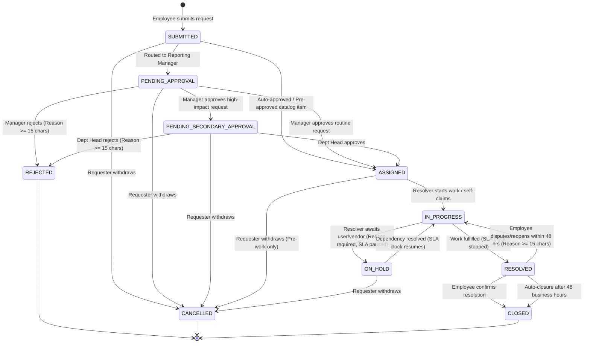

# High-Level Design (HLD) Document
## Employee Lifecycle and Service Management Platform (EPAMS)

**Document ID:** EPAMS-HLD-001  
**Version:** 1.0.0  
**Date:** November 2026  
**Status:** Approved Architecture Baseline  
**Author:** Principal Software Architect, Senior Java Engineer & Enterprise Systems Lead  

---

## 1. Executive Summary & Architectural Vision

The **Employee Lifecycle and Service Management Platform (EPAMS)** is an enterprise operations platform developed to eliminate informal, untracked, and insecure internal service requests across mid-sized organizations (100–1,000 employees). By centralizing request management across IT, HR, Facilities, and Finance into an auditable digital platform, EPAMS delivers deterministic workflows, SLA tracking, transparent managerial approvals, and cryptographically verified audit trails.

### Mandatory Technology Baseline & Runtime Strategy
* **Java Runtime:** Standardized strictly on **Java 25 LTS** (`Eclipse Adoptium Temurin 25.0.2+10-LTS`) across both local development and production container stages (`eclipse-temurin:25-jre-alpine`). Eliminates runtime version drift.
* **Backend Framework Generation:** Target architecture engineered for **Spring Boot 4.1.x** and **Spring Security 7.x** (the planned generations for certified Java 25 LTS GA support). Current active development baseline operates on Spring Boot 3.4.12 (noting official vendor certification for 3.4.x supports up to Java 23; JDK 25 executes cleanly in local compilation).
* **Security Framework:** Spring Security 7.x target design (Spring Security 6.4 verified baseline).
* **Persistence Tier:** MySQL 8.0+ (InnoDB Storage Engine) with Flyway schema migration (`baseline-on-migrate=true`).
* **Frontend Architecture:** React 18+ Single Page Application with TypeScript.
* **Architectural Pattern:** Modular Monolith within a single deployable container.
* **Deployment Model:** Multi-stage Docker container (`eclipse-temurin:25-jre-alpine`).

---

## 2. C4 Model – Level 2: Container Architecture Diagram

```mermaid
graph TD
    subgraph Browser Client [User Web Browser]
        ReactSPA["React 18+ SPA (TypeScript)<br/>Redux Toolkit / Axios / TailwindCSS"]
    end

    subgraph EPAMS Host / Container Boundary [Port 8080]
        subgraph Web Tier
            SecurityFilter["Spring Security 7 Filter Chain<br/>(Stateless JWT & CSRF Cookie Filter)"]
            RestControllers["Spring MVC REST Controllers<br/>(/api/v1/*)"]
        end

        subgraph Application Domain Tier [Modular Monolith]
            IAMModule["core.iam<br/>Identity, Auth & Token Lifecycle"]
            ProfileModule["core.profile<br/>Employee Master & Hierarchy"]
            TicketModule["module.ticket<br/>11-State Ticket Engine & SLA Clock"]
            WorkflowModule["module.workflow<br/>Approval Routing & FSM Engine"]
            AuditModule["module.audit<br/>SHA-256 Hash Chaining"]
            NotifyModule["core.notification<br/>In-App Alerts & Email Relay"]
        end

        subgraph Persistence & Infrastructure Tier
            SpringDataJPA["Spring Data JPA / Hibernate 6.6+"]
            HikariCP["HikariCP Connection Pool (Max: 10)"]
            FlywayEngine["Flyway Migration Engine"]
            MailSender["Spring JavaMailSender"]
        end
    end

    subgraph External Infrastructure
        MySQLServer[("MySQL 8.0+ Database Server<br/>(epams_db / InnoDB Engine)")]
        MailpitServer["Mailpit / Corporate SMTP Relay<br/>(Port 1025 / 587)"]
    end

    ReactSPA -->|HTTPS REST / JSON| SecurityFilter
    SecurityFilter --> RestControllers
    RestControllers --> IAMModule
    RestControllers --> ProfileModule
    RestControllers --> TicketModule
    RestControllers --> WorkflowModule
    RestControllers --> AuditModule
    RestControllers --> NotifyModule

    TicketModule --> SpringDataJPA
    WorkflowModule --> SpringDataJPA
    AuditModule --> SpringDataJPA
    ProfileModule --> SpringDataJPA
    IAMModule --> SpringDataJPA

    SpringDataJPA --> HikariCP
    FlywayEngine --> HikariCP
    HikariCP -->|JDBC / TLS (Port 3306)| MySQLServer

    NotifyModule --> MailSender
    MailSender -->|SMTP / TLS| MailpitServer
```

---

## 3. C4 Model – Level 3: Component Architecture Diagram

The component diagram details the internal structural wiring within the Spring Boot application container:



---

## 4. End-to-End Request Lifecycle Sequence Diagrams

### 4.1 Authentication & Silent Token Refresh Flow
Stateless JWT access tokens are valid for 15 minutes. Long-lived refresh tokens are stored in an `HttpOnly`, `SameSite=Lax` cookie and verified against the database (`FR-001`, `FR-003`, `FR-004`).



---

### 4.2 Routine Service Ticket Submission & Single-Level Manager Approval
Routine requests (e.g. software license, HR letter) follow the default single-level workflow (`FR-011`, `FR-016A`, `FR-017`, `BR-001`).



---

### 4.3 High-Impact Request & Conditional Two-Level Approval
Capital hardware requests or expenses exceeding ₹10,000, as well as privileged access requests, automatically trigger a secondary approval level (`FR-016B`, `BR-001`, `BR-008`, `BR-009`).



---

### 4.4 Department Resolver Assignment, Work Execution, and SLA Pausing (`ON_HOLD`)
Resolvers claim tickets, execute technical fulfillment, and manage pauses awaiting employee dependencies (`FR-013`, `FR-014`, `FR-015`, `BR-004`).



---

### 4.5 Ticket Resolution, 48-Hour Dispute Window, or Auto-Closure
Resolvers mark work complete; employees have 48 business hours to dispute or accept resolution (`FR-012`, `BR-003`).



---

## 5. 11-State Ticket Lifecycle State Machine (FSM)

The ticket engine enforces a deterministic 11-State Finite State Machine (`ADR-007`):



### 5.1 Formal State Transition & Permission Matrix

| Current State | Permitted Next State | Trigger / Event | Authorized Role(s) | SLA Action | Required Guard Conditions |
| :--- | :--- | :--- | :--- | :--- | :--- |
| `SUBMITTED` | `PENDING_APPROVAL` | Routing engine evaluation | System | Starts | Approval rule requires managerial review. |
| `SUBMITTED` | `ASSIGNED` | Auto-approval rule | System | Starts | Pre-approved catalog item (e.g. standard policy inquiry). |
| `SUBMITTED` | `CANCELLED` | User withdrawal | `ROLE_EMPLOYEE` (Owner) | Stops | Cancellation allowed before work begins. |
| `PENDING_APPROVAL` | `PENDING_SECONDARY_APPROVAL`| Primary approval | `ROLE_MANAGER` | Active | Request is high-impact / $> ₹10,000$ / privileged. |
| `PENDING_APPROVAL` | `ASSIGNED` | Primary approval | `ROLE_MANAGER` | Active | Routine request; ticket enqueued for department. |
| `PENDING_APPROVAL` | `REJECTED` | Manager rejection | `ROLE_MANAGER` | Stops | Mandatory rejection reason $\ge 15$ characters. |
| `PENDING_APPROVAL` | `CANCELLED` | User withdrawal | `ROLE_EMPLOYEE` (Owner) | Stops | Allowed while awaiting approval. |
| `PENDING_SECONDARY_APPROVAL` | `ASSIGNED` | Secondary approval | `ROLE_DEPT_HEAD` | Active | Dept Head sign-off granted. |
| `PENDING_SECONDARY_APPROVAL` | `REJECTED` | Secondary rejection | `ROLE_DEPT_HEAD` | Stops | Mandatory rejection reason $\ge 15$ characters. |
| `PENDING_SECONDARY_APPROVAL` | `CANCELLED` | User withdrawal | `ROLE_EMPLOYEE` (Owner) | Stops | Allowed while awaiting secondary approval. |
| `ASSIGNED` | `IN_PROGRESS` | Resolver claims/starts | `ROLE_RESOLVER`, `ROLE_ADMIN`| Active | Assignee ID must be populated. |
| `ASSIGNED` | `CANCELLED` | User withdrawal | `ROLE_EMPLOYEE` (Owner) | Stops | Allowed because work has not yet started. |
| `IN_PROGRESS` | `ON_HOLD` | Resolver pauses work | `ROLE_RESOLVER` | **PAUSES** | Mandatory hold reason provided. Cancellation prohibited. |
| `IN_PROGRESS` | `RESOLVED` | Work fulfilled | `ROLE_RESOLVER` | **STOPS** | Fulfillment notes provided. |
| `ON_HOLD` | `IN_PROGRESS` | Resolver resumes work | `ROLE_RESOLVER` | **RESUMES**| SLA target extended by duration in `ON_HOLD`. |
| `ON_HOLD` | `CANCELLED` | User withdrawal | `ROLE_EMPLOYEE` (Owner) | Stops | Permitted while in hold state. |
| `RESOLVED` | `CLOSED` | Employee confirmation | `ROLE_EMPLOYEE` (Owner) | Stopped | Employee verifies request satisfaction. |
| `RESOLVED` | `CLOSED` | Scheduled auto-closure | System Scheduler | Stopped | 48 business hours elapsed with no dispute. |
| `RESOLVED` | `IN_PROGRESS` | Dispute / Reopen | `ROLE_EMPLOYEE` (Owner) | **RESUMES**| Dispute within 48 business hours; reason $\ge 15$ chars. |
| `REJECTED` | *(Terminal)* | None | None | None | Immutable terminal state. |
| `CANCELLED`| *(Terminal)* | None | None | None | Immutable terminal state. |
| `CLOSED`   | *(Terminal)* | None | None | None | Immutable terminal state. |

---

### 5.2 Business Hours, Working Calendar & Clocks Formalization

1. **Organization Timezone:** Standardized on `Asia/Kolkata` (Indian Standard Time, UTC+05:30). All database entity timestamps are stored in UTC (`DATETIME(3)`).
2. **Working Calendar & Hours:**
   * Operating window: Monday through Friday, **09:00 to 18:00 IST** (9 business hours per day, 45 business hours per week).
   * **Weekend Exclusion:** Saturdays and Sundays are strictly non-operational; SLA clocks freeze at 18:00 Friday and resume at 09:00 Monday.
   * **Corporate Holidays:** Configurable gazetted Indian corporate holidays (e.g. Republic Day, Independence Day, Gandhi Jayanti, Diwali) are frozen from the business hour countdown.

### 5.3 Separation of the Three Lifecycle Clocks

EPAMS rigorously isolates three independent lifecycle timers:
* **Clock 1: Resolution SLA Clock:**
  * Runs during business hours from `SUBMITTED` until `RESOLVED`.
  * **Pauses** during `ON_HOLD`. The cumulative pause duration is stored in `total_paused_minutes`.
  * **Resumes** upon transitioning back to `IN_PROGRESS`, automatically extending `sla_target_date` by the exact business duration spent in `ON_HOLD`.
  * **Permanently stops** when the ticket enters `RESOLVED`.
* **Clock 2: Resolution Dispute Window:**
  * Initiates at the exact instant the ticket enters `RESOLVED` (if resolved outside 09:00–18:00 Mon–Fri or on a configured holiday, accumulation begins at 09:00 on the next business day in `Asia/Kolkata`).
  * Allows the employee **48 accumulated business hours** (`BusinessCalendar.calculateReopenDeadline(resolvedAt)`) to verify fulfillment and accept or dispute the outcome.
  * **Boundary Rule (Inclusive):** Reopening is permitted when `now <= reopenDeadline` (`!now.isAfter(deadline)`) and requires justification $\ge 15$ characters, transitioning the ticket directly to `IN_PROGRESS`.
* **Clock 3: Scheduled Auto-Closure Timer:**
  * A scheduled background job (`@Scheduled(cron = "0 0 * * * *")`) checks for tickets in `RESOLVED` status.
  * Strictly after the dispute window expires (`now > calculateReopenDeadline(resolvedAt)`, i.e. `BusinessCalendar.isAutoClosureEligible(resolvedAt)`), the ticket becomes eligible to automatically transition to `CLOSED` under system identity `SYSTEM_AUTO_CLOSURE` (zero overlap or gap with Clock 2).

---

## 6. High Availability, Concurrency & Scalability Characteristics

1. **Capacity Sizing:** Dimensioned for 100–1,000 active employees producing 200–500 service tickets/day, with an estimated peak transactional load of 15–30 requests per second. Empirical performance benchmarks will be validated using JMeter during Phase 2.
2. **Database Concurrency:** HikariCP connection pool (`maximum-pool-size: 10`, `minimum-idle: 5`) is calibrated to prevent thread contention on MySQL 8 InnoDB while avoiding connection exhaustion.
3. **Optimistic Locking:** All mutations on `ServiceTicket` and `ApprovalTask` verify `@Version private Long version;`. If two users attempt simultaneous updates, the second transaction fails immediately with `OptimisticLockException` and returns HTTP 409 Conflict (`ADR-008`). Blind retries are strictly prohibited.
4. **Atomic Transaction Boundary:** All state transitions and audit logging execute synchronously within the same local Spring transaction (`@Transactional(isolation = Isolation.READ_COMMITTED)`). If an audit write or database constraint fails, the entire transaction rolls back cleanly. Asynchronous notifications execute after commit (`AFTER_COMMIT`).

