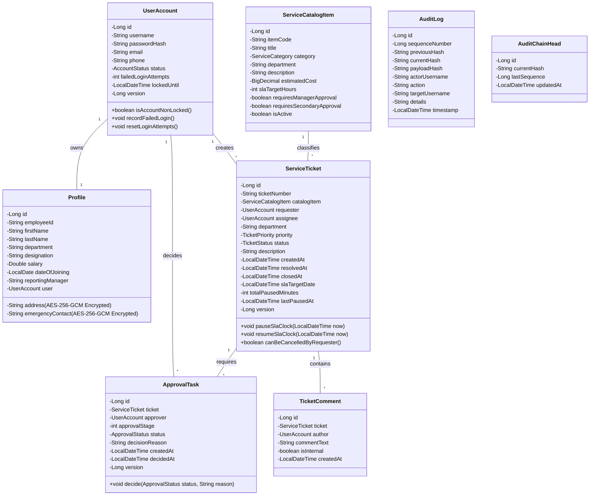
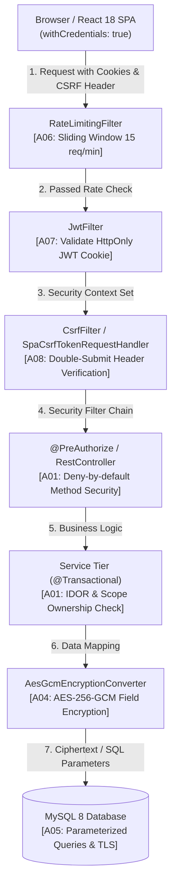

# Low-Level Design (LLD) & Component Specifications
## EMPORA — Employee Services & Workflow Platform
**One platform. Connected operations.**

*A platform for managing employee services, approvals, cross-department workflows and organisational operations.*

**Document ID:** EMPORA-LLD-001  
**Version:** 2.0.0  
**Date:** November 2026  
**Status:** Approved Architecture Baseline  
**Author:** Principal Software Architect & Senior Java Engineer  

---

## 1. Design Principles & SOLID Alignment

The Low-Level Design of EMPORA adheres to pragmatic object-oriented, clean-architecture, and enterprise design principles:
1. **Single Responsibility Principle (SRP):** Classes have one reason to change. Command mutations (`TicketCommandService`) are decoupled from analytical queries (`TicketQueryService`). Cryptographic conversions (`AesGcmEncryptionConverter`) are isolated from persistence entities.
2. **Open/Closed Principle (OCP):** Request routing strategies (`WorkflowRoutingEngine`) and SLA calendar calculators (`BusinessCalendar`) can be extended without altering the core state machine transitions.
3. **Liskov Substitution Principle (LSP):** Core domain abstractions (e.g. `NotificationChannel`) allow swapping `EmailNotificationChannel` and `InAppNotificationChannel` transparently.
4. **Interface Segregation Principle (ISP):** Focused contracts for repositories and services rather than monolithic god-interfaces.
5. **Dependency Inversion Principle (DIP):** High-level workflow orchestrators depend on repository interfaces and event publishers rather than concrete infrastructure details.

---

## 2. Domain Class Diagram & Relationships



---

## 3. OWASP Top 10:2025 Preventive Defensive Architecture



### 3.1 Mapping of Security Controls to OWASP Top 10:2025

| OWASP ID | Category | Implementation Component in EMPORA | Production Defensive Invariant |
| :--- | :--- | :--- | :--- |
| **A01** | Broken Access Control | `SecurityConfig`, `TicketSecurityEvaluator`, `@PreAuthorize` | Deny-by-default on all endpoints; strict CORS (`allowCredentials=true`, no `*` wildcards); IDOR ownership checks in service tier; React route guards. |
| **A02** | Security Misconfiguration | `SecurityConfig`, `application-mysql.properties`, `least-privilege-mysql-user.sql` | Stack traces and whitelabel disabled; strict HTTP response headers (CSP, HSTS, X-Frame-Options DENY, nosniff, Referrer-Policy); Actuator lockdown; MySQL runtime user stripped of DDL/admin grants. |
| **A03** | Software Supply Chain Failures | `pom.xml`, `package.json`, `index.html` | OWASP Dependency-Check plugin with CVSS 7 threshold; `npm audit`; zero external unverified CDN scripts; strict CSP `script-src 'self'`. |
| **A04** | Cryptographic Failures | `AesGcmEncryptionConverter`, `SecurityConfig` | AES-256-GCM with authenticated 128-bit tags and 96-bit random IVs for sensitive PII (`Profile.address`, `Profile.emergencyContact`); BCrypt strength 12; TLS 1.2/1.3 on MySQL JDBC and client-server HTTPS. |
| **A05** | Injection (SQLi, XSS, Command Injection) | Spring Data JPA Repositories, DTOs, `securityUtils.js` | Strictly parameterized JPQL/derived queries; Jakarta Bean Validation (`@Valid`, `@NotBlank`, `@Size`, `@Pattern`); JSX auto-escaping and safe URL scheme validator (`getSafeUrl`). |
| **A06** | Insecure Design | `RateLimitingFilter`, `TicketStateMachine`, `AntiSelfApprovalValidator` | Sliding token window rate limiter on auth endpoints (15 req/min per IP); account lockout after 5 failed attempts; server-side FSM invariant checks inside `@Transactional` methods. |
| **A07** | Authentication Failures | `AuthController`, `AuthService`, `RefreshTokenService` | Tokens in `HttpOnly`, `Secure`, `SameSite=Strict/Lax` cookies; rotating one-time refresh tokens stored as SHA-256 hashes in MySQL with reuse detection; generic "Invalid credentials" error responses. |
| **A08** | Software or Data Integrity Failures | `CsrfCookieFilter`, `SpaCsrfTokenRequestHandler`, DTOs | Double-Submit CSRF cookie + header protection on all mutating requests; immutable DTO request binding (`@RequestBody`) preventing JPA Mass Assignment; no untrusted deserialization. |
| **A09** | Security Logging & Alerting Failures | `LogSanitizer`, `CorrelationIdFilter`, `AuditChainService` | CRLF injection sanitization; masking of tokens, passwords, and PII; correlation IDs attached via MDC; continuous SHA-256 hash-chained immutable audit ledger. |
| **A10** | Mishandling of Exceptional Conditions | `GlobalExceptionHandler`, `ErrorBoundary.js`, `@Transactional` | RFC 7807 `ProblemDetail` responses suppressing internal stack traces and database schema; atomic rollback on all checked/unchecked exceptions; React Error Boundary catching unhandled UI errors. |

---

## 4. Finite State Machine (FSM) Implementation

The ticket lifecycle is enforced by `TicketStateMachine`:

```java
@Component
public class TicketStateMachine {

    private static final Map<TicketStatus, Set<TicketStatus>> VALID_TRANSITIONS = Map.of(
        TicketStatus.SUBMITTED, Set.of(TicketStatus.PENDING_APPROVAL, TicketStatus.ASSIGNED, TicketStatus.CANCELLED),
        TicketStatus.PENDING_APPROVAL, Set.of(TicketStatus.PENDING_SECONDARY_APPROVAL, TicketStatus.ASSIGNED, TicketStatus.REJECTED, TicketStatus.CANCELLED),
        TicketStatus.PENDING_SECONDARY_APPROVAL, Set.of(TicketStatus.ASSIGNED, TicketStatus.REJECTED, TicketStatus.CANCELLED),
        TicketStatus.ASSIGNED, Set.of(TicketStatus.IN_PROGRESS, TicketStatus.CANCELLED),
        TicketStatus.IN_PROGRESS, Set.of(TicketStatus.ON_HOLD, TicketStatus.RESOLVED),
        TicketStatus.ON_HOLD, Set.of(TicketStatus.IN_PROGRESS, TicketStatus.CANCELLED),
        TicketStatus.RESOLVED, Set.of(TicketStatus.CLOSED, TicketStatus.IN_PROGRESS),
        TicketStatus.CLOSED, Collections.emptySet(),
        TicketStatus.REJECTED, Collections.emptySet(),
        TicketStatus.CANCELLED, Collections.emptySet()
    );

    public void validateTransition(ServiceTicket ticket, TicketStatus nextStatus, String reason, String actorUsername) {
        TicketStatus current = ticket.getStatus();

        // 1. Guard against invalid state shifts
        Set<TicketStatus> allowed = VALID_TRANSITIONS.getOrDefault(current, Collections.emptySet());
        if (!allowed.contains(nextStatus)) {
            throw new IllegalStateTransitionException(
                String.format("Illegal transition from state [%s] to [%s]", current, nextStatus));
        }

        // 2. Reason length validation (BR-007)
        if (requiresReason(nextStatus)) {
            if (reason == null || reason.trim().length() < 15) {
                throw new InvalidRequestException(
                    "Transitioning to [" + nextStatus + "] requires a detailed reason of at least 15 characters.");
            }
        }

        // 3. Work-in-progress cancellation restriction (ADR-007)
        if (nextStatus == TicketStatus.CANCELLED && current == TicketStatus.IN_PROGRESS) {
            throw new BusinessRuleViolationException(
                "Tickets in 'IN_PROGRESS' state cannot be cancelled unilaterally. Please coordinate with the assigned resolver.");
        }

        // 4. Dispute window validation for reopening (BR-003: 48 business hours)
        if (current == TicketStatus.RESOLVED && nextStatus == TicketStatus.IN_PROGRESS) {
            LocalDateTime now = businessCalendar.nowInBusinessZone(clock);
            if (ticket.getResolvedAt() == null || !businessCalendar.isWithinReopenWindow(ticket.getResolvedAt(), now)) {
                throw new BusinessRuleViolationException(
                    "The 48-business-hour window to dispute or reopen this ticket has elapsed. Please submit a new service request.");
            }
        }
    }

    private boolean requiresReason(TicketStatus status) {
        return status == TicketStatus.ON_HOLD || 
               status == TicketStatus.REJECTED || 
               status == TicketStatus.CANCELLED;
    }
}
```

---

## 5. Anti-Self-Approval Enforcement (`BR-005`, `BR-010`)

To prevent employees (including managers and department heads) from approving their own requests, `TicketSecurityEvaluator` and `AntiSelfApprovalValidator` verify identity during approval routing and decision execution:

```java
@Component
public class AntiSelfApprovalValidator {

    public void validate(ServiceTicket ticket, UserAccount approver) {
        if (ticket.getRequester().getId().equals(approver.getId())) {
            throw new AntiSelfApprovalException(
                "Compliance Violation (BR-005/BR-010): The ticket requester cannot approve their own service request.");
        }
    }
}
```

---

## 6. Global Exception Handling & Problem Details Mapping

Centralized `@RestControllerAdvice` translates domain exceptions into sanitized RFC 7807 responses without exposing SQL or stack traces:

| Java Exception Class | HTTP Status Code | Response Error Code | Client Remediation Action |
| :--- | :--- | :--- | :--- |
| `OptimisticLockException` | **409 Conflict** | `CONFLICT` | Prompt user to reload page and re-verify before acting. |
| `IllegalStateTransitionException` | **400 Bad Request** | `ILLEGAL_STATE_TRANSITION`| User attempted prohibited FSM state jump. |
| `AccessDeniedException` | **403 Forbidden** | `FORBIDDEN` | Caller lacks the role or organizational scope. |
| `UnauthorizedScopeException`| **403 Forbidden** | `FORBIDDEN_SCOPE` | IDOR prevention; caller does not own the resource. |
| `AuthenticationException` | **401 Unauthorized** | `UNAUTHORIZED` | Expired session or invalid credentials. |
| `ResourceNotFoundException` | **404 Not Found** | `NOT_FOUND` | Requested record does not exist. |
| `RateLimitExceededException`| **429 Too Many Requests** | `RATE_LIMIT_EXCEEDED` | Client exceeded 15 req/min rate quota. |
| `Exception` (Unhandled) | **500 Internal Error** | `INTERNAL_ERROR` | Generic message returned; full stack trace logged internally. |
