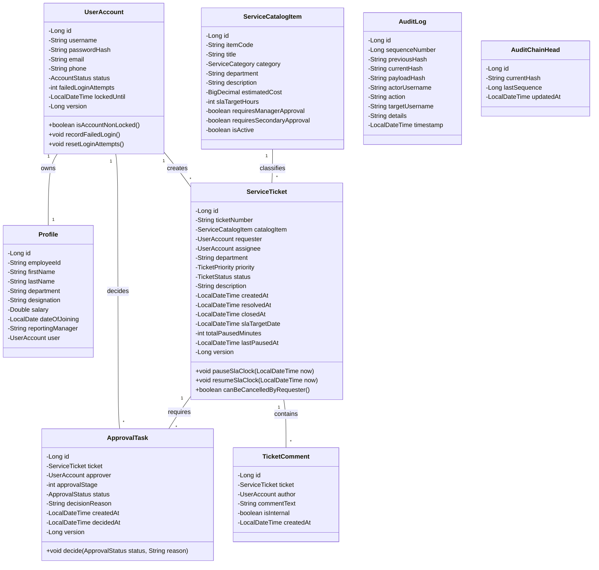

# Low-Level Design (LLD) & Component Specifications
## Employee Lifecycle and Service Management Platform (EPAMS)

**Document ID:** EPAMS-LLD-001  
**Version:** 1.0.0  
**Date:** November 2026  
**Status:** Approved Architecture Baseline  
**Author:** Principal Software Architect & Senior Java Engineer  

---

## 1. Design Principles & SOLID Alignment

The Low-Level Design of EPAMS adheres to pragmatic object-oriented and enterprise design principles:
1. **Single Responsibility Principle (SRP):** Classes have one reason to change. Command mutations (`TicketCommandService`) are isolated from analytical queries (`TicketQueryService`).
2. **Open/Closed Principle (OCP):** New request routing rules and SLA policies can be plugged into `WorkflowRoutingEngine` without altering existing state machine logic.
3. **Liskov Substitution Principle (LSP):** Core domain abstractions (e.g. `NotificationChannel`) allow swapping `EmailNotificationChannel` and `InAppNotificationChannel` transparently.
4. **Interface Segregation Principle (ISP):** Repositories and service interfaces provide focused contracts tailored to caller requirements rather than bloated god-interfaces.
5. **Dependency Inversion Principle (DIP):** High-level workflow services depend on abstract repositories and event publishers rather than concrete infrastructure details.

---

## 2. Domain Class Diagram & Relationships



---

## 3. Core Service Contracts & Responsibilities

### 3.1 `module.ticket` Services

#### `TicketCommandService`
Handles state-altering mutations on service tickets within local ACID transactions.
```java
public interface TicketCommandService {
    ServiceTicketDTO createTicket(CreateTicketRequestDTO dto, String requesterUsername);
    ServiceTicketDTO assignTicket(Long ticketId, Long assigneeId, String actorUsername);
    ServiceTicketDTO updateStatus(Long ticketId, TicketStatus newStatus, String reason, Long version, String actorUsername);
    ServiceTicketDTO cancelTicket(Long ticketId, String reason, Long version, String requesterUsername);
    ServiceTicketDTO reopenTicket(Long ticketId, String reason, Long version, String requesterUsername);
}
```

#### `TicketQueryService`
Handles high-performance read-only queries, filtering, and pagination.
```java
public interface TicketQueryService {
    ServiceTicketDetailDTO getTicketById(Long ticketId, String callerUsername);
    Page<ServiceTicketDTO> getMyTickets(String requesterUsername, Pageable pageable);
    Page<ServiceTicketDTO> getDepartmentQueue(String department, TicketStatus status, Pageable pageable);
}
```

#### `SlaCalculationEngine`
Calculates business-hour deadlines, tracking working calendars and pause intervals.
```java
public interface SlaCalculationEngine {
    LocalDateTime calculateTargetDeadline(LocalDateTime startTime, int slaHours);
    int calculateElapsedBusinessMinutes(LocalDateTime start, LocalDateTime end);
    LocalDateTime extendDeadline(LocalDateTime originalTarget, int pausedMinutes);
}
```

---

### 3.2 `module.workflow` Services

#### `WorkflowRoutingEngine`
Evaluates business rules (`ADR-001`) to construct the approval pipeline.
```java
public interface WorkflowRoutingEngine {
    void routeTicket(ServiceTicket ticket);
    boolean requiresSecondaryApproval(ServiceTicket ticket);
}
```

#### `ApprovalDecisionService`
Processes human managerial decisions with mandatory validation.
```java
public interface ApprovalDecisionService {
    ApprovalDecisionResultDTO decide(Long taskId, DecisionDTO decisionDto, String approverUsername);
    Page<ApprovalTaskDTO> getPendingApprovals(String approverUsername, Pageable pageable);
}
```

---

### 3.3 `module.audit` Services

#### `AuditLogService`
Performs synchronous cryptographic hash chaining within the business transaction.
```java
public interface AuditLogService {
    AuditLog logEvent(String actorUsername, String action, String targetUsername, String details);
}
```

#### `AuditVerificationService`
Validates cryptographic continuity across the entire ledger.
```java
public interface AuditVerificationService {
    AuditVerificationReport verifyChainIntegrity();
}
```

---

## 4. Finite State Machine (FSM) Implementation

The ticket lifecycle is enforced by `TicketStateMachine`:

```java
@Component
public class TicketStateMachine {

    private static final Map<TicketStatus, Set<TicketStatus>> VALID_TRANSITIONS = Map.of(
        TicketStatus.SUBMITTED, Set.of(TicketStatus.PENDING_APPROVAL, TicketStatus.ASSIGNED, TicketStatus.CANCELLED),
        TicketStatus.PENDING_APPROVAL, Set.of(TicketStatus.PENDING_SECONDARY_APPROVAL, TicketStatus.ASSIGNED, TicketStatus.REJECTED, TicketStatus.CANCELLED),
        TicketStatus.PENDING_SECONDARY_APPROVAL, Set.of(TicketStatus.ASSIGNED, TicketStatus.REJECTED, TicketStatus.CANCELLED),
        TicketStatus.ASSIGNED, Set.of(TicketStatus.IN_PROGRESS, TicketStatus.CANCELLED),
        TicketStatus.IN_PROGRESS, Set.of(TicketStatus.ON_HOLD, TicketStatus.RESOLVED),
        TicketStatus.ON_HOLD, Set.of(TicketStatus.IN_PROGRESS, TicketStatus.CANCELLED),
        TicketStatus.RESOLVED, Set.of(TicketStatus.CLOSED, TicketStatus.IN_PROGRESS),
        TicketStatus.CLOSED, Collections.emptySet(),
        TicketStatus.REJECTED, Collections.emptySet(),
        TicketStatus.CANCELLED, Collections.emptySet()
    );

    public void validateTransition(ServiceTicket ticket, TicketStatus nextStatus, String reason, String actorUsername) {
        TicketStatus current = ticket.getStatus();

        // 1. Guard against invalid state shifts
        Set<TicketStatus> allowed = VALID_TRANSITIONS.getOrDefault(current, Collections.emptySet());
        if (!allowed.contains(nextStatus)) {
            throw new IllegalStateTransitionException(
                String.format("Illegal transition from state [%s] to [%s]", current, nextStatus));
        }

        // 2. Reason length validation (BR-007)
        if (requiresReason(nextStatus)) {
            if (reason == null || reason.trim().length() < 15) {
                throw new InvalidRequestException(
                    "Transitioning to [" + nextStatus + "] requires a detailed reason of at least 15 characters.");
            }
        }

        // 3. Work-in-progress cancellation restriction (ADR-007)
        if (nextStatus == TicketStatus.CANCELLED && current == TicketStatus.IN_PROGRESS) {
            throw new BusinessRuleViolationException(
                "Tickets in 'IN_PROGRESS' state cannot be cancelled unilaterally. Please coordinate with the assigned resolver.");
        }

        // 4. Dispute window validation for reopening (BR-003: 48 business hours, inclusive of exact deadline)
        if (current == TicketStatus.RESOLVED && nextStatus == TicketStatus.IN_PROGRESS) {
            LocalDateTime now = businessCalendar.nowInBusinessZone(clock);
            if (ticket.getResolvedAt() == null || !businessCalendar.isWithinReopenWindow(ticket.getResolvedAt(), now)) {
                throw new BusinessRuleViolationException(
                    "The 48-business-hour window to dispute or reopen this ticket has elapsed. Please submit a new service request.");
            }
        }
    }

    private boolean requiresReason(TicketStatus status) {
        return status == TicketStatus.ON_HOLD || 
               status == TicketStatus.REJECTED || 
               status == TicketStatus.CANCELLED;
    }
}
```

---

## 5. Anti-Self-Approval Enforcement (`BR-005`, `BR-010`)

To prevent employees (including managers) from approving their own requests, `AntiSelfApprovalValidator` verifies identity during approval routing and decision execution:

```java
@Component
public class AntiSelfApprovalValidator {

    public void validate(ServiceTicket ticket, UserAccount approver) {
        if (ticket.getRequester().getId().equals(approver.getId())) {
            throw new AntiSelfApprovalException(
                "Compliance Violation (BR-005/BR-010): The ticket requester cannot approve their own service request.");
        }
    }
}
```

---

## 6. Domain Event Architecture & Decoupling

EPAMS carefully decouples transactional auditing from post-commit side effects:

```mermaid
graph TD
    TicketCommandSvc["TicketCommandService<br/>(@Transactional)"] -->|1. Mutate Ticket in DB| MySQL[("MySQL Database<br/>(service_ticket)")]
    TicketCommandSvc -->|2. Direct Synchronous Call (Same JDBC TX)| AuditService["AuditLogService.logEvent(...)"]
    AuditService -->|3. Lock & Hash Chain in Same TX| AuditTable[("audit_chain_head & audit_log")]
    
    TicketCommandSvc -->|4. publishEvent() on Success| SpringBus["Spring ApplicationEventPublisher"]

    SpringBus -->|5. Asynchronous @Async AFTER_COMMIT| NotifyListener["@TransactionalEventListener(phase = AFTER_COMMIT)<br/>NotificationEventListener"]
    NotifyListener -->|Send Email Alert| SMTP["Mailpit / SMTP Relay"]
    NotifyListener -->|Insert Alert Badge| NotifyTable[("notification table")]
```

### 6.1 Transactional Mechanics: Direct Audit vs. Asynchronous Notification
1. **Core Audit Persistence (Atomic):** `AuditLogService.logEvent(...)` is called **directly and synchronously** from the command service within the active `@Transactional(isolation = Isolation.READ_COMMITTED)` boundary. If an audit write or hash calculation fails, the entire transaction (including ticket mutation) rolls back atomically.
2. **Notification Dispatch (Post-Commit Decoupled):** Notification and email triggers are subscribed via:
   `@TransactionalEventListener(phase = TransactionPhase.AFTER_COMMIT)` combined with `@Async`.
   This guarantees that:
   * Notifications are dispatched **only if and when** the database transaction has committed successfully.
   * If the external SMTP relay or Mailpit times out, the committed ticket state and audit log are completely unaffected.
    NotifyListener -->|Insert Alert Badge| NotifyTable[("notification table")]
```

### Event Classes
1. `TicketCreatedEvent`: Fired upon initial ticket submission.
2. `ApprovalRequiredEvent`: Dispatched to notify manager of pending task.
3. `TicketApprovedEvent`: Dispatched when managerial sign-off is completed.
4. `TicketStateChangedEvent`: Fired on every FSM state transition.
5. `TicketResolvedEvent`: Triggers the 48-business-hour verification countdown.

---

## 7. Global Exception Handling & Error Code Mapping

The `@RestControllerAdvice` component centralizes error handling, mapping domain and database exceptions into RFC 7807 responses:

| Java Exception Class | HTTP Status Code | Response Error Code | Client Remediation Action |
| :--- | :--- | :--- | :--- |
| `OptimisticLockException` | **409 Conflict** | `CONFLICT` | Prompt user to reload page and re-verify before acting. |
| `IllegalStateTransitionException` | **400 Bad Request** | `ILLEGAL_STATE_TRANSITION`| User attempted prohibited FSM state jump. |
| `AntiSelfApprovalException` | **400 Bad Request** | `ANTI_SELF_APPROVAL_VIOLATION` | Re-route task to supervisor. |
| `MethodArgumentNotValidException` | **400 Bad Request** | `VALIDATION_FAILED` | Display field-specific validation errors. |
| `BadCredentialsException` | **401 Unauthorized** | `INVALID_CREDENTIALS` | Check username and password. |
| `LockedException` | **423 Locked** | `ACCOUNT_LOCKED` | Wait for 15-min lockout window or contact Admin. |
| `AccessDeniedException` | **403 Forbidden** | `FORBIDDEN` | Caller lacks authorized security role. |
| `EntityNotFoundException` | **404 Not Found** | `NOT_FOUND` | Verify ID of requested resource. |

