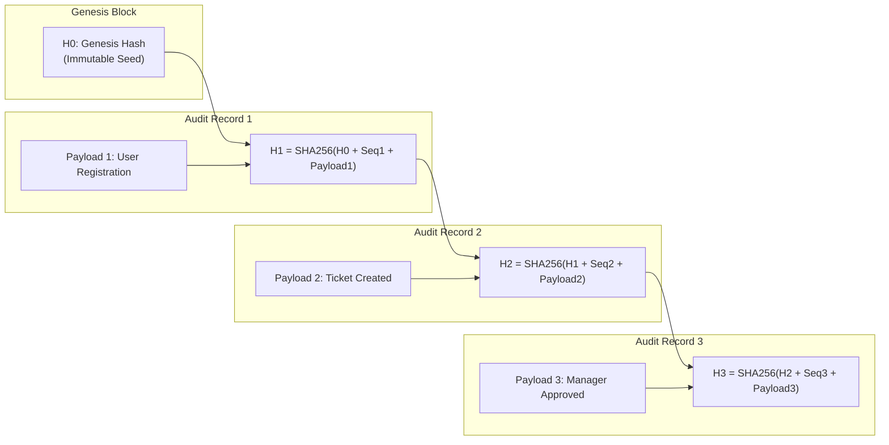

# Cryptographic Audit Logging Architecture & Non-Repudiation Design
## Employee Lifecycle and Service Management Platform (EPAMS)

**Document ID:** EPAMS-HLD-AUD-001  
**Version:** 1.0.0  
**Date:** November 2026  
**Status:** Approved Architecture Baseline  
**Author:** Principal Security Architect & Senior Java Engineer  

---

## 1. Context, Objectives & Integrity Classification

In enterprise service management, regulatory compliance (DPDP Act 2023, ISO/IEC 27001, SOC 2 Type II) mandates that administrative, lifecycle, and financial decisions cannot be repudiated. However, traditional database audit logs stored as mutable rows can be silently altered or deleted by malicious insiders or compromised application credentials.

To guarantee forensic integrity without introducing exorbitant blockchain overhead, EPAMS implements a **Transactional SHA-256 Hash-Chained Audit Journal** combined with **Database-Level Privilege Separation** (`ADR-011`).

### Technical Classification Matrix
1. **Audit Trail:** Chronological record of system, user, and domain events. *(Fully implemented).*
2. **Append-Only Storage:** Storage where records can only be inserted, with update and delete permissions revoked at the database user privilege level. *(Implemented via MySQL grants).*
3. **Tamper-Evident Logging:** Log records linked cryptographically where each entry includes the SHA-256 digest of its predecessor. Any unauthorized retroactive change breaks the chain and is mathematically detectable. *(Core EPAMS design).*
4. **Hardware/Cloud WORM Immutability:** Write Once Read Many storage (e.g. AWS S3 Object Lock in Compliance Mode) where no identity—including root/cloud admins—can delete records. *(Designated for Phase 2 cloud archival).*

---

## 2. Cryptographic Hash-Chain Mathematical Specification

Each audit entry $n$ is bound to its predecessor $n-1$ through a deterministic SHA-256 cryptographic hash function.

### 2.1 Formal Hashing Formula

$$H_0 = \text{SHA256}(\text{"EPAMS_GENESIS_BLOCK_2026_V1"})$$

$$\text{PayloadHash}_n = \text{SHA256}(\text{ISO\_Timestamp} \parallel \text{Actor} \parallel \text{Action} \parallel \text{Target} \parallel \text{Details})$$

$$H_n = \text{SHA256}(H_{n-1} \parallel \text{Seq}_n \parallel \text{PayloadHash}_n)$$

Where:
* $H_0$: The hardcoded immutable genesis hash anchor (`e3b0c442...`).
* $\text{Seq}_n$: A gapless, monotonically increasing integer counter ($1, 2, 3, \dots$).
* $\parallel$: UTF-8 byte concatenation separator (`|`).
* $\text{PayloadHash}_n$: The cryptographic digest of the immutable audit domain data.
* $H_n$: The current entry's hash, recorded in `audit_log.current_hash`.



---

## 3. Concurrency Control & Chain Head Locking Architecture

### 3.1 The Concurrency Race Condition Challenge
In a multi-threaded application server, two concurrent requests (e.g., Worker Thread A and Worker Thread B) mutating tickets simultaneously could read the same "latest" audit record $N$, both compute $N+1$ with the same $H_N$ as predecessor, and attempt parallel inserts. This would create a "forked chain" or a primary key collision on `sequence_number`.

### 3.2 The Solution: Dedicated Single-Row Chain Head Lock
EPAMS resolves this race condition using a dedicated state anchor table: `audit_chain_head` containing exactly one row (`id = 1`).

```mermaid
sequenceDiagram
    autonumber
    participant ThreadA as Request Thread A (Ticket Submit)
    participant ThreadB as Request Thread B (Ticket Approve)
    participant HeadDB as audit_chain_head (id=1)
    participant LogDB as audit_log (InnoDB)

    Note over ThreadA, ThreadB: Parallel Requests Arrive Simultaneously
    ThreadA->>HeadDB: BEGIN TX; SELECT current_hash, last_sequence FROM audit_chain_head WHERE id=1 FOR UPDATE;
    Note over HeadDB: Thread A acquires Exclusive Row Lock
    ThreadB->>HeadDB: BEGIN TX; SELECT current_hash, last_sequence FROM audit_chain_head WHERE id=1 FOR UPDATE;
    Note over ThreadB: Thread B BLOCKS waiting for row lock release

    ThreadA->>ThreadA: seq = last_sequence + 1 (e.g. 42)
    ThreadA->>ThreadA: H_42 = SHA256(current_hash + 42 + PayloadA)
    ThreadA->>LogDB: INSERT INTO audit_log (seq=42, prev=H_41, curr=H_42, ...)
    ThreadA->>HeadDB: UPDATE audit_chain_head SET current_hash=H_42, last_sequence=42 WHERE id=1;
    ThreadA->>HeadDB: COMMIT TRANSACTION;
    Note over HeadDB: Row Lock Released!

    Note over ThreadB: Thread B Unblocks and Reads Updated Head (Seq=42, H_42)
    ThreadB->>ThreadB: seq = 42 + 1 = 43
    ThreadB->>ThreadB: H_43 = SHA256(H_42 + 43 + PayloadB)
    ThreadB->>LogDB: INSERT INTO audit_log (seq=43, prev=H_42, curr=H_43, ...)
    ThreadB->>HeadDB: UPDATE audit_chain_head SET current_hash=H_43, last_sequence=43 WHERE id=1;
    ThreadB->>HeadDB: COMMIT TRANSACTION;
```

### Concurrency & Capacity Analysis for 100–1,000 Employees:
* The exclusive lock duration on `audit_chain_head` is extremely brief: computing a single SHA-256 hash in Java takes approximately $0.05\text{ ms}$, and the indexed row update takes $< 1\text{ ms}$.
* **Capacity Sizing:** For the target 100–1,000 employee organization generating 200–500 tickets/day (peak transactional throughput of 15–30 requests/sec), holding the row lock for $\approx 1\text{ ms}$ represents $< 3\%$ lock utilization. This guarantees contention-free serialization without queuing bottlenecks. Formal empirical throughput benchmarks will be established using JMeter load suites during Phase 2.

---

## 4. Transactional Persistence Guarantee & Event Mechanics

### 4.1 Resolving Event Mechanics: Direct Synchronous Persistence vs. Event Listeners

A critical architectural distinction governs how state changes and audit events interact with Spring transactions:

| Architectural Approach | Execution Phase | Transactional Context | Atomicity Guarantee | Downstream Failure Risk | Audit Suitability |
| :--- | :--- | :--- | :--- | :--- | :--- |
| **`@TransactionalEventListener(phase = AFTER_COMMIT)`** | After physical commit | New/Independent TX | **BROKEN** | If audit write fails, ticket mutation is ALREADY committed. Audit is lost. | **PROHIBITED** for audit records. |
| **`@TransactionalEventListener(phase = BEFORE_COMMIT)`** | Before physical commit | Same TX context | Partial | If physical commit on DB fails later, listener already executed. | Acceptable, but adds unnecessary interception overhead. |
| **Direct Synchronous Transactional Persistence** | Inline in service method | Exact same JDBC connection & TX | **STRICT ATOMICITY** | If audit insert fails, Spring rolls back the ticket mutation completely. | **MANDATORY & APPROVED** for audit logs. |
| **Decoupled Asynchronous Listener (`@Async` + `AFTER_COMMIT`)** | After physical commit in background thread | Detached thread pool | Independent | If SMTP server times out, database commit is completely unaffected. | **MANDATORY & APPROVED** for emails and in-app alerts. |

> [!CAUTION]
> **Strict Architectural Rule:** Critical transactional audit logging MUST NEVER be delegated to fire-and-forget asynchronous execution (`@Async`) or `AFTER_COMMIT` event listeners. If an unpersisted event is held in memory and the JVM encounters an OutOfMemoryError, kernel panic, or sudden container restart, the audit record is permanently lost, causing severe compliance failure.

In EPAMS, `AuditLogService.logEvent(...)` executes synchronously within the **exact same ACID transactional boundary** as the business mutation:
```java
@Transactional(isolation = Isolation.READ_COMMITTED)
public ServiceTicketDTO approveTicket(Long taskId, String reason, String username) {
    // 1. Mutate ticket state
    ticket.setStatus(TicketStatus.ASSIGNED);
    ticketRepo.save(ticket);

    // 2. Synchronous cryptographic audit logging
    auditLogService.logEvent(username, "TICKET_APPROVED", ticket.getRequesterUsername(), 
        "Approved ticket " + ticket.getTicketNumber() + " with reason: " + reason);

    // 3. Commit: Both domain change and audit log commit atomically
    return mapper.toDto(ticket);
}
```
If the audit hash calculation or insert fails for any reason, the entire transaction rolls back, preventing untracked state mutations from ever reaching the database.

---

## 5. Database Privilege Separation (Least Privilege Defense)

To protect the audit trail against unauthorized alteration even if an attacker achieves SQL injection into the application tier, EPAMS enforces **database user privilege separation**:

```sql
-- Production Privilege Configuration (docker/mysql/init-privileges.sql)

-- 1. Create Application Runtime User
CREATE USER IF NOT EXISTS 'epams_app'@'%' IDENTIFIED BY '${APP_DB_PASSWORD}';

-- 2. Grant standard CRUD on operational tables
GRANT SELECT, INSERT, UPDATE, DELETE ON epams_db.user_account TO 'epams_app'@'%';
GRANT SELECT, INSERT, UPDATE, DELETE ON epams_db.profile TO 'epams_app'@'%';
GRANT SELECT, INSERT, UPDATE, DELETE ON epams_db.service_ticket TO 'epams_app'@'%';
GRANT SELECT, INSERT, UPDATE, DELETE ON epams_db.approval_task TO 'epams_app'@'%';
GRANT SELECT, INSERT, UPDATE, DELETE ON epams_db.ticket_comment TO 'epams_app'@'%';
GRANT SELECT, INSERT, UPDATE, DELETE ON epams_db.refresh_token TO 'epams_app'@'%';
GRANT SELECT, INSERT, UPDATE, DELETE ON epams_db.notification TO 'epams_app'@'%';
GRANT SELECT, INSERT, UPDATE, DELETE ON epams_db.role TO 'epams_app'@'%';
GRANT SELECT, INSERT, UPDATE, DELETE ON epams_db.user_role_mapping TO 'epams_app'@'%';

-- 3. Grant Lock & Update on Chain Head
GRANT SELECT, UPDATE ON epams_db.audit_chain_head TO 'epams_app'@'%';

-- 4. STRICT PRIVILEGE SEPARATION ON AUDIT LOG:
-- Application CAN insert new records and read history, but CANNOT modify or delete!
GRANT SELECT, INSERT ON epams_db.audit_log TO 'epams_app'@'%';
REVOKE UPDATE, DELETE, DROP, ALTER ON epams_db.audit_log FROM 'epams_app'@'%';

-- 5. Dedicated Read-Only Auditor User (for Compliance Officers)
CREATE USER IF NOT EXISTS 'epams_auditor'@'%' IDENTIFIED BY '${AUDITOR_DB_PASSWORD}';
GRANT SELECT ON epams_db.audit_log TO 'epams_auditor'@'%';
GRANT SELECT ON epams_db.audit_chain_head TO 'epams_auditor'@'%';

FLUSH PRIVILEGES;
```

---

## 6. Chain Verification Engine & Failure Handling

### 6.1 Verification Algorithm
The system provides both a scheduled daily background verification job and an on-demand administrative verification endpoint (`GET /api/v1/audit/verify`):

```java
public AuditVerificationReport verifyIntegrity() {
    List<AuditLog> logs = auditLogRepo.findAllByOrderBySequenceNumberAsc();
    String expectedPreviousHash = GENESIS_HASH;
    
    for (AuditLog entry : logs) {
        // Step A: Verify previous hash continuity
        if (!entry.getPreviousHash().equals(expectedPreviousHash)) {
            return AuditVerificationReport.failure(entry.getSequenceNumber(), 
                "Broken chain continuity at sequence " + entry.getSequenceNumber());
        }
        
        // Step B: Recompute payload hash from row attributes
        String computedPayloadHash = sha256(entry.getTimestamp() + "|" + 
            entry.getActorUsername() + "|" + entry.getAction() + "|" + 
            entry.getTargetUsername() + "|" + entry.getDetails());
            
        if (!entry.getPayloadHash().equals(computedPayloadHash)) {
            return AuditVerificationReport.failure(entry.getSequenceNumber(), 
                "Payload tampering detected at sequence " + entry.getSequenceNumber());
        }
        
        // Step C: Recompute block hash
        String computedCurrentHash = sha256(expectedPreviousHash + "|" + 
            entry.getSequenceNumber() + "|" + computedPayloadHash);
            
        if (!entry.getCurrentHash().equals(computedCurrentHash)) {
            return AuditVerificationReport.failure(entry.getSequenceNumber(), 
                "Cryptographic signature mismatch at sequence " + entry.getSequenceNumber());
        }
        
        expectedPreviousHash = entry.getCurrentHash();
    }
    
    return AuditVerificationReport.success(logs.size());
}
```

### 6.2 Failure Handling & Incident Protocol
If verification fails:
1. **Critical Alert Dispatch:** An immediate high-priority alert is dispatched via email to the Security Administrator and Compliance Auditor.
2. **Read-Only Containment:** If configured, the security engine trips a circuit breaker, transitioning sensitive administrative operations to read-only until the integrity breach is reviewed.
3. **Forensic Pinpointing:** The report pinpoints the exact sequence number $k$ where tampering occurred, the expected vs actual hash, and the preceding valid block.

---

## 7. Threat Boundaries & Honest Documentation Policy

| Threat / Attack Vector | Mitigation Mechanism | Protection Status |
| :--- | :--- | :--- |
| **Application Layer SQL Injection** | `UPDATE` and `DELETE` revoked on `audit_log` at MySQL privilege level. | **Mitigated** |
| **Compromised User / Admin Account** | Records cannot be modified via UI or REST API; any manual DB update breaks hash chain. | **Mitigated (Detected)** |
| **Silent Historical Record Alteration** | SHA-256 chaining ensures altering record $k$ invalidates all subsequent records $k+1 \dots N$. | **Mitigated (Detected)** |
| **Rogue DBA / Infrastructure Root Attacker** | A root DBA could theoretically update row $k$ and recompute all subsequent hashes $k \dots N$. | **Out of Boundary (Single Server)** |
| **Off-Site Non-Repudiation (Phase 2)** | Daily export of chain head hashes to external WORM storage (AWS S3 Object Lock) makes retroactive recalculation impossible. | **Target Architecture** |

> [!NOTE]
> **Architecture Principle:** EPAMS formally describes its audit subsystem as an **"Append-Only, Cryptographically Hash-Chained Audit Trail"**. We make **NO** unverified claims of "hardware immutability" or "unconditional tamper-proofing" against hypervisor-level root access prior to Phase 2 WORM integration.

