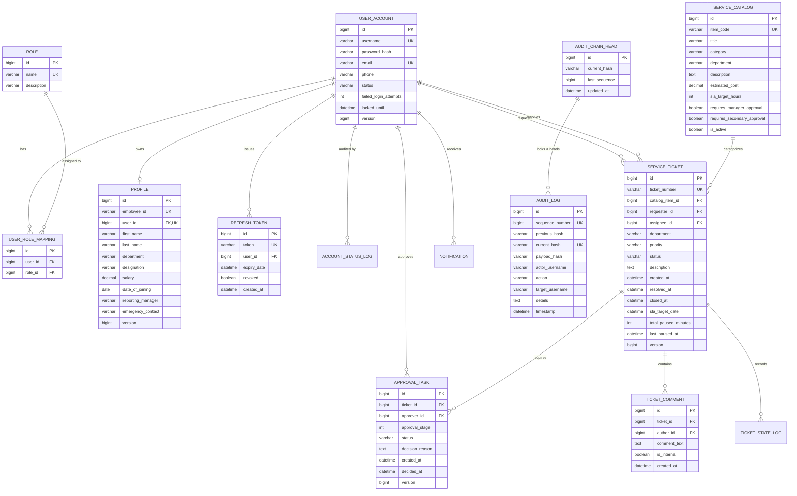

# Relational Database Design & Schema Architecture
## Employee Lifecycle and Service Management Platform (EPAMS)

**Document ID:** EPAMS-HLD-DB-001  
**Version:** 1.0.0  
**Date:** November 2026  
**Status:** Approved Architecture Baseline  
**Author:** Principal Database Architect & Senior Java Engineer  

---

## 1. Overview & Data Architecture Principles

The EPAMS persistence tier is engineered on **MySQL 8.0+** using the **InnoDB** ACID-compliant storage engine (`ADR-004`). The data model is optimized for transactional reliability, strict relational integrity via foreign key constraints, high-performance indexed queries for queues and directory searches, and non-repudiation through cryptographic audit logging.

### Core Database Principles
1. **Flyway Migration Governance:** Schema evolution is managed strictly via versioned migration scripts (`ADR-005`). `spring.jpa.hibernate.ddl-auto=validate` is enforced in production.
2. **Optimistic Concurrency Control:** Concurrency-sensitive entities (`service_ticket`, `approval_task`, `user_account`) maintain an integer `version` column mapped to JPA `@Version` to guarantee atomic state changes (`ADR-008`).
3. **Database Privilege Separation:** The runtime application user (`epams_app`) is granted `INSERT` and `SELECT` on `audit_log`, with `UPDATE` and `DELETE` explicitly revoked (`ADR-011`).
4. **UTF-8 & Timezone Standard:** Strict `utf8mb4` character set with `utf8mb4_unicode_ci` collation; all timestamps stored in UTC (`DATETIME(3)` or `TIMESTAMP(3)`).

---

## 2. Entity-Relationship (ER) Diagram



---

## 3. Detailed Table Schema Definitions & Constraints

### 3.1 Table: `user_account`
Central authentication identity entity. Preserves existing structure while adding optimistic lock `version`.

| Column | Type | Constraints | Description |
| :--- | :--- | :--- | :--- |
| `id` | `BIGINT` | `PK, AUTO_INCREMENT` | Synthetic surrogate primary key. |
| `username` | `VARCHAR(50)` | `NOT NULL, UNIQUE` | Unique login username. |
| `password_hash` | `VARCHAR(255)` | `NOT NULL` | BCrypt password hash. |
| `email` | `VARCHAR(100)` | `NOT NULL, UNIQUE` | Unique corporate email address. |
| `phone` | `VARCHAR(20)` | `NULL` | Contact phone number. |
| `status` | `VARCHAR(20)` | `NOT NULL DEFAULT 'ACTIVE'` | Account status: `ACTIVE`, `LOCKED`, `DISABLED`. |
| `failed_login_attempts` | `INT` | `NOT NULL DEFAULT 0` | Counter for brute-force tracking. |
| `locked_until` | `DATETIME(3)` | `NULL` | Timestamp until which account is locked. |
| `version` | `BIGINT` | `NOT NULL DEFAULT 0` | Optimistic lock version counter. |

*Indexes:*
* `idx_user_account_username` (`username`) - Unique index for fast authentication lookup.
* `idx_user_account_email` (`email`) - Unique index.

---

### 3.2 Table: `profile`
Employee master record linked to identity (`FR-006`).

| Column | Type | Constraints | Description |
| :--- | :--- | :--- | :--- |
| `id` | `BIGINT` | `PK, AUTO_INCREMENT` | Synthetic primary key. |
| `employee_id` | `VARCHAR(30)` | `NOT NULL, UNIQUE` | Business employee code (e.g. `EMP-1042`). |
| `user_id` | `BIGINT` | `NOT NULL, UNIQUE, FK -> user_account(id)` | 1-to-1 linkage with authentication account. |
| `first_name` | `VARCHAR(50)` | `NOT NULL` | Employee first name. |
| `last_name` | `VARCHAR(50)` | `NOT NULL` | Employee last name. |
| `department` | `VARCHAR(50)` | `NOT NULL` | Department (`IT`, `HR`, `FACILITIES`, `FINANCE`). |
| `designation` | `VARCHAR(100)`| `NOT NULL` | Job role / title. |
| `salary` | `DECIMAL(12,2)`| `NULL` | Sensitive compensation field (masked in general queries). |
| `date_of_joining` | `DATE` | `NOT NULL` | Date of joining. |
| `reporting_manager` | `VARCHAR(50)` | `NULL` | Username of direct reporting manager. |
| `emergency_contact` | `VARCHAR(50)` | `NULL` | Emergency contact phone/name. |
| `version` | `BIGINT` | `NOT NULL DEFAULT 0` | Optimistic lock version counter. |

*Indexes:*
* `idx_profile_department` (`department`) - B-tree index for department roster filtering.
* `idx_profile_manager` (`reporting_manager`) - B-tree index for manager team hierarchy lookups.
* `idx_profile_emp_id` (`employee_id`) - Unique index.

---

### 3.3 Table: `service_catalog`
Pre-configured requestable catalog items across departments (`FR-010`).

| Column | Type | Constraints | Description |
| :--- | :--- | :--- | :--- |
| `id` | `BIGINT` | `PK, AUTO_INCREMENT` | Synthetic primary key. |
| `item_code` | `VARCHAR(50)` | `NOT NULL, UNIQUE` | Unique catalog identifier (e.g. `IT-HARDWARE-LAPTOP`). |
| `title` | `VARCHAR(100)`| `NOT NULL` | Display title for self-service portal. |
| `category` | `VARCHAR(50)` | `NOT NULL` | Category: `HARDWARE`, `SOFTWARE`, `ACCESS`, `HR_DOC`, `EXPENSE`. |
| `department` | `VARCHAR(50)` | `NOT NULL` | Fulfilling department (`IT`, `HR`, `FACILITIES`, `FINANCE`). |
| `description` | `TEXT` | `NOT NULL` | Detailed item description and instructions. |
| `estimated_cost` | `DECIMAL(10,2)`| `NOT NULL DEFAULT 0.00` | Financial value for conditional threshold check (`ADR-001`). |
| `sla_target_hours` | `INT` | `NOT NULL DEFAULT 24` | Target resolution SLA in business hours. |
| `requires_manager_approval` | `BOOLEAN` | `NOT NULL DEFAULT TRUE` | Whether manager sign-off is mandatory. |
| `requires_secondary_approval` | `BOOLEAN` | `NOT NULL DEFAULT FALSE` | Whether department head sign-off is mandatory. |
| `is_active` | `BOOLEAN` | `NOT NULL DEFAULT TRUE` | Active visibility flag in self-service portal. |

---

### 3.4 Table: `service_ticket`
Core service request entity enforcing the 11-state lifecycle and optimistic locking (`FR-011`, `FR-012`, `NFR-012`).

| Column | Type | Constraints | Description |
| :--- | :--- | :--- | :--- |
| `id` | `BIGINT` | `PK, AUTO_INCREMENT` | Synthetic primary key. |
| `ticket_number` | `VARCHAR(32)` | `NOT NULL, UNIQUE` | Human-readable tracking number (e.g. `TKT-2026-00042`). |
| `catalog_item_id` | `BIGINT` | `NOT NULL, FK -> service_catalog(id)` | Requested service item. |
| `requester_id` | `BIGINT` | `NOT NULL, FK -> user_account(id)` | Identity of employee submitting ticket. |
| `assignee_id` | `BIGINT` | `NULL, FK -> user_account(id)` | Service specialist currently assigned to ticket. |
| `department` | `VARCHAR(50)` | `NOT NULL` | Target department fulfilling request. |
| `priority` | `VARCHAR(20)` | `NOT NULL DEFAULT 'MEDIUM'` | Priority: `LOW`, `MEDIUM`, `HIGH`, `URGENT`. |
| `status` | `VARCHAR(30)` | `NOT NULL DEFAULT 'SUBMITTED'` | FSM State (11 states). |
| `description` | `TEXT` | `NOT NULL` | Justification and details supplied by requester. |
| `created_at` | `DATETIME(3)` | `NOT NULL` | Submission timestamp (UTC). |
| `resolved_at` | `DATETIME(3)` | `NULL` | Timestamp when marked `RESOLVED`. |
| `closed_at` | `DATETIME(3)` | `NULL` | Timestamp when marked `CLOSED` or auto-closed. |
| `sla_target_date` | `DATETIME(3)` | `NOT NULL` | Computed target deadline based on business hours. |
| `total_paused_minutes` | `INT` | `NOT NULL DEFAULT 0` | Cumulative minutes paused in `ON_HOLD`. |
| `last_paused_at` | `DATETIME(3)` | `NULL` | Timestamp when ticket transitioned into `ON_HOLD`. |
| `version` | `BIGINT` | `NOT NULL DEFAULT 0` | JPA `@Version` concurrency token. |

*Indexes:*
* `idx_ticket_dept_status` (`department`, `status`) - Compound index for department queue queries.
* `idx_ticket_requester` (`requester_id`, `created_at`) - For "My Tickets" dashboard view.
* `idx_ticket_status_sla` (`status`, `sla_target_date`) - For background SLA breach detector job (`FR-021`).
* `idx_ticket_resolved_at` (`status`, `resolved_at`) - For 48-hour auto-closure cron job (`BR-003`).

---

### 3.5 Table: `approval_task`
Workflow approval instance for single or multi-level managerial authorization (`FR-016A`, `FR-016B`, `FR-017`).

| Column | Type | Constraints | Description |
| :--- | :--- | :--- | :--- |
| `id` | `BIGINT` | `PK, AUTO_INCREMENT` | Synthetic primary key. |
| `ticket_id` | `BIGINT` | `NOT NULL, FK -> service_ticket(id)` | Service ticket requiring approval. |
| `approver_id` | `BIGINT` | `NOT NULL, FK -> user_account(id)` | User authorized to decide this task. |
| `approval_stage` | `INT` | `NOT NULL DEFAULT 1` | `1` = Primary Manager, `2` = Department Head. |
| `status` | `VARCHAR(20)` | `NOT NULL DEFAULT 'PENDING'` | Task status: `PENDING`, `APPROVED`, `REJECTED`, `SKIPPED`. |
| `decision_reason` | `TEXT` | `NULL` | Mandatory reason for approval or rejection ($\ge 15$ chars). |
| `created_at` | `DATETIME(3)` | `NOT NULL` | Task creation timestamp. |
| `decided_at` | `DATETIME(3)` | `NULL` | Decision timestamp. |
| `version` | `BIGINT` | `NOT NULL DEFAULT 0` | Optimistic lock token. |

*Indexes:*
* `idx_approval_approver_status` (`approver_id`, `status`) - For "Pending Approvals" manager queue.
* `idx_approval_ticket_stage` (`ticket_id`, `approval_stage`) - Compound unique constraint ensuring at most one active task per stage.

---

### 3.6 Table: `audit_chain_head` & `audit_log`
Cryptographic hash-chained audit storage (`ADR-011`).

#### Table: `audit_chain_head`
Single-row state anchor used to serialize concurrent audit writes via row-level locking (`SELECT ... FOR UPDATE`).
| Column | Type | Constraints | Description |
| :--- | :--- | :--- | :--- |
| `id` | `BIGINT` | `PK` | Fixed row (`id = 1`). |
| `current_hash` | `CHAR(64)` | `NOT NULL` | SHA-256 hash of the latest audit log entry. |
| `last_sequence` | `BIGINT` | `NOT NULL DEFAULT 0` | Monotonically increasing sequence number. |
| `updated_at` | `DATETIME(3)` | `NOT NULL` | Last update timestamp. |

#### Table: `audit_log`
Append-only cryptographically chained audit journal.
| Column | Type | Constraints | Description |
| :--- | :--- | :--- | :--- |
| `id` | `BIGINT` | `PK, AUTO_INCREMENT` | Synthetic primary key. |
| `sequence_number` | `BIGINT` | `NOT NULL, UNIQUE` | Gapless sequence counter anchored to chain head. |
| `previous_hash` | `CHAR(64)` | `NOT NULL` | SHA-256 hash of record $(N-1)$. |
| `current_hash` | `CHAR(64)` | `NOT NULL, UNIQUE` | SHA-256 hash of this record's payload and previous hash. |
| `payload_hash` | `CHAR(64)` | `NOT NULL` | SHA-256 hash of `(timestamp + actor + action + target + details)`. |
| `actor_username` | `VARCHAR(50)` | `NOT NULL` | Username of identity performing mutation. |
| `action` | `VARCHAR(50)` | `NOT NULL` | Domain action (e.g. `TICKET_SUBMITTED`, `APPROVAL_GRANTED`). |
| `target_username` | `VARCHAR(50)` | `NULL` | Subject or target user of the action. |
| `details` | `TEXT` | `NOT NULL` | JSON or textual description of state payload. |
| `timestamp` | `DATETIME(3)` | `NOT NULL` | Record creation timestamp in UTC. |

*Indexes:*
* `idx_audit_sequence` (`sequence_number`) - Unique index for ordered chain verification.
* `idx_audit_actor_time` (`actor_username`, `timestamp`) - For auditor investigation queries.

---

## 4. Flyway Database Migration Strategy & Migration Drafts

> [!IMPORTANT]
> The following Flyway scripts are formal design artifacts representing the target schema architecture. They must NOT be executed directly on the live development database until the corresponding migration tasks in Phase 2 implementation begin.

### 4.1 Flyway Baseline Configuration & Schema Preservation Strategy

To guarantee that pre-existing tables (`user_account`, `role`, `profile`, etc.) generated by Hibernate during early development are never dropped or corrupted when introducing Flyway:
1. **Flyway Baseline Settings (`application-mysql.properties`):**
   ```properties
   spring.flyway.enabled=true
   spring.flyway.baseline-on-migrate=true
   spring.flyway.baseline-version=0
   spring.flyway.baseline-description=Initial Legacy Schema Baseline
   spring.jpa.hibernate.ddl-auto=validate
   ```
2. **Defensive Additive Syntax:**
   All scripts enforce `CREATE TABLE IF NOT EXISTS`. For existing tables that need new columns (`version` for optimistic locking, `created_at`), the migration uses safe defensive alter blocks to prevent duplicate column errors.
3. **Data Preservation Rule:**
   Existing rows in `user_account`, `profile`, and `refresh_token` are 100% preserved. Zero `DROP TABLE` or `DROP COLUMN` statements are permitted.

---

### 4.2 Draft `V1__init_schema.sql` (Core IAM & Profile)

```sql
-- =============================================================================
-- EPAMS Migration V1: Core Identity, Access Management and Profile Schema
-- =============================================================================

CREATE TABLE IF NOT EXISTS user_account (
    id BIGINT AUTO_INCREMENT PRIMARY KEY,
    username VARCHAR(50) NOT NULL,
    password_hash VARCHAR(255) NOT NULL,
    email VARCHAR(100) NOT NULL,
    phone VARCHAR(20) NULL,
    status VARCHAR(20) NOT NULL DEFAULT 'ACTIVE',
    failed_login_attempts INT NOT NULL DEFAULT 0,
    locked_until DATETIME(3) NULL,
    version BIGINT NOT NULL DEFAULT 0,
    created_at DATETIME(3) NOT NULL DEFAULT CURRENT_TIMESTAMP(3),
    CONSTRAINT uk_user_account_username UNIQUE (username),
    CONSTRAINT uk_user_account_email UNIQUE (email)
) ENGINE=InnoDB DEFAULT CHARSET=utf8mb4 COLLATE=utf8mb4_unicode_ci;

CREATE TABLE IF NOT EXISTS role (
    id BIGINT AUTO_INCREMENT PRIMARY KEY,
    name VARCHAR(50) NOT NULL,
    description VARCHAR(255) NULL,
    CONSTRAINT uk_role_name UNIQUE (name)
) ENGINE=InnoDB DEFAULT CHARSET=utf8mb4 COLLATE=utf8mb4_unicode_ci;

CREATE TABLE IF NOT EXISTS user_role_mapping (
    id BIGINT AUTO_INCREMENT PRIMARY KEY,
    user_id BIGINT NOT NULL,
    role_id BIGINT NOT NULL,
    assigned_at DATETIME(3) NOT NULL DEFAULT CURRENT_TIMESTAMP(3),
    CONSTRAINT fk_urm_user FOREIGN KEY (user_id) REFERENCES user_account (id) ON DELETE CASCADE,
    CONSTRAINT fk_urm_role FOREIGN KEY (role_id) REFERENCES role (id) ON DELETE RESTRICT,
    CONSTRAINT uk_user_role UNIQUE (user_id, role_id)
) ENGINE=InnoDB DEFAULT CHARSET=utf8mb4 COLLATE=utf8mb4_unicode_ci;

CREATE TABLE IF NOT EXISTS profile (
    id BIGINT AUTO_INCREMENT PRIMARY KEY,
    employee_id VARCHAR(30) NOT NULL,
    user_id BIGINT NOT NULL,
    first_name VARCHAR(50) NOT NULL,
    last_name VARCHAR(50) NOT NULL,
    address VARCHAR(255) NULL,
    dob DATE NULL,
    gender VARCHAR(20) NULL,
    department VARCHAR(50) NOT NULL,
    designation VARCHAR(100) NOT NULL,
    salary DECIMAL(12,2) NULL,
    date_of_joining DATE NOT NULL,
    reporting_manager VARCHAR(50) NULL,
    emergency_contact VARCHAR(50) NULL,
    version BIGINT NOT NULL DEFAULT 0,
    CONSTRAINT uk_profile_employee_id UNIQUE (employee_id),
    CONSTRAINT uk_profile_user_id UNIQUE (user_id),
    CONSTRAINT fk_profile_user FOREIGN KEY (user_id) REFERENCES user_account (id) ON DELETE CASCADE
) ENGINE=InnoDB DEFAULT CHARSET=utf8mb4 COLLATE=utf8mb4_unicode_ci;

CREATE INDEX idx_profile_dept ON profile (department);
CREATE INDEX idx_profile_manager ON profile (reporting_manager);

CREATE TABLE IF NOT EXISTS refresh_token (
    id BIGINT AUTO_INCREMENT PRIMARY KEY,
    token VARCHAR(255) NOT NULL,
    user_id BIGINT NOT NULL,
    expiry_date DATETIME(3) NOT NULL,
    revoked BOOLEAN NOT NULL DEFAULT FALSE,
    created_at DATETIME(3) NOT NULL DEFAULT CURRENT_TIMESTAMP(3),
    CONSTRAINT uk_refresh_token UNIQUE (token),
    CONSTRAINT fk_refresh_token_user FOREIGN KEY (user_id) REFERENCES user_account (id) ON DELETE CASCADE
) ENGINE=InnoDB DEFAULT CHARSET=utf8mb4 COLLATE=utf8mb4_unicode_ci;

CREATE TABLE IF NOT EXISTS account_status_log (
    id BIGINT AUTO_INCREMENT PRIMARY KEY,
    user_id BIGINT NOT NULL,
    old_status VARCHAR(20) NOT NULL,
    new_status VARCHAR(20) NOT NULL,
    changed_by VARCHAR(50) NOT NULL,
    reason VARCHAR(255) NULL,
    timestamp DATETIME(3) NOT NULL DEFAULT CURRENT_TIMESTAMP(3),
    CONSTRAINT fk_asl_user FOREIGN KEY (user_id) REFERENCES user_account (id) ON DELETE CASCADE
) ENGINE=InnoDB DEFAULT CHARSET=utf8mb4 COLLATE=utf8mb4_unicode_ci;
```

---

### 4.2 Draft `V2__service_tickets.sql` (Catalog, Tickets & Comments)

```sql
-- =============================================================================
-- EPAMS Migration V2: Service Catalog, 11-State Tickets and Contextual Comments
-- =============================================================================

CREATE TABLE IF NOT EXISTS service_catalog (
    id BIGINT AUTO_INCREMENT PRIMARY KEY,
    item_code VARCHAR(50) NOT NULL,
    title VARCHAR(100) NOT NULL,
    category VARCHAR(50) NOT NULL,
    department VARCHAR(50) NOT NULL,
    description TEXT NOT NULL,
    estimated_cost DECIMAL(10,2) NOT NULL DEFAULT 0.00,
    sla_target_hours INT NOT NULL DEFAULT 24,
    requires_manager_approval BOOLEAN NOT NULL DEFAULT TRUE,
    requires_secondary_approval BOOLEAN NOT NULL DEFAULT FALSE,
    is_active BOOLEAN NOT NULL DEFAULT TRUE,
    created_at DATETIME(3) NOT NULL DEFAULT CURRENT_TIMESTAMP(3),
    CONSTRAINT uk_catalog_item_code UNIQUE (item_code)
) ENGINE=InnoDB DEFAULT CHARSET=utf8mb4 COLLATE=utf8mb4_unicode_ci;

CREATE TABLE IF NOT EXISTS service_ticket (
    id BIGINT AUTO_INCREMENT PRIMARY KEY,
    ticket_number VARCHAR(32) NOT NULL,
    catalog_item_id BIGINT NOT NULL,
    requester_id BIGINT NOT NULL,
    assignee_id BIGINT NULL,
    department VARCHAR(50) NOT NULL,
    priority VARCHAR(20) NOT NULL DEFAULT 'MEDIUM',
    status VARCHAR(30) NOT NULL DEFAULT 'SUBMITTED',
    description TEXT NOT NULL,
    created_at DATETIME(3) NOT NULL DEFAULT CURRENT_TIMESTAMP(3),
    resolved_at DATETIME(3) NULL,
    closed_at DATETIME(3) NULL,
    sla_target_date DATETIME(3) NOT NULL,
    total_paused_minutes INT NOT NULL DEFAULT 0,
    last_paused_at DATETIME(3) NULL,
    version BIGINT NOT NULL DEFAULT 0,
    CONSTRAINT uk_ticket_number UNIQUE (ticket_number),
    CONSTRAINT fk_ticket_catalog FOREIGN KEY (catalog_item_id) REFERENCES service_catalog (id),
    CONSTRAINT fk_ticket_requester FOREIGN KEY (requester_id) REFERENCES user_account (id),
    CONSTRAINT fk_ticket_assignee FOREIGN KEY (assignee_id) REFERENCES user_account (id)
) ENGINE=InnoDB DEFAULT CHARSET=utf8mb4 COLLATE=utf8mb4_unicode_ci;

CREATE INDEX idx_ticket_dept_status ON service_ticket (department, status);
CREATE INDEX idx_ticket_requester_created ON service_ticket (requester_id, created_at);
CREATE INDEX idx_ticket_status_sla ON service_ticket (status, sla_target_date);
CREATE INDEX idx_ticket_resolved_status ON service_ticket (status, resolved_at);

CREATE TABLE IF NOT EXISTS ticket_comment (
    id BIGINT AUTO_INCREMENT PRIMARY KEY,
    ticket_id BIGINT NOT NULL,
    author_id BIGINT NOT NULL,
    comment_text TEXT NOT NULL,
    is_internal BOOLEAN NOT NULL DEFAULT FALSE,
    created_at DATETIME(3) NOT NULL DEFAULT CURRENT_TIMESTAMP(3),
    CONSTRAINT fk_comment_ticket FOREIGN KEY (ticket_id) REFERENCES service_ticket (id) ON DELETE CASCADE,
    CONSTRAINT fk_comment_author FOREIGN KEY (author_id) REFERENCES user_account (id)
) ENGINE=InnoDB DEFAULT CHARSET=utf8mb4 COLLATE=utf8mb4_unicode_ci;

CREATE TABLE IF NOT EXISTS ticket_state_log (
    id BIGINT AUTO_INCREMENT PRIMARY KEY,
    ticket_id BIGINT NOT NULL,
    from_state VARCHAR(30) NOT NULL,
    to_state VARCHAR(30) NOT NULL,
    actor_username VARCHAR(50) NOT NULL,
    reason TEXT NULL,
    timestamp DATETIME(3) NOT NULL DEFAULT CURRENT_TIMESTAMP(3),
    CONSTRAINT fk_tsl_ticket FOREIGN KEY (ticket_id) REFERENCES service_ticket (id) ON DELETE CASCADE
) ENGINE=InnoDB DEFAULT CHARSET=utf8mb4 COLLATE=utf8mb4_unicode_ci;
```

---

### 4.3 Draft `V3__approval_tasks.sql` (Approval Workflow & Cryptographic Audit)

```sql
-- =============================================================================
-- EPAMS Migration V3: Workflow Approvals, Cryptographic Audit & Notifications
-- =============================================================================

CREATE TABLE IF NOT EXISTS approval_task (
    id BIGINT AUTO_INCREMENT PRIMARY KEY,
    ticket_id BIGINT NOT NULL,
    approver_id BIGINT NOT NULL,
    approval_stage INT NOT NULL DEFAULT 1,
    status VARCHAR(20) NOT NULL DEFAULT 'PENDING',
    decision_reason TEXT NULL,
    created_at DATETIME(3) NOT NULL DEFAULT CURRENT_TIMESTAMP(3),
    decided_at DATETIME(3) NULL,
    version BIGINT NOT NULL DEFAULT 0,
    CONSTRAINT fk_approval_ticket FOREIGN KEY (ticket_id) REFERENCES service_ticket (id) ON DELETE CASCADE,
    CONSTRAINT fk_approval_approver FOREIGN KEY (approver_id) REFERENCES user_account (id),
    CONSTRAINT uk_approval_ticket_stage UNIQUE (ticket_id, approval_stage)
) ENGINE=InnoDB DEFAULT CHARSET=utf8mb4 COLLATE=utf8mb4_unicode_ci;

CREATE INDEX idx_approval_approver_status ON approval_task (approver_id, status);

-- Audit Hash Chain Head Anchor Table
CREATE TABLE IF NOT EXISTS audit_chain_head (
    id BIGINT PRIMARY KEY,
    current_hash CHAR(64) NOT NULL,
    last_sequence BIGINT NOT NULL DEFAULT 0,
    updated_at DATETIME(3) NOT NULL DEFAULT CURRENT_TIMESTAMP(3) ON UPDATE CURRENT_TIMESTAMP(3)
) ENGINE=InnoDB DEFAULT CHARSET=utf8mb4 COLLATE=utf8mb4_unicode_ci;

-- Initialize Genesis Anchor Block (H0 = SHA-256("EPAMS_GENESIS_BLOCK_2026"))
INSERT INTO audit_chain_head (id, current_hash, last_sequence, updated_at)
VALUES (1, 'e3b0c44298fc1c149afbf4c8996fb92427ae41e4649b934ca495991b7852b855', 0, CURRENT_TIMESTAMP(3))
ON DUPLICATE KEY UPDATE id=id;

-- Cryptographically Chained Append-Only Audit Journal
CREATE TABLE IF NOT EXISTS audit_log (
    id BIGINT AUTO_INCREMENT PRIMARY KEY,
    sequence_number BIGINT NOT NULL,
    previous_hash CHAR(64) NOT NULL,
    current_hash CHAR(64) NOT NULL,
    payload_hash CHAR(64) NOT NULL,
    actor_username VARCHAR(50) NOT NULL,
    action VARCHAR(50) NOT NULL,
    target_username VARCHAR(50) NULL,
    details TEXT NOT NULL,
    timestamp DATETIME(3) NOT NULL,
    CONSTRAINT uk_audit_sequence UNIQUE (sequence_number),
    CONSTRAINT uk_audit_hash UNIQUE (current_hash)
) ENGINE=InnoDB DEFAULT CHARSET=utf8mb4 COLLATE=utf8mb4_unicode_ci;

CREATE INDEX idx_audit_actor_time ON audit_log (actor_username, timestamp);

-- In-App Alerts Table
CREATE TABLE IF NOT EXISTS notification (
    id BIGINT AUTO_INCREMENT PRIMARY KEY,
    user_id BIGINT NOT NULL,
    title VARCHAR(100) NOT NULL,
    message TEXT NOT NULL,
    link VARCHAR(255) NULL,
    is_read BOOLEAN NOT NULL DEFAULT FALSE,
    created_at DATETIME(3) NOT NULL DEFAULT CURRENT_TIMESTAMP(3),
    CONSTRAINT fk_notification_user FOREIGN KEY (user_id) REFERENCES user_account (id) ON DELETE CASCADE
) ENGINE=InnoDB DEFAULT CHARSET=utf8mb4 COLLATE=utf8mb4_unicode_ci;

CREATE INDEX idx_notification_user_unread ON notification (user_id, is_read);
```

