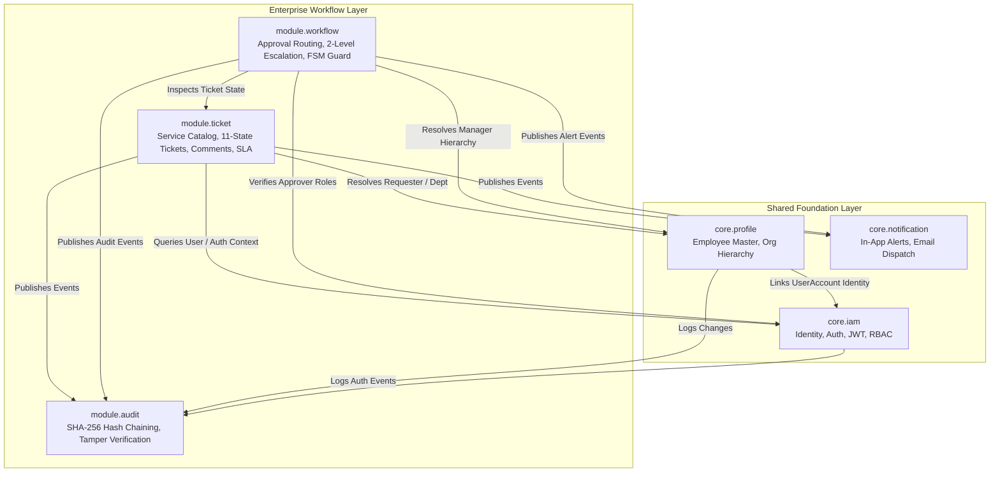

# Modular Monolith Module Architecture & Package Boundaries
## Employee Lifecycle and Service Management Platform (EPAMS)

**Document ID:** EPAMS-HLD-MOD-001  
**Version:** 1.0.0  
**Date:** November 2026  
**Status:** Approved Architecture Baseline  
**Author:** Principal Software Architect & Senior Java Engineer  

---

## 1. Architectural Style & Modularity Rationale

EPAMS is architected as a **Modular Monolith** (`ADR-006`). For organizations with 100–1,000 employees and engineering teams of 2–10 developers, a modular monolith offers the optimal trade-off:
* **Single Deployment Unit:** Eliminates distributed systems overhead (network latency, RPC serialization, distributed transactions, multi-repo CI/CD, Kubernetes cluster complexity).
* **Strict Logical Boundaries:** Strong package-level encapsulation prevents architectural erosion and "spaghetti code."
* **In-Memory ACID Transactions:** Enables atomic consistency across tickets, approval tasks, and cryptographic audit records within a single database transaction.
* **Evolutionary Migration Path:** Clean module boundaries allow any module (e.g. `module.ticket` or `module.audit`) to be extracted into an independent microservice in the future if organizational scale demands it.

---

## 2. Module Boundary Overview & Responsibilities

The system is decomposed into **six bounded modules** organized under the base package `com.examly.springapp`:

---

## 3. Detailed Module Specifications

### 3.1 Module: `core.iam` (Identity & Access Management)
* **Namespace:** `com.examly.springapp.core.iam`
* **Responsibilities:**
  * User identity lifecycle: Registration, password hashing (BCrypt), credential validation.
  * Stateless JWT issuance, Bearer token extraction, and silent refresh via rotating database refresh tokens.
  * Role-Based Access Control (RBAC) definitions: `ROLE_EMPLOYEE`, `ROLE_MANAGER`, `ROLE_RESOLVER`, `ROLE_DEPT_HEAD`, `ROLE_ADMIN`, `ROLE_AUDITOR`.
  * Security filter chain, CSRF cookie-to-header repository, CORS policy, rate limiting, and brute-force account lockout.
* **Exported Public APIs:**
  * `IamService`: `getCurrentAuthenticatedUser()`, `hasRole(role)`, `unlockUser(userId)`.
  * Security context helpers and authentication DTOs.
* **Internal Components:**
  * `UserAccount`, `Role`, `UserRoleMapping`, `RefreshToken`, `AccountStatusLog`.
  * `SecurityConfig`, `JwtFilter`, `JwtService`, `CustomUserDetailsService`, `AuthController`.

### 3.2 Module: `core.profile` (Employee Master Records)
* **Namespace:** `com.examly.springapp.core.profile`
* **Responsibilities:**
  * Centralized employee master data (`Profile` entity: employee ID, names, department, designation, joining date, reporting manager).
  * Organization hierarchy queries (retrieving direct manager and department head for workflow resolution).
  * Sensitive field masking (redacting compensation/salary details for unauthorized callers per `FR-009`).
  * Directory search and pagination.
* **Exported Public APIs:**
  * `ProfileQueryService`: `getProfileByUserId(Long userId)`, `getReportingManagerUserId(Long requesterId)`, `getDepartmentHeadUserId(String department)`.
* **Internal Components:**
  * `Profile`, `ProfileRepo`, `ProfileService`, `ProfileController`.

### 3.3 Module: `module.ticket` (Service Catalog & Ticketing Engine)
* **Namespace:** `com.examly.springapp.module.ticket`
* **Responsibilities:**
  * Service catalog definition and categorization (IT Hardware, IT Software, HR Policy, Facilities, Finance).
  * Ticket submission, retrieval, updates, filtering, and pagination.
  * 11-State Ticket Lifecycle state tracking (`SUBMITTED` $\rightarrow$ `CLOSED`).
  * Optimistic concurrency control via JPA `@Version`.
  * Threaded conversation comments and status transition logs.
  * SLA clock computation (business hours tracking, pause on `ON_HOLD`, resume on `IN_PROGRESS`, target calculation).
* **Exported Public APIs:**
  * `TicketCommandService`: `createTicket(...)`, `updateTicketState(...)`, `assignTicket(...)`.
  * `TicketQueryService`: `getTicketById(Long id)`, `getDepartmentQueue(String department, Pageable pageable)`.
* **Internal Components:**
  * `ServiceCatalogItem`, `ServiceTicket`, `TicketComment`, `TicketStateLog`.
  * `TicketController`, `CatalogController`, `TicketRepo`, `CatalogRepo`.

### 3.4 Module: `module.workflow` (Approval & Escalation Engine)
* **Namespace:** `com.examly.springapp.module.workflow`
* **Responsibilities:**
  * Approval task generation upon ticket submission.
  * Approval hierarchy evaluation: Single-level default vs. Conditional two-level escalation (`ADR-001`).
  * Anti-self-approval enforcement (`BR-005`, `BR-010`): strictly prohibiting requesters from signing off on their own tickets.
  * Recording managerial decisions with mandatory audit reasons ($\ge 15$ characters).
  * Synchronizing approval decisions back to ticket state (`ASSIGNED` or `REJECTED`).
* **Exported Public APIs:**
  * `WorkflowRoutingEngine`: `evaluateAndCreateApprovalTasks(ServiceTicket ticket)`.
  * `ApprovalDecisionService`: `decide(Long taskId, Decision decision, String reason, String actorUsername)`.
* **Internal Components:**
  * `ApprovalTask`, `ApprovalRule`, `ApprovalTaskRepo`, `WorkflowController`.

### 3.5 Module: `module.audit` (Tamper-Evident Audit Subsystem)
* **Namespace:** `com.examly.springapp.module.audit`
* **Responsibilities:**
  * SHA-256 cryptographic hash-chained audit logging (`ADR-011`).
  * Concurrency serialization via database row-level locking on `audit_chain_head`.
  * Recording actor, action, target, payload hash, sequence number, and previous hash.
  * Cryptographic integrity verification service (detecting retroactive record modifications).
  * Enforcing database privilege separation (append-only operations for application runtime user).
* **Exported Public APIs:**
  * `AuditLogService`: `logEvent(String actor, String action, String target, String details)`.
  * `AuditVerificationService`: `verifyChainIntegrity() -> VerificationReport`.
* **Internal Components:**
  * `AuditLog`, `AuditChainHead`, `AuditLogRepo`, `AuditChainHeadRepo`, `AuditLogController`.

### 3.6 Module: `core.notification` (Alerting & Email Dispatch)
* **Namespace:** `com.examly.springapp.core.notification`
* **Responsibilities:**
  * In-app alert management (unread badge counts, notification list, mark as read).
  * Outbound transactional email dispatch via Spring `JavaMailSender` and Thymeleaf HTML templates.
  * Asynchronous event consumption via Spring `@EventListener` (`TicketCreatedEvent`, `ApprovalRequiredEvent`, `TicketResolvedEvent`).
* **Exported Public APIs:**
  * `NotificationEventPublisher`: Listens to domain events and dispatches alerts.
* **Internal Components:**
  * `InAppNotification`, `NotificationRepo`, `EmailService`, `NotificationController`.

---

## 4. Module Dependency Matrix & Enforcement Rules

| Source Module | Permitted Target Dependencies | Prohibited Dependencies | Inter-Module Communication Mechanism |
| :--- | :--- | :--- | :--- |
| **`core.iam`** | Independent foundation | `ticket`, `workflow`, `notification` | Direct calls to internal utilities only. |
| **`core.profile`** | `core.iam` | `ticket`, `workflow` | Java service interface calls; foreign key references to `UserAccount.id`. |
| **`module.ticket`** | `core.iam`, `core.profile`, `module.audit`, `core.notification` | `module.workflow` (Workflow depends on Ticket, not vice-versa) | Spring `ApplicationEventPublisher` for audit/notification; Java service interfaces. |
| **`module.workflow`** | `module.ticket`, `core.profile`, `core.iam`, `module.audit`, `core.notification` | Direct database manipulation of ticket internal fields | Invokes `TicketCommandService.updateTicketState(...)`. |
| **`module.audit`** | Independent subsystem | `ticket`, `workflow`, `profile` (Audit must not depend on domain logic) | Receives generic event DTOs: `(actor, action, target, details)`. |
| **`core.notification`**| Independent subsystem | `ticket`, `workflow` | Subscribes to Spring `ApplicationEvent` types. |

### Architectural Guardrails:
1. **Zero Cyclic Dependencies:** `module.workflow` depends on `module.ticket`, but `module.ticket` **never** imports classes from `module.workflow`. Ticket status updates triggered by approvals occur via public service contracts.
2. **No Direct Entity Cross-Writes:** No module may execute JPA repository mutations (`save`, `delete`) on entities owned by another module. Cross-module writes must invoke the target module's service interface.
3. **Event-Driven Decoupling:** Auditing and notifications are decoupled using Spring `ApplicationEventPublisher`. The core business transaction publishes a domain event; the audit listener executes synchronously within the transaction, while notification listeners execute asynchronously (`@Async`).

---

## 5. Existing Code Refactoring & Migration Mapping

The existing codebase under `com.examly.springapp` will be reorganized cleanly into the 6 bounded modules without breaking existing business logic:

| Existing Class | Current Package | Target Package in Modular Monolith | Migration Category | Notes |
| :--- | :--- | :--- | :--- | :--- |
| `UserAccount` | `com.examly.springapp.model` | `com.examly.springapp.core.iam.model` | **Preserve & Relocate** | Retain fields; add `@Version` for concurrency. |
| `Role` | `com.examly.springapp.model` | `com.examly.springapp.core.iam.model` | **Preserve & Relocate** | Retain role enumeration and entity. |
| `UserRoleMapping` | `com.examly.springapp.model` | `com.examly.springapp.core.iam.model` | **Preserve & Relocate** | Retain relationship mapping. |
| `RefreshToken` | `com.examly.springapp.model` | `com.examly.springapp.core.iam.model` | **Preserve & Relocate** | Retain rotating token mechanism. |
| `AccountStatusLog` | `com.examly.springapp.model` | `com.examly.springapp.core.iam.model` | **Preserve & Relocate** | Track lockout and unlock history. |
| `SecurityConfig` | `com.examly.springapp.security`| `com.examly.springapp.core.iam.security`| **Modify** | Tighten URL authorization; replace `permitAll()` on business endpoints. |
| `JwtFilter` | `com.examly.springapp.security`| `com.examly.springapp.core.iam.security`| **Preserve & Relocate** | Retain dual cookie/header extraction. |
| `Profile` | `com.examly.springapp.model` | `com.examly.springapp.core.profile.model`| **Modify** | Add reporting manager relation and department indexing. |
| `AuditLog` | `com.examly.springapp.model` | `com.examly.springapp.module.audit.model`| **Modify / Upgrade** | Add `sequenceNumber`, `previousHash`, `currentHash`. |
| `AuditChainHead` | *None (New)* | `com.examly.springapp.module.audit.model`| **New Component** | Dedicated row for chain head locking. |
| `ServiceTicket` | *None (New)* | `com.examly.springapp.module.ticket.model`| **New Component** | 11-state ticket entity with `@Version` optimistic lock. |
| `ServiceCatalogItem`| *None (New)* | `com.examly.springapp.module.ticket.model`| **New Component** | Request catalog items with categories and SLA tiers. |
| `TicketComment` | *None (New)* | `com.examly.springapp.module.ticket.model`| **New Component** | Contextual threaded ticket comments. |
| `ApprovalTask` | *None (New)* | `com.examly.springapp.module.workflow.model`| **New Component** | Managerial decision tasks with reason validation. |
| `InAppNotification`| *None (New)* | `com.examly.springapp.core.notification.model`| **New Component** | In-app alerts for users and managers. |
| `RiskAssessmentService` | `com.examly.springapp.service`| `com.examly.springapp.module.workflow.service`| **Migrate / Integrate** | Integrate into conditional approval risk evaluation. |

