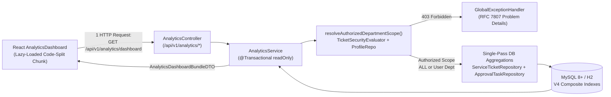

# EPAMS P8 — Business Analytics Architecture

**Project:** Employee Lifecycle and Service Management Platform (EPAMS)  
**Phase:** P8 — Notifications, Performance & Analytics  
**Date:** 2026-11-17  
**Classification:** `[VERIFIED]`  

---

## 1. Architectural Design

The Operational Analytics module operates inside the EPAMS Spring Boot modular monolith as a strictly read-only (`@Transactional(readOnly = true)`) aggregation layer backed by indexed database queries and lightweight scalar projections.

---

## 2. Core Design Principles

1. **Zero N+1 & Zero Full-Entity Hydration:**
   - Status distribution, priority distribution, service popularity, open backlog, overdue open counts, and approval pipeline metrics use database-side JPQL `GROUP BY` and `COUNT` queries.
   - SLA compliance, daily trend bucketing, and average resolution time use a single lightweight scalar projection (`SELECT t.department, t.status, t.createdAt, t.resolvedAt, t.slaTargetDate, t.totalPausedMinutes`) rather than hydrating `ServiceTicket` entities and lazy relations.
2. **Single-Roundtrip Dashboard Bundle (`/api/v1/analytics/dashboard`):**
   - Eliminates the 8-request frontend waterfall by resolving department authorization once and sharing the period scalar projection across overview, SLA, trends, status distribution, and department performance in a single pass.
   - All 8 granular endpoints remain exposed for targeted API consumers and modular reporting.
3. **Authoritative Backend Source of Truth:**
   - The React frontend performs zero business math (never computes SLA percentages, overdue counts, or averages locally).
   - When denominators are zero (e.g., 0 evaluated tickets), backend returns `null` rather than fabricating `0%` or `100%`, and the UI renders `N/A`.
4. **Timezone & Date Boundary Discipline:**
   - All date windows evaluate against the injected Spring `Clock` configured to `Asia/Kolkata`.
   - Date inputs are strictly validated: `startDate <= endDate`, maximum range `366` days, and invalid date strings rejected via RFC 7807 HTTP `400 Bad Request`.
5. **No Unnecessary Materialized Views:**
   - Composite indexes added in Flyway V4 (`idx_ticket_created_dept_status`, `idx_ticket_priority_dept`, `idx_ticket_catalog_created`, `idx_approval_status_created`) deliver sub-50ms single-pass query performance without introducing background aggregation staleness or operational complexity.

