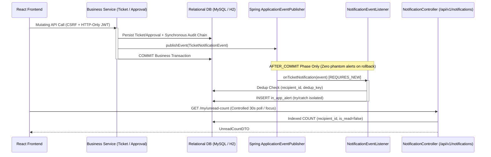

# EPAMS P8 — Notification System Architecture

**Project:** Employee Lifecycle and Service Management Platform (EPAMS)  
**Phase:** P8 — Notifications, Performance & Analytics  
**Date:** 2026-11-17  
**Classification:** `[VERIFIED]`  

---

## 1. Architectural Overview

EPAMS implements an event-driven, transaction-safe in-app notification subsystem integrated cleanly inside the existing Spring Boot modular monolith without introducing external message brokers.

---

## 2. Business Event-to-Recipient Mapping

| Event Type | Trigger Point | Resolved Recipient | Related Entity | Deduplication Key |
| :--- | :--- | :--- | :--- | :--- |
| `TICKET_SUBMITTED` | `TicketCommandService.createTicket()` | Ticket requester | `TICKET` (`ticketId`) | — |
| `TICKET_ASSIGNED` | `TicketCommandService.assignTicket()` | Assigned specialist | `TICKET` (`ticketId`) | — |
| `STATUS_CHANGED` | `TicketCommandService.updateStatus()` (non-resolved) | Ticket requester | `TICKET` (`ticketId`) | — |
| `TICKET_RESOLVED` | `TicketCommandService.updateStatus()` (`RESOLVED`) | Ticket requester | `TICKET` (`ticketId`) | — |
| `TICKET_REOPENED` | `TicketCommandService.reopenTicket()` | Assigned specialist (if assigned & != requester) | `TICKET` (`ticketId`) | — |
| `TICKET_CANCELLED` | `TicketCommandService.cancelTicket()` | Assigned specialist (if assigned & != requester) | `TICKET` (`ticketId`) | — |
| `APPROVAL_REQUIRED` | `ApprovalService.createStage1Approval()` | Stage 1 manager | `APPROVAL` (`taskId`) | `APPROVAL_STAGE1_{ticketId}` |
| `APPROVAL_REQUIRED` | `ApprovalService.decideApproval()` (Stage 1 -> 2) | Stage 2 secondary approver | `APPROVAL` (`stage2TaskId`) | `APPROVAL_STAGE2_{ticketId}` |
| `TICKET_APPROVED` | `ApprovalService.decideApproval()` (Final approval) | Ticket requester | `TICKET` (`ticketId`) | — |
| `APPROVAL_REJECTED` | `ApprovalService.decideApproval()` (Rejected) | Ticket requester | `TICKET` (`ticketId`) | — |

---

## 3. Data Model & Flyway V4 Schema Extension

The existing `in_app_alert` table from Flyway V3 was extended additively in `V4__notifications_and_analytics_indexes.sql` without modifying V1–V3:

- **Preserved V3 Columns:** `id`, `recipient_id` (FK `user_account` ON DELETE CASCADE), `ticket_id` (FK `service_ticket` ON DELETE SET NULL), `alert_type`, `title`, `message`, `is_read`, `created_at`.
- **Additive V4 Columns (Nullable, Backward-Compatible):**
  - `read_at TIMESTAMP NULL` — Exact `Asia/Kolkata` timestamp when the owner first marks the notification read.
  - `related_entity_type VARCHAR(50) NULL` — Deep-link target classification (`TICKET`, `APPROVAL`).
  - `related_entity_id BIGINT NULL` — Target entity identifier.
  - `dedup_key VARCHAR(128) NULL` — Deterministic duplicate-suppression key.
- **Indexes:**
  - `idx_alert_recipient_read (recipient_id, is_read, created_at)` (V3) — Covers unread count and default sorted feed.
  - `idx_alert_recipient_type (recipient_id, alert_type, created_at)` (V4) — Covers event-type filtered feed.
  - `uk_alert_recipient_dedup (recipient_id, dedup_key)` (V4) — Enforces database-level duplicate suppression for non-null keys.

---

## 4. Transaction Safety, Failure Isolation & Bounded Executor

1. **After-Commit Guarantee:** `NotificationEventListener.onTicketNotification` uses `@TransactionalEventListener(phase = TransactionPhase.AFTER_COMMIT)`. Verified in `NotificationTests.test11_RolledBackBusinessTransactionDoesNotPersistNotifications`: if the business transaction rolls back, zero notifications are created.
2. **Independent Persistence Transaction:** Annotated with `@Transactional(propagation = Propagation.REQUIRES_NEW)` and wrapped in a defensive `try/catch` block logging structured SLF4J messages without exposing sensitive payloads. A notification failure never causes an already-committed ticket or approval operation to fail.
3. **Synchronous Audit Guarantee Preserved:** `AuditChainService.recordChainedEvent` remains 100% synchronous inside the business transaction and is never decoupled into asynchronous delivery.
4. **Bounded Executor Configuration:** `AppConfig.notificationTaskExecutor()` defines a bounded `ThreadPoolTaskExecutor` (`corePoolSize=2`, `maxPoolSize=4`, `queueCapacity=100`, `CallerRunsPolicy`, `waitForTasksToCompleteOnShutdown=true`, `awaitTerminationSeconds=15`) ready for future external delivery channels (e.g., SMTP email) without unbounded memory queues.

---

## 5. Delivery Capability Classification

| Capability | Status |
| :--- | :---: |
| In-app notification persistence (`in_app_alert`) | **IMPLEMENTED & VERIFIED** |
| In-app notification retrieval, filtering & pagination | **IMPLEMENTED & VERIFIED** |
| Read/unread tracking (`is_read`, `read_at`, idempotent PUT, mark-all-read) | **IMPLEMENTED & VERIFIED** |
| Duplicate event suppression (`dedup_key`) | **IMPLEMENTED & VERIFIED** |
| External SMTP / Email delivery & retry queue | **NOT IMPLEMENTED (DEFERRED)** |

