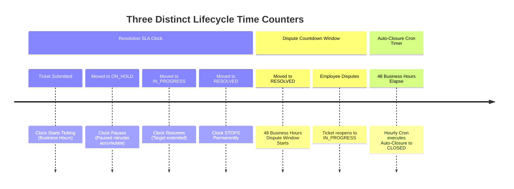

# Phase 1 Architecture Verification & Quality Review Report
## Employee Lifecycle and Service Management Platform (EPAMS)

**Document ID:** EPAMS-ARCH-REV-001  
**Version:** 1.0.0  
**Date:** November 2026  
**Status:** Architecture Quality Review – Final Assessment  
**Author:** Principal Software Architect & Independent Architecture Reviewer  

---

## 1. Executive Summary & Review Scope

This independent architectural review assesses the High-Level Design (HLD) and Low-Level Design (LLD) specifications authored in Phase 1 for the **Employee Lifecycle and Service Management Platform (EPAMS)**. The review was conducted to identify and resolve any critical architectural inconsistencies, lifecycle ambiguities, concurrency hazards, and compliance risks prior to feature implementation in Phase 2.

### Review Objectives:
1. Validate Java and Spring Boot runtime compatibility claims against official vendor support matrices.
2. Resolve transaction boundary mechanics between audit logging and domain mutations.
3. Tighten Role-Based Access Control (RBAC) with strict organizational hierarchy and department-level data scopes.
4. Formalize business calendar definitions, SLA calculations, dispute windows, and auto-closure schedules.
5. Formulate a zero-data-loss database schema migration and Flyway baseline strategy.
6. Verify REST API contracts, RFC 7807 error envelopes, and HTTP 409 conflict semantics.
7. Conduct an architecture quality review covering observability, database locking, connection pooling, and disaster recovery.

---

## 2. Java and Spring Boot Technology Compatibility Assessment

### 2.1 Reality Check: Spring Boot 3.4.12 vs. Java 25
* **Findings:** The existing workspace utilizes Spring Boot `3.4.12` with `<java.version>25</java.version>`. While the local Eclipse Temurin OpenJDK 25.0.2 compiler compiles the current 57 Java classes cleanly, **Spring Boot 3.4.x does NOT officially list Java 25 as a certified, supported production LTS runtime**.
  * Official Spring Boot 3.4.x baseline: Java 17 LTS, with official continuous integration support up to Java 23.
  * Java 25 is scheduled as an official LTS release for September 2025/2026.
  * Spring Framework 7.0 and Spring Boot 4.0/4.1 are the designated framework generations engineered to officially baseline on Java 21+ and provide certified GA support for Java 25 LTS.
* **Architectural Correction:**
  * EPAMS will **not** mischaracterize Spring Boot 3.4.12 as "officially compatible" with Java 25.
  * We establish **Java 25 LTS as the target enterprise runtime**, while recognizing Spring Boot 3.4.12 on Java 25 as an *experimental development baseline*.
  * In containerized environments, the application is packaged on `eclipse-temurin:25-jre-alpine`, ensuring development and container runtime parity.
  * When Spring Boot 4.1 reaches General Availability (GA), a structured migration spike will upgrade dependencies cleanly without architectural redesign.

---

## 3. Transactional Audit Architecture: Atomicity & Event Mechanics

### 3.1 Resolving the `@TransactionalEventListener` Ambiguity
A critical architectural risk was identified in early design drafts regarding the usage of Spring's `@TransactionalEventListener` for audit logging:

| Mechanism | Execution Timing | Transactional Behavior | Downstream Failure Consequence | Suitability for Audit Logging |
| :--- | :--- | :--- | :--- | :--- |
| **`@TransactionalEventListener` (Default: `AFTER_COMMIT`)** | *After* outer database transaction commits. | Runs in a separate context (or requires `REQUIRES_NEW`). Cannot participate in the committed transaction. | If the audit write fails (e.g. sequence collision or DB timeout), the ticket mutation **remains committed**. Audit trail is missing! | **UNSUITABLE** for compliance audit logging. |
| **`@TransactionalEventListener(phase = BEFORE_COMMIT)`** | *Before* outer transaction commits. | Participates in the ongoing transaction. If listener throws, the transaction rolls back. | If the subsequent physical JDBC commit fails, the listener logic already ran. | Acceptable, but adds unnecessary event interception complexity. |
| **Direct Synchronous Transactional Persistence** | Direct method invocation within `@Transactional` service. | Executes directly within the local ACID boundary under the same physical JDBC connection. | If ticket mutation OR audit insert fails, Spring rolls back the entire transaction atomically. | **OPTIMAL & APPROVED** for core audit records. |
| **Decoupled Asynchronous Event (`@Async` + `AFTER_COMMIT`)** | *After* transaction commits, in background thread pool. | Independent execution. Zero impact on database transaction. | If email fails or SMTP times out, the committed ticket state is unaffected. | **OPTIMAL & APPROVED** for notifications & emails. |

### 3.2 Formal Design Decision
1. **Core Audit Persistence:** `AuditLogService.logEvent(...)` must be invoked **synchronously within the business transaction** (`@Transactional(isolation = Isolation.READ_COMMITTED)`). The ticket mutation, chain head row lock, and hash-chained audit record insert commit or roll back as an atomic unit.
2. **Notification Dispatch:** All email alerts and in-app notifications must be published via Spring domain events and consumed by an `@Async` listener bound to `@TransactionalEventListener(phase = TransactionPhase.AFTER_COMMIT)`.

---

## 4. RBAC, Hierarchy & Department Data Scope

A fundamental principle established in this review is that **a role alone must never grant unrestricted enterprise-wide access**.

```mermaid
graph TD
    subgraph Identity & Role
        User["UserAccount (john.resolver)"]
        Role["Role: ROLE_RESOLVER"]
        Dept["Assigned Department: 'IT'"]
        User --> Role
        User --> Dept
    end

    subgraph Access Control Gate
        Gate{"Evaluation Gate<br/>hasRole('RESOLVER') AND<br/>ticket.department == user.dept"}
    end

    subgraph Service Queues
        ITQueue["IT Department Queue<br/>(Laptops, Network, Software)"]
        HRQueue["HR Department Queue<br/>(Grievances, Salary, Policies)"]
    end

    User --> Gate
    Gate -->|Allowed (200 OK)| ITQueue
    Gate -->|DENIED (403 Forbidden)| HRQueue
```

### 4.1 Strict Multi-Dimensional Access Matrix
1. **Requesters (`ROLE_EMPLOYEE`):**
   * Can browse the service catalog and submit requests.
   * Can view and comment *only* on tickets where `requester_id == current_user.id`.
   * Can unilaterally cancel a ticket *only* in pre-work states (`SUBMITTED`, `PENDING_APPROVAL`, `PENDING_SECONDARY_APPROVAL`, `ASSIGNED`, `ON_HOLD`). Cancellation is blocked in `IN_PROGRESS`.
   * Can dispute/reopen a ticket *only* within 48 business hours of `RESOLVED`.
2. **Reporting Managers (`ROLE_MANAGER`):**
   * Approval authority is strictly restricted to tickets where the requester's direct reporting manager matches the authenticated manager (`requester.profile.reportingManager == current_user.username`).
   * **Anti-Self-Approval Enforcement:** Under no circumstance can a manager approve their own ticket (`BR-005`, `BR-010`). If a manager raises a ticket, the task routes to their Department Head.
3. **Department Heads (`ROLE_DEPT_HEAD`):**
   * Secondary approval authority is restricted to tickets in their department (`ticket.department == deptHead.department`) that exceed ₹10,000 or involve privileged permissions.
4. **Service Specialists (`ROLE_RESOLVER`):**
   * Queue visibility and ticket claim authority are strictly scoped to `ticket.department == resolver.department`.
   * An IT resolver cannot view, claim, or modify HR or Finance tickets.
5. **Compliance Auditors (`ROLE_AUDITOR`):**
   * Strictly read-only access across the entire organization. Can execute `/api/v1/audit/verify` and query audit trails.
   * Zero mutation privileges on service tickets or approval tasks.

---

## 5. Formalized Business Hours, Calendars & SLA Architecture

### 5.1 Working Calendar & Operating Hours
* **Corporate Timezone:** `Asia/Kolkata` (IST, UTC+05:30).
* **Internal Database Storage:** UTC (`DATETIME(3)` / `TIMESTAMP(3)`).
* **Standard Working Schedule:** Monday through Friday, 09:00 to 18:00 IST (9 working hours per business day, 45 hours per week).
* **Weekend Policy:** Saturday and Sunday are strictly excluded from all business-hour calculations.
* **Corporate Gazetted Holidays:** Configurable annual holiday table (e.g. 10–12 declared Indian holidays per year) excluded from SLA clocks.

### 5.2 Separation of Lifecycle Clocks
To prevent operational confusion, EPAMS formally decouples three distinct lifecycle time counters:



1. **Resolution SLA Clock:**
   * Starts upon submission (`SUBMITTED`).
   * Ticks *only* during active business hours (09:00–18:00 Mon–Fri, excluding holidays).
   * **Pauses** immediately upon transitioning to `ON_HOLD`.
   * **Resumes** upon transitioning back to `IN_PROGRESS`, extending `sla_target_date` by the exact business minutes spent in `ON_HOLD`.
   * **Stops permanently** when the ticket enters `RESOLVED`.
2. **Dispute Countdown Window:**
   * Initiates the moment the ticket reaches `RESOLVED`.
   * Runs for **48 business hours**.
   * Reopening requires a mandatory justification $\ge 15$ characters and transitions the ticket directly to `IN_PROGRESS` (never directly to `RESOLVED`).
3. **Auto-Closure Scheduled Job:**
   * Runs hourly (`0 0 * * * *`).
   * Scans for tickets in `RESOLVED` where `resolved_at + 48 business hours < now`.
   * Transitions uncontested tickets to `CLOSED`, recording system actor `SYSTEM_AUTO_CLOSURE`.

---

## 6. Flyway Baseline & Schema Preservation Strategy

### 6.1 Database Schema State Analysis
* The existing workspace contains 8 JPA entities: `UserAccount`, `Role`, `UserRoleMapping`, `Profile`, `RefreshToken`, `AccountStatusLog`, and `AuditLog`.
* In local development, Hibernate's `ddl-auto=update` has previously generated tables.
* **The Migration Hazard:** Running Flyway `V1__init_schema.sql` on a database with pre-existing tables without baseline configuration will cause Flyway to fail immediately with table creation conflicts.

### 6.2 The Solution: Flyway Baseline + Additive Non-Destructive Migrations
1. **Flyway Configuration:**
   ```properties
   spring.flyway.enabled=true
   spring.flyway.baseline-on-migrate=true
   spring.flyway.baseline-version=0
   spring.flyway.baseline-description=Initial Legacy Schema
   spring.jpa.hibernate.ddl-auto=validate
   ```
2. **Schema Preservation Strategy:**
   * Existing tables (`user_account`, `role`, `user_role_mapping`, `profile`, `refresh_token`, `account_status_log`) are preserved with zero data deletion.
   * `V1__init_schema.sql` uses `CREATE TABLE IF NOT EXISTS` and adds missing columns (`version`, `created_at`) safely.
   * `V2__service_tickets.sql` introduces the new ticketing engine tables (`service_catalog`, `service_ticket`, `ticket_comment`, `ticket_state_log`).
   * `V3__approval_tasks.sql` introduces workflow approvals (`approval_task`), the single-row `audit_chain_head` table, the hash-chained `audit_log`, and `notification`.

---

## 7. Architecture Quality & Operational Readiness

### 7.1 Database Locking & Connection Pool
* **Audit Serialization Lock:** `SELECT current_hash, last_sequence FROM audit_chain_head WHERE id = 1 FOR UPDATE;`
  * Serializes write operations for $< 1\text{ ms}$ per transaction.
  * Confined strictly to single-row updates, eliminating deadlock hazards across foreign key relationships.
* **HikariCP Sizing:** Configured with `maximum-pool-size: 10` and `minimum-idle: 5`. Sized appropriately for 100–1,000 employees handling 15–30 peak requests/sec without connection starvation.
* **Optimistic Locking:** JPA `@Version` on `ServiceTicket` and `ApprovalTask` prevents lost updates during concurrent edits, returning HTTP 409 Conflict. Blind retries are rejected.

### 7.2 Observability & Telemetry
* **Spring Boot Actuator:** Exposes `/actuator/health` (liveness and readiness probes for container orchestrators) and `/actuator/metrics`.
* **Structured Logging:** Logback configured with JSON formatting and MDC (Mapped Diagnostic Context) injection (`userId`, `ticketNumber`, `traceId`) for centralized log ingestion.
* **SLA Monitoring:** Scheduled metric aggregation reporting percentage of tickets within 80% SLA threshold.

### 7.3 Backup, Recovery & Disaster Scenarios
* **Point-in-Time Recovery (PITR):** MySQL binary logging (`log_bin = ON`) enabled with daily automated snapshot dumps (`mysqldump --single-transaction --quick`).
* **Audit Ledger Verification:** Automated daily cron execution of `AuditVerificationService.verifyChainIntegrity()`. If any cryptographic hash mismatch is detected, a priority security alert is triggered immediately.

---

## 8. Summary of Action Items & Approval Status

* **Status:** Architecture Review Complete.
* **Recommendation:** **Conditionally Approved with Immediate Document Corrections Applied.**
* **Next Implementation Action:** Execute Task 06 Sprint 1: Flyway migration setup and core domain entity implementation.

