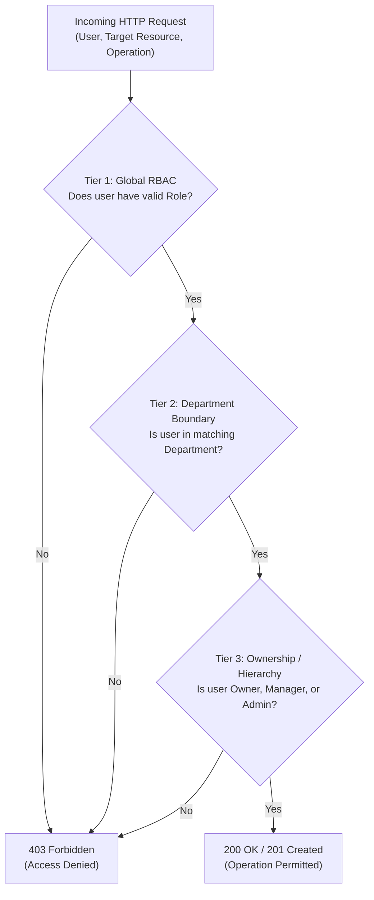

# Security Boundaries, Scoped RBAC & Data Isolation Review
## Employee Lifecycle and Service Management Platform (EPAMS)

**Document ID:** EPAMS-ARCH-SEC-001  
**Version:** 1.0.0  
**Date:** November 2026  
**Status:** Approved Security Specification  
**Author:** Principal Security Architect & Enterprise Identity Lead  

---

## 1. Executive Summary & Security Model

A fundamental flaw in naive RBAC implementations is the assumption that a security role grants uniform access across the entire organization. In an enterprise service management platform handling confidential HR disciplinary matters, IT administrator privileges, and finance reimbursements, **role authorization must be strictly intersected with data ownership, organizational hierarchy, and department scope**.

This document defines the formal access control rules, scoping predicates, and boundary enforcement mechanisms implemented in EPAMS.

---

## 2. Personas, Roles & Reconciled Authority Mapping

The platform reconciles legacy coarse-grained roles (`ROLE_USER`, `ROLE_ADMIN`) with six enterprise functional personas:

| Enterprise Persona | Spring Security Role String | Hierarchy Level | Primary Operational Scope |
| :--- | :--- | :--- | :--- |
| **Employee** | `ROLE_EMPLOYEE` | Base Worker | Self-service catalog, personal tickets, personal profile. |
| **Reporting Manager** | `ROLE_MANAGER` | First-Line Supervisor | Direct report request approval, team allocations. |
| **Department Head** | `ROLE_DEPT_HEAD` | Department Executive | High-impact approvals ($> ₹10,000$), department workflows. |
| **Service Specialist** | `ROLE_RESOLVER` | Operational Resolver | Department ticket queue fulfillment, state transitions, SLA execution. |
| **System Administrator** | `ROLE_ADMIN` | Platform Operations | User lifecycle, account unlock, catalog configuration. |
| **Compliance Auditor** | `ROLE_AUDITOR` | Independent Oversight | Read-only ledger inspection, cryptographic chain verification. |

---

## 3. Multi-Dimensional Access Control Rules

Access to any resource in EPAMS requires passing a **three-tier evaluation gate**:

$$\text{Access Granted} \iff (\text{Role Authorized}) \land (\text{Department In-Scope}) \land (\text{Ownership / Hierarchy Valid})$$

---

## 4. Concrete Policy Specifications by Persona

### 4.1 Requesters (`ROLE_EMPLOYEE`)
* **Permitted Capabilities:**
  * Browse the active service catalog (`GET /api/v1/catalog`).
  * Submit service requests (`POST /api/v1/tickets`).
  * View their own submitted tickets (`GET /api/v1/tickets?requester=me`).
  * Add public comments to their own tickets (`POST /api/v1/tickets/{id}/comments`).
  * Unilaterally cancel tickets prior to work initiation (`SUBMITTED`, `PENDING_APPROVAL`, `PENDING_SECONDARY_APPROVAL`, `ASSIGNED`, `ON_HOLD`).
  * Dispute resolution and reopen tickets within **48 business hours** of `RESOLVED` with mandatory justification $\ge 15$ characters.
* **Prohibited Capabilities:**
  * Cannot view tickets submitted by colleagues (`requester_id != current_user.id`).
  * Cannot view internal resolver comments (`is_internal = true`).
  * Cannot cancel tickets once they enter `IN_PROGRESS`.
  * Cannot reopen tickets once the 48-business-hour dispute window has elapsed.

---

### 4.2 Service Specialists (`ROLE_RESOLVER`)
* **Permitted Capabilities:**
  * View the actionable queue for their *assigned department* (`GET /api/v1/departments/{dept}/queue`).
  * Self-claim or assign unassigned tickets within their department queue (`POST /api/v1/tickets/{id}/assign`).
  * Transition ticket state to `IN_PROGRESS`, `ON_HOLD` (with reason $\ge 15$ chars), and `RESOLVED`.
  * Add internal private notes visible only to resolvers (`is_internal = true`).
* **Strict Boundary Restrictions:**
  * **Department Isolation:** An IT resolver (`department = 'IT'`) is strictly blocked from querying or claiming HR, Facilities, or Finance queues. Any cross-department query returns **HTTP 403 Forbidden**.
  * Cannot approve tickets requiring managerial authorization.
  * Cannot alter audit logs or modify user profile compensation data.

---

### 4.3 Reporting Managers (`ROLE_MANAGER`)
* **Permitted Capabilities:**
  * View pending approval tasks assigned to them (`GET /api/v1/approvals/pending`).
  * Approve or reject requests submitted by their direct reports (`POST /api/v1/approvals/{taskId}/decide`) with mandatory justification $\ge 15$ characters.
* **Strict Boundary Restrictions & Anti-Self-Approval (`BR-005`, `BR-010`):**
  * **Anti-Self-Approval Rule:** If a manager raises a service ticket for themselves, the approval task is **prohibited** from routing to that manager. The task automatically routes to their Department Head.
  * Cannot approve requests for employees outside their reporting hierarchy (`requester.reportingManager != current_user.username`).
  * Cannot approve high-impact requests exceeding ₹10,000 as final sign-off (must route to Department Head).

---

### 4.4 Department Heads (`ROLE_DEPT_HEAD`)
* **Permitted Capabilities:**
  * Act as the secondary approver for high-impact tickets ($> ₹10,000$ or privileged access) within their department.
  * Act as the primary approver for tickets submitted by reporting managers in their department.
  * View department-wide SLA analytics and performance reports.
* **Strict Boundary Restrictions:**
  * Cannot authorize secondary approvals for other departments (e.g. IT Department Head cannot approve Finance capital disbursements).
  * Bound by the same Anti-Self-Approval rules as managers.

---

### 4.5 Compliance Auditors (`ROLE_AUDITOR`)
* **Permitted Capabilities:**
  * Query the append-only audit trail (`GET /api/v1/audit/logs`).
  * Execute cryptographic hash-chain verification (`GET /api/v1/audit/verify`).
  * Inspect historical ticket state changes and approval justifications across all departments.
* **Strict Boundary Restrictions:**
  * **Strictly Read-Only:** Zero mutation privileges across tickets, catalogs, users, and approvals.
  * Cannot claim, transition, approve, or cancel tickets.

---

## 5. Sensitive Field Masking & Privacy (India DPDP Act 2023)

In accordance with Section 6 of the Digital Personal Data Protection Act (DPDP), employee compensation (`salary`) is classified as confidential financial personal data:

1. **Self-Access:** An employee querying `/api/v1/profiles/me` can view their own salary.
2. **HR / Payroll Scope:** Only users holding `ROLE_HR` or `ROLE_ADMIN` can view salary attributes in employee directories (`/api/v1/profiles`).
3. **General Directory Masking:** For all other users (colleagues, managers of other teams, IT resolvers), the `salary` attribute is serialized as `null` in the JSON response payload. Redaction is enforced at the Service layer prior to serialization, preventing accidental leakage in client-side state.

