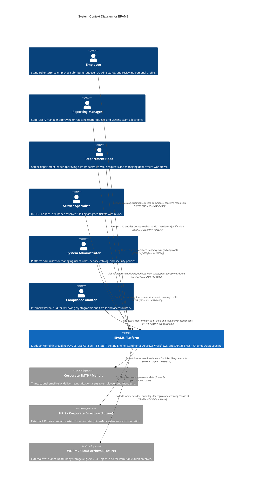

# System Context & Integration Architecture
## Employee Lifecycle and Service Management Platform (EPAMS)

**Document ID:** EPAMS-HLD-CTX-001  
**Version:** 1.0.0  
**Date:** November 2026  
**Status:** Approved Architecture Baseline  
**Author:** Principal Software Architect & Enterprise Systems Lead  

---

## 1. System Overview

The **Employee Lifecycle and Service Management Platform (EPAMS)** is an enterprise-grade service management and employee operations platform designed for mid-market organizations (100–1,000 employees). EPAMS provides a centralized, secure, and auditable digital gateway for all internal workforce service requests—spanning IT hardware/software provisioning, HR letters and policy queries, facilities access, and finance reimbursement sign-offs.

The architecture emphasizes **security, regulatory auditability, deterministic workflow automation, and lightweight operational simplicity**.

---

## 2. C4 Model – Level 1: System Context Diagram

The following C4 System Context diagram illustrates the system boundaries of EPAMS, the primary human user personas, and the external supporting enterprise systems.



---

## 3. Stakeholder Personas & Interaction Models

| Persona | Security Role | Business Responsibilities | Key System Touchpoints |
| :--- | :--- | :--- | :--- |
| **Employee** | `ROLE_EMPLOYEE` | Submits service requests, tracks status, adds contextual comments, verifies completed work, self-manages profile details. | Request Catalog, My Tickets, Ticket Detail, Profile View. |
| **Reporting Manager** | `ROLE_MANAGER` | Validates necessity of team member requests, approves routine requests, adds approval/rejection justification. | Pending Approvals Queue, Approval Detail, Team Requests. |
| **Department Head** | `ROLE_DEPT_HEAD` | Authorizes high-impact requests (hardware $> ₹10,000$, privileged system access), monitors department SLA adherence. | Secondary Approval Queue, Department Analytics. |
| **Service Specialist (Resolver)** | `ROLE_RESOLVER` | Claims unassigned tickets in their department queue (IT/HR/Facilities), executes work, transitions states (`IN_PROGRESS`, `ON_HOLD`, `RESOLVED`). | Department Queue, Resolver Workspace, SLA Clock. |
| **System Administrator** | `ROLE_ADMIN` | Configures organizational service catalog, manages user accounts and role assignments, resolves account lockouts. | Admin Console, User Directory, Service Catalog Editor. |
| **Compliance Auditor** | `ROLE_AUDITOR` | Reviews immutable audit trails, validates SHA-256 cryptographic chain integrity, verifies non-repudiation of approvals. | Audit Explorer, Hash Verification Utility, Access Logs. |

---

## 4. External System Integrations & Protocol Boundaries

### 4.1 Corporate SMTP / Mailpit Relay
* **Purpose:** Outbound transactional notification dispatch for ticket creation, pending approval alerts, SLA breach warnings, and resolution notifications (`FR-019`, `FR-020`, `FR-021`).
* **Protocol:** SMTP over TLS (Port 587 in production) / Plain SMTP (Port 1025 for Mailpit in local/staging environments).
* **Failure Mode / Resilience:** Transactional email dispatch is decoupled via Spring `ApplicationEventPublisher` and asynchronous execution (`@Async`). If SMTP fails or times out, the local database transaction for the ticket or approval is **NOT rolled back**. Failed email attempts are logged to the application error log for retry.

### 4.2 Corporate Directory / HRIS (Phase 2 Roadmap)
* **Purpose:** Automated synchronization of Joiner-Mover-Leaver (JML) identity events from external identity providers (Active Directory, Azure AD, Okta, or Darwinbox/Zoho People).
* **Protocol:** SCIM 2.0 / REST over HTTPS (Port 443).
* **Boundary:** External HRIS acts as the master record for employee status; EPAMS consumes webhooks or polling events to automatically deactivate accounts or update reporting manager hierarchies.

### 4.3 Cloud Archival & WORM Storage (Phase 2 Roadmap)
* **Purpose:** Long-term regulatory archival of cryptographically verified audit records satisfying DPDP Act 2023, ISO 27001, and SOC 2 Type II compliance.
* **Protocol:** AWS S3 REST API (SigV4) with Object Lock in Compliance Mode.
* **Boundary:** Once local audit records reach a configured retention threshold (e.g. 90 days), a scheduled batch export generates signed parquet/JSON batches committed to immutable WORM storage.

---

## 5. Security & Trust Boundaries

```
[ UNTRUSTED INTERNET / CORPORATE WAN ]
                   |
                   | HTTPS (TLS 1.3, Strict-Transport-Security)
                   v
+-----------------------------------------------------------------+
| DMZ / INGRESS BOUNDARY (Port 443)                               |
| - Reverse Proxy / TLS Termination (Nginx or Cloudflare)        |
| - WAF Inspection & DDoS Mitigation                              |
+-----------------------------------------------------------------+
                   |
                   | Plain HTTP (Internal Bridge, Port 8080)
                   v
+-----------------------------------------------------------------+
| TRUSTED APPLICATION BOUNDARY (EPAMS Container)                  |
| - Stateless Spring Security 7 Filter Chain                      |
| - JWT Bearer Token Validation & DB Refresh Token Verification   |
| - Cookie-to-Header CSRF Protection (XSRF-TOKEN)                 |
| - RBAC & Department Data Ownership Guards                       |
+-----------------------------------------------------------------+
                   |
         +---------+---------+
         | JDBC (TLS)        | SMTP
         v                   v
+------------------+  +--------------------+
| DATABASE TIER    |  | NOTIFICATION TIER  |
| MySQL 8.0+       |  | Mailpit / SMTP     |
| (InnoDB Engine)  |  | Relay              |
+------------------+  +--------------------+
```

* **Trust Zone 1 (External / Client):** Web browsers and mobile clients run in untrusted environments. All client input is strictly validated with Bean Validation (Jakarta EE) and parameterized queries to eliminate SQL injection and XSS.
* **Trust Zone 2 (Ingress / DMZ):** Handles TLS termination, enforces HTTP Strict Transport Security (HSTS), and strips malicious request headers.
* **Trust Zone 3 (Application Boundary):** Spring Boot runtime enforces stateless JWT authentication, RBAC method authorization (`@PreAuthorize`), and optimistic locking.
* **Trust Zone 4 (Data Storage Tier):** MySQL 8.0+ database isolated inside a private container network, accessible exclusively by the EPAMS application container via least-privilege database user credentials (`epams_app`).

