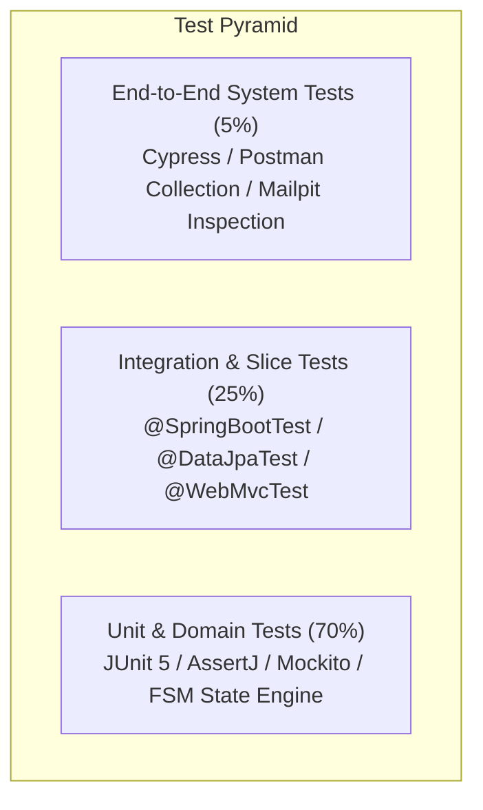

# Comprehensive Quality Assurance & Testing Strategy
## Employee Lifecycle and Service Management Platform (EPAMS)

**Document ID:** EPAMS-HLD-TST-001  
**Version:** 1.0.0  
**Date:** November 2026  
**Status:** Approved Architecture Baseline  
**Author:** Principal QA Architect & Senior Java Engineer  

---

## 1. Quality Engineering Philosophy & Test Pyramid

EPAMS enforces a rigorous, multi-tiered testing strategy designed to validate functional requirements (`FR-001` through `FR-021`), non-functional constraints (`NFR-001` through `NFR-013`), business rules (`BR-001` through `BR-010`), and security threat mitigations.



---

## 2. Test Boundaries & Execution Matrix

| Test Layer | Framework / Tools | Scope & Boundary | Target Execution Time | Database Target |
| :--- | :--- | :--- | :--- | :--- |
| **Domain / Unit** | JUnit 5, AssertJ, Mockito | Service business logic, FSM transitions, SLA business-hour math, SHA-256 hash algorithms, validation rules. | $< 10\text{ seconds}$ | In-Memory / Mocked |
| **Repository Slices** | `@DataJpaTest`, Spring Data | Relational queries, uniqueness constraints, compound indexes, pagination, audit head locking. | $< 15\text{ seconds}$ | H2 (Dev) / MySQL (CI) |
| **Web / Security Slices**| `@WebMvcTest`, MockMvc | Security filter chain, JWT extraction, CSRF header checks, RBAC method authorization, RFC 7807 error serialization. | $< 20\text{ seconds}$ | Mocked Service Layer |
| **Integration Suites** | `@SpringBootTest`, Testcontainers | End-to-end ticket lifecycle, conditional approval routing, transactional rollback, hash-chain integrity. | $< 60\text{ seconds}$ | MySQL Testcontainers |
| **Concurrency Suites** | `ExecutorService`, `CountDownLatch` | Multi-threaded optimistic lock collision (`@Version`), chain-head row lock contention. | $< 15\text{ seconds}$ | MySQL Testcontainers |
| **Notification Integration**| Mailpit, `@MockBean JavaMailSender` | Transactional email template rendering, recipient addressing, decoupled asynchronous dispatch. | $< 10\text{ seconds}$ | Mailpit Container |

---

## 3. Specialized Test Scenarios

### 3.1 11-State Ticket Lifecycle & Transition Tests
* **Boundary:** Unit and Integration tests on `TicketStateMachine`.
* **Objective:** Verify that every valid transition succeeds and every invalid transition is strictly rejected with `IllegalStateTransitionException`.
* **Test Cases:**
  1. `testValidRoutineLifecycle`: `SUBMITTED` $\rightarrow$ `PENDING_APPROVAL` $\rightarrow$ `ASSIGNED` $\rightarrow$ `IN_PROGRESS` $\rightarrow$ `RESOLVED` $\rightarrow$ `CLOSED`.
  2. `testTwoLevelEscalationLifecycle`: `SUBMITTED` $\rightarrow$ `PENDING_APPROVAL` $\rightarrow$ `PENDING_SECONDARY_APPROVAL` $\rightarrow$ `ASSIGNED`.
  3. `testSlaPauseOnHold`: Transition to `ON_HOLD` pauses SLA clock; transition back to `IN_PROGRESS` extends target date.
  4. `testIllegalTransitionBlocked`: Direct jump from `SUBMITTED` to `RESOLVED` throws `IllegalStateTransitionException`.
  5. `testCancellationBoundaries`: Cancelling in `SUBMITTED` or `ON_HOLD` succeeds; cancelling in `IN_PROGRESS` is rejected with `BusinessRuleViolationException`.
  6. `testReopenWithin48Hours`: Reopening within 48 business hours with reason $\ge 15$ chars succeeds and transitions directly to `IN_PROGRESS`; reopening after 48 business hours fails.
  7. `testTerminalStateImmutability`: Assert that no transitions are permitted out of `CLOSED`, `REJECTED`, or `CANCELLED`.

---

### 3.2 Concurrency & Optimistic Locking Test Suite (`NFR-012`, `ADR-008`)
* **Objective:** Ensure parallel modifications to the same ticket or approval task do not produce lost updates.
* **Test Architecture:**
  ```java
  @Test
  void testConcurrentTicketModification_ThrowsOptimisticLockException() throws InterruptedException {
      // 1. Arrange: Create and persist ticket at version 0
      ServiceTicket ticket = createAndPersistTestTicket();
      Long ticketId = ticket.getId();

      int threadCount = 2;
      ExecutorService executor = Executors.newFixedThreadPool(threadCount);
      CountDownLatch readyLatch = new CountDownLatch(threadCount);
      CountDownLatch startLatch = new CountDownLatch(1);
      AtomicInteger successCount = new AtomicInteger(0);
      AtomicInteger conflictCount = new AtomicInteger(0);

      // 2. Act: Two parallel threads attempt status updates using the initial version
      for (int i = 0; i < threadCount; i++) {
          final int workerId = i;
          executor.submit(() -> {
              readyLatch.countDown();
              try {
                  startLatch.await(); // Synchronize exact trigger time
                  ticketCommandService.updateStatus(ticketId, 
                      workerId == 0 ? TicketStatus.IN_PROGRESS : TicketStatus.ON_HOLD, 
                      "Testing concurrent modification worker " + workerId, 
                      0L, // Both pass stale version 0
                      "resolver" + workerId);
                  successCount.incrementAndGet();
              } catch (OptimisticLockException | ObjectOptimisticLockingFailureException ex) {
                  conflictCount.incrementAndGet();
              }
          });
      }

      readyLatch.await();
      startLatch.countDown();
      executor.shutdown();
      executor.awaitTermination(5, TimeUnit.SECONDS);

      // 3. Assert: Exactly one update commits; the second fails with Conflict
      assertThat(successCount.get()).isEqualTo(1);
      assertThat(conflictCount.get()).isEqualTo(1);
      
      ServiceTicket updated = ticketRepo.findById(ticketId).orElseThrow();
      assertThat(updated.getVersion()).isEqualTo(1L);
  }
  ```

---

### 3.3 Cryptographic Audit Hash-Chain Verification Tests (`ADR-011`)
* **Objective:** Prove that retroactive database alterations are mathematically detected.
* **Test Cases:**
  1. `testSequentialChaining`: Generating 100 audit events produces a contiguous chain with strictly incrementing sequence numbers and matching previous hashes.
  2. `testTamperingDetection`:
     * Persist 10 audit records.
     * Use raw JDBC to silently alter `action` or `details` in record #5.
     * Invoke `AuditVerificationService.verifyChainIntegrity()`.
     * Assert that verification fails, reporting sequence #5 as the exact failure point.
  3. `testConcurrentChainWrites`: 20 parallel threads execute audit logging; assert that row lock on `audit_chain_head` serializes writes cleanly with zero duplicate sequence numbers and zero broken hashes.

---

### 3.4 Security & Access Control Test Suite
* **Objective:** Validate authentication, RBAC boundaries, and account lockout.
* **Test Cases:**
  1. `testBruteForceLockout`: Five consecutive invalid logins trigger `AccountStatus.LOCKED` and return HTTP 423 Locked.
  2. `testAdminAccountUnlock`: `ROLE_ADMIN` successfully unlocks locked user via `/api/v1/users/{id}/unlock`.
  3. `testDepartmentQueueIsolation`: IT resolver attempting to access `/api/v1/departments/HR/queue` receives HTTP 403 Forbidden.
  4. `testSensitiveSalaryMasking`: Employee querying `/api/v1/profiles` receives `salary: null`; HR administrator querying receives `salary: 1250000.00`.
  5. `testAntiSelfApprovalBlocked`: Manager submitting ticket and attempting to approve their own task receives HTTP 400 Bad Request (`AntiSelfApprovalException`).

---

### 3.5 Email Testing Architecture via Mailpit (`ADR-009`, `NFR-013`)
* **Local Development & CI:**
  * Outbound SMTP requests point to `epams-mailpit:1025`.
  * Integration tests probe Mailpit REST API (`http://localhost:8025/api/v1/messages`) to assert:
    * Subject line contains ticket tracking number.
    * Recipient matches assigned reporting manager email.
    * No emails are dispatched to real-world internet addresses.
* **Automated Unit & Slice Testing:**
  * `@MockBean private JavaMailSender mailSender;` verifies `mailSender.send(...)` interactions without opening network sockets.

---

## 4. Traceability to SRS-v1 & RTM

| Test Suite / Test Class | Validated Requirements | Validated Business Rules |
| :--- | :--- | :--- |
| `JwtAuthenticationTests` | `FR-001`, `FR-003`, `FR-004`, `NFR-004` | Standard authentication policies |
| `AccountLifecycleTests` | `FR-002`, `FR-005`, `NFR-006` | Brute-force lockout and unlock |
| `ProfileDirectoryTests` | `FR-006`, `FR-007`, `FR-008`, `FR-009` | Salary privacy, DPDP compliance |
| `TicketStateMachineTests` | `FR-011`, `FR-012`, `NFR-009` | `BR-003`, `BR-004`, `BR-007`, `ADR-007` |
| `ApprovalWorkflowTests` | `FR-016A`, `FR-016B`, `FR-017` | `BR-001`, `BR-005`, `BR-008`, `BR-009`, `BR-010` |
| `OptimisticLockingTests` | `NFR-012`, `ADR-008` | Concurrency consistency |
| `CryptographicAuditTests`| `FR-018`, `NFR-006`, `ADR-011` | Non-repudiation and tamper detection |
| `DepartmentQueueSecurityTests`| `FR-013`, `FR-014`, `NFR-001` | Data isolation by department |
| `MailpitNotificationTests`| `FR-019`, `FR-020`, `NFR-013` | Transactional alerting |

