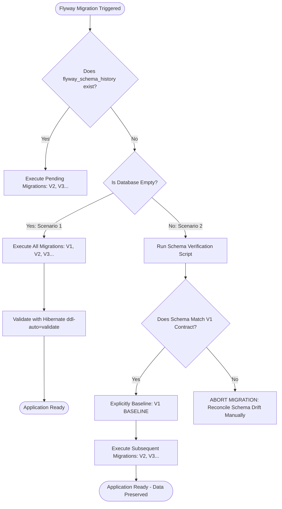

# EPAMS Migration Baseline Strategy & Data Preservation Protocol

**Document ID:** EPAMS-DB-BASE-001  
**Version:** 1.1.0  
**Date:** November 15, 2026  
**Task:** Task 07B.1 — Database Migration Safety Corrections  
**Author:** Principal Database Architect & Senior Spring Boot Engineer  
**Status:** **APPROVED & VERIFIED**  

---

## 1. Executive Summary & Core Mandate

The primary mandate of this protocol is:

> **Preserve the existing application schema, user accounts, profiles, authentication data, and audit history. Never destroy or silently recreate existing data to make migrations pass.**

This document establishes the dual-scenario lifecycle strategy for adopting Flyway across:
1. **Scenario 1: Fresh Database Installations** (Empty development, CI/CD test, or new production deployment).
2. **Scenario 2: Existing Database Adoption** (Databases with active user accounts, password hashes, profiles, refresh tokens, and audit records created by prior application runs).

---

## 2. Technical Evaluation of Flyway Baseline Mechanisms

### 2.1 The Danger of Blind Baseline Settings
Using `baseline-on-migrate=true` and `baseline-version=0` without schema reconciliation introduces severe risks:
* If set to `baseline-version=0`, Flyway stamps the existing database as version `0`, and then attempts to execute `V1__init_iam_schema.sql`. In MySQL 8.0, unconditioned `CREATE INDEX` statements fail with `ERROR 1061: Duplicate key name`.
* If set to `baseline-on-migrate=true` and `baseline-version=1` without pre-validation, Flyway blindly marks `V1` as `BASELINE` on any database with tables, ignoring schema drift (e.g. missing columns or altered nullability). The application boots with an incomplete schema, leading to runtime failures or Hibernate `validate` crashes.
* **Correction in Task 07B.1:** Production profile (`application-mysql.properties`) enforces `spring.flyway.baseline-on-migrate=false` and `spring.flyway.baseline-version=1`. Automated baselining is restricted, and an explicit, verifiable 7-step adoption runbook is mandated for all brownfield environments.

### 2.2 Approved Dual-Lifecycle Strategy



---

## 3. Scenario 1: Fresh Database Initialization Protocol

### 3.1 Initial State
* Target database `epams_db` is completely empty (zero tables).
* `flyway_schema_history` does not exist.

### 3.2 Execution Flow
1. Flyway detects an empty database. Even with `baseline-on-migrate=false`, Flyway does NOT baseline an empty database.
2. Flyway creates `flyway_schema_history`.
3. Flyway executes all versioned migration scripts in numerical sequence:
   * `V1__init_iam_schema.sql` (Creates 7 core IAM, profile, token, and audit tables with `ENGINE=InnoDB DEFAULT CHARSET=utf8mb4`).
   * `V2__service_catalog_and_tickets.sql` (Creates catalog item, service ticket, comment tables).
   * `V3__approvals_and_audit_chain.sql` (Creates approval task, in-app alerts, audit chain head genesis seed, and extends `audit_log`).
4. Spring Boot initializes JPA `EntityManagerFactory`.
5. Hibernate performs schema validation (`spring.jpa.hibernate.ddl-auto=validate`).
6. `DataInitializer` seeds initial canonical roles idempotently.
7. Application successfully transitions to running state.

---

## 4. Scenario 2: Existing Database Adoption Protocol (7-Step Runbook)

### 4.1 Initial State
* Database `epams_db` already contains:
  * `user_account` (Active administrative and employee accounts, BCrypt passwords, lockout state).
  * `role` (`ROLE_ADMIN`, `ROLE_EMPLOYEE`, `ROLE_MANAGER`, etc.).
  * `user_role_mapping` (Role assignments).
  * `profile` (Employee master attributes, employee codes, manager linkages).
  * `refresh_token` (Active cryptographic refresh session tokens).
  * `audit_log` (Historical compliance audit records).
  * `account_status_log` (Historical account status changes).
* `flyway_schema_history` does **NOT** exist.

### 4.2 Data Preservation Guarantees
1. **Zero Data Loss:** Under no circumstances will `DROP TABLE`, `TRUNCATE`, or `DROP COLUMN` be executed.
2. **BCrypt Hash Continuity:** Stored BCrypt password hashes (`$2a$...`) remain byte-for-byte identical.
3. **Audit History Retention:** All existing rows in `audit_log` are preserved intact. Legacy records retain `NULL` for `sequence_number`, `previous_hash`, and `current_hash` (forensically unchained).
4. **Token & Profile Integrity:** Refresh tokens and employee profiles maintain referential integrity.

### 4.3 Safe Adoption Procedure

#### Step 1: Pre-Migration Backup
```bash
mysqldump --single-transaction --quick --routines --triggers -u epams_admin -p epams_db > pre_migration_backup.sql
```

#### Step 2: Record Pre-Migration Baseline Metrics
```sql
SELECT 
    (SELECT COUNT(*) FROM user_account) AS user_account_count,
    (SELECT COUNT(*) FROM role) AS role_count,
    (SELECT COUNT(*) FROM user_role_mapping) AS mapping_count,
    (SELECT COUNT(*) FROM profile) AS profile_count,
    (SELECT COUNT(*) FROM refresh_token) AS refresh_token_count,
    (SELECT COUNT(*) FROM audit_log) AS audit_log_count,
    (SELECT COUNT(*) FROM account_status_log) AS status_log_count;
```

#### Step 3: Schema Parity Audit
Inspect `information_schema.columns` to verify that all column names, lengths, nullability, and indexes match `V1__init_iam_schema.sql`.

#### Step 4: Reconcile or Reject Drift
If any table or required column is missing, halt. Reconcile schema drift before baseline stamping.

#### Step 5: Explicit Baseline Stamping
Execute baseline stamping at Version 1 via Flyway CLI (credentials supplied via environment variables, never on the command line):
```bash
export FLYWAY_PASSWORD="${PROD_DB_PASSWORD}"
flyway -url="jdbc:mysql://localhost:3306/epams_db" -user="epams_admin" -baselineVersion="1" -baselineDescription="Existing IAM Schema Baseline" baseline
```

#### Step 6: Apply Migrations V2 and V3
```bash
flyway -url="jdbc:mysql://localhost:3306/epams_db" -user="epams_admin" migrate
```

#### Step 7: Post-Migration Value Verification
Verify that:
1. Row counts are strictly greater than or equal to pre-migration baseline.
2. User BCrypt hashes are intact.
3. User-role mappings are unbroken.
4. Refresh tokens remain valid and unrevoked.
5. Legacy audit records have `sequence_number IS NULL`.
6. New tables (`service_catalog`, `service_ticket`, `approval_task`, `audit_chain_head`, `in_app_alert`) exist.
7. `audit_chain_head` contains genesis record (`id = 1`, 64-zero SHA-256 hash, sequence 0).

---

## 5. Automated Brownfield Test Verification Evidence

The brownfield migration protocol is automated and continuously validated in [`FlywayMigrationTests.java#test5_ExistingDatabaseUpgradePreservesAllData`](file:///c:/Users/Iyyappan%20E/Folders/SDE/Round%203-HR%20Interview/PROJECTS/Projects/EPAMS/springapp/src/test/java/com/examly/springapp/FlywayMigrationTests.java#L147-L290).

### Verified Test Evidence:
* **Isolated Legacy Environment:** Spawns an isolated H2 in-memory instance (`jdbc:h2:mem:upgrade_test_db`).
* **Complete IAM Pre-Population:**
  * User `legacy_admin` with BCrypt `$2a$10$wO7vI13Lg1J13O0t7Vz7euZ8yG3bU0wUvO7vI13Lg1J13O0t7Vz7e`, `admin@legacy.com`, status `LOCKED`, failed login attempts `5`.
  * Role `ROLE_ADMIN` and `user_role_mapping` record.
  * Profile `EMP-9999` with `Legacy Admin`, department `IT`, designation `Director`, salary `125000.0`, reporting manager `chief_exec`, emergency contact `9876543210`.
  * Refresh token `legacy_refresh_token_sha256_hash_9876543210abcdef`, `revoked = false`.
  * Audit record `LEGACY_EVENT`.
  * Status log `LOCKED`.
* **Execution of Explicit Baseline Runbook:**
  * Flyway configured with `baselineOnMigrate(false)` and `baselineVersion("1")`.
  * Invokes `upgradeFlyway.baseline();`.
  * Invokes `upgradeFlyway.migrate();` (applies V2 and V3).
* **Deep Value-Level Assertions (All Passing):**
  * `assertEquals("legacy_admin", preservedUser.get("username"))`
  * `assertEquals(testBcryptHash, preservedUser.get("password_hash"))`
  * `assertEquals("admin@legacy.com", preservedUser.get("email"))`
  * `assertEquals("LOCKED", preservedUser.get("status"))`
  * `assertEquals(5, preservedUser.get("failed_login_attempts"))`
  * `assertEquals(1, mappingCount)`
  * `assertEquals("EMP-9999", preservedProfile.get("employee_id"))`
  * `assertEquals(125000.0, preservedProfile.get("salary"))`
  * `assertEquals(legacyTokenHash, preservedToken.get("token_hash"))`
  * `assertEquals(false, preservedToken.get("revoked"))`
  * `assertEquals("LEGACY_EVENT", auditRecord.get("action"))`
  * `assertNull(auditRecord.get("sequence_number"))` (Proves forensic truth: no synthetic hashes fabricated).
  * `assertNull(auditRecord.get("previous_hash"))`
  * `assertNull(auditRecord.get("current_hash"))`
  * All V2 and V3 tables verified queryable with 0 errors.
