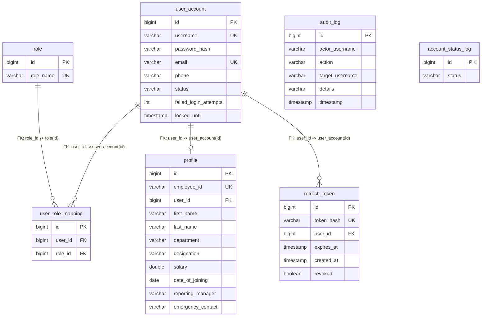

# EPAMS Existing Schema Audit & Database Baseline Verification

**Document ID:** EPAMS-DB-AUDIT-001  
**Version:** 1.0.0  
**Date:** November 15, 2026  
**Task:** Task 07B — Phase A: Database Schema Audit  
**Author:** Principal Database Architect & Senior Spring Boot Engineer  
**Status:** **VERIFIED**  

---

## 1. Executive Summary

Prior to introducing version-controlled database migrations via Flyway into the **Employee Lifecycle and Service Management Platform (EPAMS)**, a forensic audit of the repository's database configuration, JPA entities, repositories, and runtime schema generation was conducted.

### Critical Architecture Findings
1. **Zero Pre-existing SQL Migrations:** No `.sql` files or Flyway/Liquibase migration configurations currently exist in the codebase.
2. **Runtime Schema Mechanism:** The schema is currently created exclusively at runtime by Hibernate using `spring.jpa.hibernate.ddl-auto=update`.
3. **Critical Mismatch between Draft V1 and Actual JPA Entities:**
   * In `Role.java`, the entity column is `role_name` (`private String roleName`), whereas earlier architectural drafts in `database-design.md` specified `name`.
   * In `RefreshToken.java`, the entity columns are `token_hash` (`private String tokenHash`) and `expires_at` (`private LocalDateTime expiresAt`), whereas earlier architectural drafts specified `token` and `expiry_date`.
   * In `AccountStatusLog.java`, the entity only contains `id` and `status` (`private String status`), whereas architectural drafts proposed multi-column audit attributes (`user_id`, `old_status`, `new_status`, `changed_by`).
   * In `UserAccount.java` and `Profile.java`, optimistic lock `@Version private Long version;` has not yet been introduced into the Java entities.
   * **Mandate:** If draft V1 SQL were applied directly with `spring.jpa.hibernate.ddl-auto=validate`, Hibernate startup would immediately fail with missing column errors (`role_name`, `token_hash`, `expires_at`). The Flyway baseline **must reflect actual JPA entity reality** or safely bridge existing and future schemas.

---

## 2. Actual Existing Schema Inventory

Forensic inspection of the JPA entities under `com.examly.springapp.model` and Hibernate DDL output generated during the 99-test IAM regression run reveals the following 7 tables:

### 2.1 Table: `user_account`
*Entity:* `com.examly.springapp.model.UserAccount`  
*Table Responsibility:* Central identity store for credentials, lockout tracking, and account lifecycle state.

| Column Name | JPA Mapping | Hibernate H2 Type | MySQL 8.0 Target Type | Nullable | Constraints & Default | Description |
| :--- | :--- | :--- | :--- | :---: | :--- | :--- |
| `id` | `@Id @GeneratedValue(IDENTITY)` | `BIGINT` | `BIGINT AUTO_INCREMENT` | No | `PRIMARY KEY` | Surrogate primary key |
| `username` | `String` | `VARCHAR(255)` | `VARCHAR(50)` | No | `UNIQUE` | Unique user handle |
| `password_hash` | `String` | `VARCHAR(255)` | `VARCHAR(255)` | No | - | BCrypt hash (`$2a$` / `$2y$`) |
| `email` | `String` | `VARCHAR(255)` | `VARCHAR(100)` | No | `UNIQUE` | Corporate email address |
| `phone` | `String` | `VARCHAR(255)` | `VARCHAR(20)` | Yes | - | Contact telephone |
| `status` | `@Enumerated(EnumType.STRING)` | `ENUM('ACTIVE','DISABLED','SUSPENDED')` | `VARCHAR(20)` | No | `DEFAULT 'ACTIVE'` | AccountStatus enum |
| `failed_login_attempts`| `int` | `INTEGER` | `INT` | No | `DEFAULT 0` | Brute-force failure counter |
| `locked_until` | `LocalDateTime` | `TIMESTAMP(6)` | `DATETIME(3)` | Yes | - | Lockout expiration timestamp |

### 2.2 Table: `role`
*Entity:* `com.examly.springapp.model.Role`  
*Table Responsibility:* Role authority definitions for RBAC (`ADMIN`, `HR_MANAGER`, `EMPLOYEE`, `USER`).

| Column Name | JPA Mapping | Hibernate H2 Type | MySQL 8.0 Target Type | Nullable | Constraints & Default | Description |
| :--- | :--- | :--- | :--- | :---: | :--- | :--- |
| `id` | `@Id @GeneratedValue(IDENTITY)` | `BIGINT` | `BIGINT AUTO_INCREMENT` | No | `PRIMARY KEY` | Primary key |
| `role_name` | `String` | `VARCHAR(255)` | `VARCHAR(50)` | No | `UNIQUE` | Authority name |

*Note on Schema Discrepancy:* `Role.java` defines property `roleName`. Hibernate maps this by default to `role_name`. Previous draft SQL erroneously designated `name`.

### 2.3 Table: `user_role_mapping`
*Entity:* `com.examly.springapp.model.UserRoleMapping`  
*Table Responsibility:* Associative join table linking `UserAccount` to `Role`.

| Column Name | JPA Mapping | Hibernate H2 Type | MySQL 8.0 Target Type | Nullable | Constraints & Default | Description |
| :--- | :--- | :--- | :--- | :---: | :--- | :--- |
| `id` | `@Id @GeneratedValue(IDENTITY)` | `BIGINT` | `BIGINT AUTO_INCREMENT` | No | `PRIMARY KEY` | Primary key |
| `user_id` | `@ManyToOne UserAccount user` | `BIGINT` | `BIGINT` | No | `FK -> user_account(id)` | Foreign key to user |
| `role_id` | `@ManyToOne Role role` | `BIGINT` | `BIGINT` | No | `FK -> role(id)` | Foreign key to role |

### 2.4 Table: `profile`
*Entity:* `com.examly.springapp.model.Profile`  
*Table Responsibility:* Employee master record holding HR attributes, department, manager, and personal info.

| Column Name | JPA Mapping | Hibernate H2 Type | MySQL 8.0 Target Type | Nullable | Constraints & Default | Description |
| :--- | :--- | :--- | :--- | :---: | :--- | :--- |
| `id` | `@Id @GeneratedValue(IDENTITY)` | `BIGINT` | `BIGINT AUTO_INCREMENT` | No | `PRIMARY KEY` | Primary key |
| `employee_id` | `String` | `VARCHAR(255)` | `VARCHAR(30)` | No | `UNIQUE` | Business employee code |
| `user_id` | `@ManyToOne UserAccount user` | `BIGINT` | `BIGINT` | No | `FK -> user_account(id)` | 1-to-1 link to identity |
| `first_name` | `String` | `VARCHAR(255)` | `VARCHAR(50)` | No | - | Employee first name |
| `last_name` | `String` | `VARCHAR(255)` | `VARCHAR(50)` | No | - | Employee surname |
| `address` | `String` | `VARCHAR(255)` | `VARCHAR(255)` | Yes | - | Residential address |
| `dob` | `LocalDate` | `DATE` | `DATE` | Yes | - | Date of birth |
| `gender` | `String` | `VARCHAR(255)` | `VARCHAR(20)` | Yes | - | Gender identity |
| `department` | `String` | `VARCHAR(255)` | `VARCHAR(50)` | No | - | Functional department |
| `designation` | `String` | `VARCHAR(255)` | `VARCHAR(100)` | No | - | Official job title |
| `salary` | `Double` | `FLOAT(53)` | `DECIMAL(12,2)` | Yes | - | Compensation (masked) |
| `date_of_joining`| `LocalDate` | `DATE` | `DATE` | No | - | Employment start date |
| `reporting_manager`| `String` | `VARCHAR(255)` | `VARCHAR(50)` | Yes | - | Manager handle/username |
| `emergency_contact`| `String` | `VARCHAR(255)` | `VARCHAR(50)` | Yes | - | Emergency telephone |

### 2.5 Table: `refresh_token`
*Entity:* `com.examly.springapp.model.RefreshToken`  
*Table Responsibility:* Cryptographic hash of long-lived refresh tokens for session rotation and revocation.

| Column Name | JPA Mapping | Hibernate H2 Type | MySQL 8.0 Target Type | Nullable | Constraints & Default | Description |
| :--- | :--- | :--- | :--- | :---: | :--- | :--- |
| `id` | `@Id @GeneratedValue(IDENTITY)` | `BIGINT` | `BIGINT AUTO_INCREMENT` | No | `PRIMARY KEY` | Primary key |
| `token_hash` | `@Column(nullable=false, unique=true)` | `VARCHAR(255)` | `VARCHAR(255)` | No | `UNIQUE` | SHA-256 token hash |
| `user_id` | `@ManyToOne @JoinColumn(name="user_id")` | `BIGINT` | `BIGINT` | No | `FK -> user_account(id)` | Associated identity |
| `expires_at` | `@Column(nullable=false)` | `TIMESTAMP(6)` | `DATETIME(3)` | No | - | Expiration timestamp |
| `created_at` | `@Column(nullable=false)` | `TIMESTAMP(6)` | `DATETIME(3)` | No | `DEFAULT CURRENT_TIMESTAMP(3)` | Issuance timestamp |
| `revoked` | `boolean` | `BOOLEAN` | `BOOLEAN` | No | `DEFAULT FALSE` | Revocation status flag |

### 2.6 Table: `audit_log`
*Entity:* `com.examly.springapp.model.AuditLog`  
*Table Responsibility:* Compliance journal for IAM and operational events.

| Column Name | JPA Mapping | Hibernate H2 Type | MySQL 8.0 Target Type | Nullable | Constraints & Default | Description |
| :--- | :--- | :--- | :--- | :---: | :--- | :--- |
| `id` | `@Id @GeneratedValue(IDENTITY)` | `BIGINT` | `BIGINT AUTO_INCREMENT` | No | `PRIMARY KEY` | Primary key |
| `actor_username` | `String` | `VARCHAR(255)` | `VARCHAR(50)` | No | - | Identity performing action |
| `action` | `String` | `VARCHAR(255)` | `VARCHAR(50)` | No | - | Event type descriptor |
| `target_username`| `String` | `VARCHAR(255)` | `VARCHAR(50)` | Yes | - | Identity affected |
| `details` | `@Column(length=1000)` | `VARCHAR(1000)` | `TEXT` | Yes | - | Event context / payload |
| `timestamp` | `LocalDateTime` | `TIMESTAMP(6)` | `DATETIME(3)` | No | - | Event timestamp (UTC) |

### 2.7 Table: `account_status_log`
*Entity:* `com.examly.springapp.model.AccountStatusLog`  
*Table Responsibility:* Legacy entity tracking simple account status strings.

| Column Name | JPA Mapping | Hibernate H2 Type | MySQL 8.0 Target Type | Nullable | Constraints & Default | Description |
| :--- | :--- | :--- | :--- | :---: | :--- | :--- |
| `id` | `@Id @GeneratedValue(IDENTITY)` | `BIGINT` | `BIGINT AUTO_INCREMENT` | No | `PRIMARY KEY` | Primary key |
| `status` | `String` | `VARCHAR(255)` | `VARCHAR(50)` | Yes | - | Account status string |

---

## 3. Existing Table Relationships & Foreign Keys

---

## 4. Existing Data Dependencies & Initializer Mechanics

`com.examly.springapp.config.DataInitializer` runs on application startup as a Spring `CommandLineRunner`:
1. **Roles Seeded:** `ADMIN`, `HR_MANAGER`, `EMPLOYEE`, `USER`.
2. **Employees Seeded:**
   * `admin` (`EMP-1001`, Executive, System Administrator & Lead)
   * `hr_manager` (`EMP-1002`, Human Resources, Senior HR Operations Lead)
   * `john_doe` (`EMP-1003`, Engineering, Senior Full-Stack Engineer)
   * `sarah_connor` (`EMP-1004`, Engineering, Lead UI/UX Architect)
   * `alex_chen` (`EMP-1005`, Finance, Corporate Financial Analyst)
   * `emily_watson` (`EMP-1006`, Operations, Operations & Logistics Specialist)
3. **Idempotency:** `DataInitializer` checks `userAccountRepo.findByUsername(username).isEmpty()` before insertion, preventing duplicate insertions when tables already contain these accounts.

---

## 5. H2 versus MySQL 8.0 Technical Differences

| Dimension | In-Memory H2 (Test Runtime) | MySQL 8.0+ (Production Target) | Flyway Migration Impact |
| :--- | :--- | :--- | :--- |
| **DDL Transactions** | Supported (DDL statements participate in transactions) | Non-transactional (DDL causes implicit commits) | In MySQL, a failed DDL statement cannot be rolled back automatically; scripts must be tested and deterministic. |
| **Case Sensitivity** | Case-insensitive table names by default | Case-sensitive on Linux hosts (`lower_case_table_names=0`) | All SQL identifiers must strictly use lowercase snake_case across both platforms. |
| **Identifier Quoting** | Double quotes `"` or standard ANSI | Backticks `` ` `` or ANSI quotes | Use standard ANSI unquoted identifiers where possible. |
| **Auto-Increment Syntax**| `BIGINT GENERATED BY DEFAULT AS IDENTITY` or `AUTO_INCREMENT` | `BIGINT AUTO_INCREMENT` | `BIGINT AUTO_INCREMENT` is supported in MySQL and H2 MySQL mode. |
| **Character Sets** | Ignored | `DEFAULT CHARSET=utf8mb4 COLLATE=utf8mb4_unicode_ci` | Explicitly specify InnoDB and `utf8mb4` in MySQL production migrations. |
| **Enum Handling** | `ENUM(...)` or `VARCHAR` | `VARCHAR(...)` or `ENUM(...)` | Standardize on `VARCHAR(20)` for portable, refactor-safe enum representation. |
| **Timestamp Precision**| Microseconds (`TIMESTAMP(6)`) | Fractional seconds (`DATETIME(3)` / `TIMESTAMP(3)`) | Use `TIMESTAMP` / `DATETIME(3)` compatible with both engines. |

---

## 6. Risks of Introducing Flyway & Mitigation Strategy

| Risk ID | Identified Risk | Impact | Mitigation Strategy |
| :--- | :--- | :--- | :--- |
| **R-01** | Column Name Mismatch (`role_name` vs `name`, `token_hash` vs `token`) | Application startup fails with `SchemaManagementException` under `validate` | Base V1 schema exactly on actual JPA entity columns, preserving existing database schema. |
| **R-02** | Accidental Table Re-creation or Drop | Loss of existing user credentials, profiles, or audit logs | Enforce `CREATE TABLE IF NOT EXISTS` and strict additive DDL. Ban `DROP TABLE` or destructive scripts. |
| **R-03** | Existing Database Baseline Failure | Flyway fails on existing databases because tables already exist without `flyway_schema_history` | Configure `baseline-on-migrate=true` and `baseline-version=0` with proven schema compatibility. |
| **R-04** | H2 Test Incompatibility | 99-test IAM regression suite fails during `mvn test` | Configure dual-mode Flyway behavior or test profile ensuring clean migration on fresh H2 test databases. |

---

## 7. Verified Facts vs Assumptions Ledger

| Item | Classification | Verification Evidence |
| :--- | :---: | :--- |
| Spring Boot version is 3.4.12 | **VERIFIED** | Inspected `pom.xml` line 12: `<version>3.4.12</version>`. |
| Java compiler target is 25 | **VERIFIED** | Inspected `pom.xml` line 23: `<java.version>25</java.version>`. |
| Flyway is currently absent from pom.xml | **VERIFIED** | Grepped `pom.xml`; no `flyway-core` or `flyway-mysql` dependency found. |
| Current schema created by Hibernate | **VERIFIED** | Inspected `application.properties`: `spring.jpa.hibernate.ddl-auto=update`. |
| Existing IAM regression suite has 99 tests | **VERIFIED** | Executed all 5 test classes in Task 07; 99/99 passed in 159.12 seconds. |
| Local MySQL 8.0 is installed & port 3306 open | **VERIFIED** | Checked via CLI `mysql.exe Ver 8.0.45` and `Test-NetConnection` port 3306 `TcpTestSucceeded: True`. |
| Local Docker daemon is currently stopped | **VERIFIED** | Checked via `docker ps`; failed to connect to pipe (daemon not running). |
| Existing JPA entities do not have `@Version` yet | **VERIFIED** | Inspected `UserAccount.java` and `Profile.java`; no `@Version` field present in source code. |

