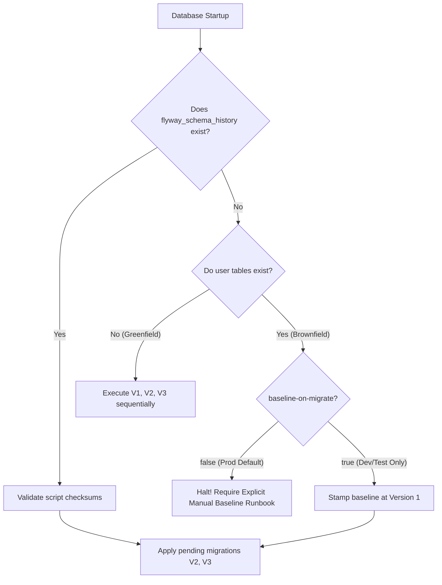

# EPAMS Flyway Dependency & Database Configuration Specification

**Document ID:** EPAMS-DB-CFG-001  
**Version:** 1.1.0  
**Date:** November 15, 2026  
**Task:** Task 07B.1 — Database Migration Safety Corrections  
**Author:** Principal Database Architect & Senior Spring Boot Engineer  
**Status:** **APPROVED & VERIFIED**  

---

## 1. Executive Summary

This document specifies the Flyway migration infrastructure, dependency governance, and multi-profile database configuration for the **Employee Lifecycle and Service Management Platform (EPAMS)**.

Under this corrected specification:
1. Schema governance is transitioned from Hibernate automatic generation (`ddl-auto=update`) to deterministic, version-controlled SQL migrations via **Flyway 10.20.1**.
2. Production environments enforce Hibernate schema validation (`spring.jpa.hibernate.ddl-auto=validate`) against the Flyway-migrated schema.
3. Production configuration enforces `spring.flyway.baseline-on-migrate=false` and `spring.flyway.baseline-version=1` to prevent silent adoption of unverified or drifted schemas.
4. An explicit 7-step manual brownfield adoption runbook is established for pre-existing databases.
5. All table creation DDL explicitly specifies `ENGINE=InnoDB DEFAULT CHARSET=utf8mb4`.

---

## 2. Dependency Specification

### 2.1 Dependencies in `pom.xml`
In Spring Boot `3.4.12`, the parent POM manages `flyway-core` and `flyway-mysql` versions automatically (v10.20.1), guaranteeing compatibility with the Spring Boot autoconfiguration and Java 25 runtime:

```xml
<!-- Flyway Database Migration Core -->
<dependency>
    <groupId>org.flywaydb</groupId>
    <artifactId>flyway-core</artifactId>
</dependency>

<!-- Flyway MySQL 8.0+ Compatibility Engine -->
<dependency>
    <groupId>org.flywaydb</groupId>
    <artifactId>flyway-mysql</artifactId>
</dependency>
```

* **`flyway-core`:** Provides the migration runner, schema history table (`flyway_schema_history`), checksum computation, and lifecycle callbacks.
* **`flyway-mysql`:** Provides specialized dialect support for MySQL 8.0+ (InnoDB storage engine, character sets, row-locking syntax, and MySQL error code mapping).

### 2.2 Maven Plugin Status & Security Policy
* **Flyway Maven Plugin:** The `flyway-maven-plugin` is **NOT** configured in `springapp/pom.xml`. Executing `mvn flyway:baseline` or `mvn flyway:migrate` directly from the CLI will fail unless the plugin is explicitly added with database coordinates.
* **Credential Security Rule:** Database passwords must **NEVER** be passed directly into command-line arguments (e.g. `-Dflyway.password=...`), as command lines are visible in process tables (`ps`, Task Manager) and shell history files. Credentials must be injected exclusively via secure environment variables (`SPRING_DATASOURCE_PASSWORD` or `FLYWAY_PASSWORD`) or cloud secret managers.

---

## 3. Environment-Specific Database & Flyway Configurations

### 3.1 Production Profile (`application-mysql.properties`)

```properties
# =============================================================================
# EPAMS Production Database Configuration (MySQL 8.0+ InnoDB)
# =============================================================================

# DataSource Connection
spring.datasource.url=jdbc:mysql://${DB_HOST:localhost}:${DB_PORT:3306}/${DB_NAME:epams_db}?useSSL=false&allowPublicKeyRetrieval=true&serverTimezone=UTC&createDatabaseIfNotExist=true
spring.datasource.username=${DB_USERNAME:root}
spring.datasource.password=${DB_PASSWORD:rootpassword}
spring.datasource.driver-class-name=com.mysql.cj.jdbc.Driver

# HikariCP Enterprise Connection Pooling
spring.datasource.hikari.maximum-pool-size=10
spring.datasource.hikari.minimum-idle=5
spring.datasource.hikari.idle-timeout=300000
spring.datasource.hikari.connection-timeout=20000
spring.datasource.hikari.max-lifetime=1200000

# JPA & Hibernate Validation (Zero Schema Generation in Production)
spring.jpa.hibernate.ddl-auto=validate
spring.jpa.show-sql=false
spring.jpa.properties.hibernate.dialect=org.hibernate.dialect.MySQLDialect

# Flyway Production Migration Governance (Corrected for Task 07B.1)
spring.flyway.enabled=${FLYWAY_ENABLED:true}
spring.flyway.locations=classpath:db/migration
spring.flyway.baseline-on-migrate=false
spring.flyway.baseline-version=1
spring.flyway.baseline-description=Existing IAM Schema Baseline
spring.flyway.table=flyway_schema_history
spring.flyway.out-of-order=false
spring.flyway.validate-on-migrate=true

# Security: Disable In-Memory Consoles
spring.h2.console.enabled=false
```

### 3.2 Test Profile (`src/test/resources/application.properties`)

```properties
# =============================================================================
# EPAMS Test Profile (Automated Integration & Regression Testing)
# =============================================================================

spring.datasource.url=jdbc:h2:mem:testdb;MODE=MySQL;DATABASE_TO_LOWER=TRUE
spring.datasource.username=testuser
spring.datasource.password=testpassword
spring.datasource.driver-class-name=org.h2.Driver

# Hibernate validation against Flyway-migrated test database
spring.jpa.hibernate.ddl-auto=validate
spring.jpa.show-sql=false
spring.jpa.properties.hibernate.dialect=org.hibernate.dialect.H2Dialect

# Flyway enabled for test database initialization
spring.flyway.enabled=true
spring.flyway.locations=classpath:db/migration
spring.flyway.baseline-on-migrate=false
spring.flyway.baseline-version=1

# JWT & Security Test Overrides
jwt.secret=404E635266556A586E3272357538782F413F4428472B4B6250645367566B5970
jwt.expiration=900000
jwt.refresh-expiration=604800000
app.security.cookie.secure=false
app.security.cookie.same-site=Lax
```

---

## 4. Greenfield vs. Brownfield Lifecycle Execution



### 4.1 Greenfield Database (Clean Target)
When target database has no tables:
1. `baseline-on-migrate=false` has no effect because no tables exist.
2. Flyway creates `flyway_schema_history`.
3. Flyway executes `V1__init_iam_schema.sql`, `V2__service_catalog_and_tickets.sql`, and `V3__approvals_and_audit_chain.sql`.
4. Schema is at Version 3.

### 4.2 Brownfield Database (Existing IAM Target) — 7-Step Production Adoption Runbook
To prevent index collision failures (`ERROR 1061: Duplicate key name`) and avoid silent adoption of corrupted or drifted schemas, production administrators must follow this controlled runbook:

1. **Full Pre-Migration Backup:**
   Execute a physical or logical database dump before running any migrations:
   ```bash
   mysqldump --single-transaction --quick --routines --triggers -u epams_admin -p epams_db > pre_migration_backup.sql
   ```
2. **Inspect Existing Schema Metadata:**
   Query `information_schema.tables` to confirm that all 7 IAM tables exist: `user_account`, `role`, `user_role_mapping`, `profile`, `refresh_token`, `audit_log`, `account_status_log`.
3. **Compare Schema Parity Against `V1`:**
   Verify column names, types, nullability, unique keys, and indexes against `V1__init_iam_schema.sql` to confirm no column drift has occurred.
4. **Reject Incomplete or Drifted Schemas:**
   If any table is missing (e.g. `refresh_token`), or column types diverge, halt immediately. Reconcile schema drift manually before proceeding.
5. **Execute Explicit Baseline Stamping:**
   Using the standalone Flyway CLI or a dedicated administrative migration runner (with password supplied via environment variable):
   ```bash
   export FLYWAY_PASSWORD="${PROD_DB_PASSWORD}"
   flyway -url="jdbc:mysql://localhost:3306/epams_db" -user="epams_admin" -baselineVersion="1" -baselineDescription="Existing IAM Schema Baseline" baseline
   ```
6. **Apply Migrations V2 and V3:**
   ```bash
   flyway -url="jdbc:mysql://localhost:3306/epams_db" -user="epams_admin" migrate
   ```
   Flyway will cleanly apply `V2__service_catalog_and_tickets.sql` and `V3__approvals_and_audit_chain.sql`.
7. **Verify Resulting Schema and Application Health:**
   Run `flyway info` to confirm status is `SUCCESS` for V1 (BASELINE), V2 (SUCCESS), and V3 (SUCCESS). Boot the Spring Boot application with `spring.jpa.hibernate.ddl-auto=validate`.

---

## 5. Database Engine Compatibility Matrix

| Feature / Behavior | MySQL 8.0+ Target | H2 In-Memory Compatibility Engine | Design Decision / Standard |
| :--- | :--- | :--- | :--- |
| **Storage Engine** | `ENGINE=InnoDB` | Ignored in H2 MySQL mode | Explicitly declared on all `CREATE TABLE` statements. |
| **Character Set** | `DEFAULT CHARSET=utf8mb4` | Ignored in H2 MySQL mode | Explicitly declared on all `CREATE TABLE` statements. |
| **Auto-Increment Primary Key** | `BIGINT AUTO_INCREMENT PRIMARY KEY` | Supported in `MODE=MySQL` | Standardized across all tables. |
| **Identifier Casing** | Sensitive on Linux, insensitive on Windows | Insensitive by default (`DATABASE_TO_LOWER=TRUE`) | All table and column names use lowercase snake_case. |
| **Audit Extension** | `ALTER TABLE audit_log ADD COLUMN ...` | Supported | Option A: Extended in `V3` with nullable sequence and hash fields. |
| **Genesis Anchor** | ANSI `INSERT INTO ... SELECT ... WHERE NOT EXISTS` | Supported | Portable single-row seed. |
