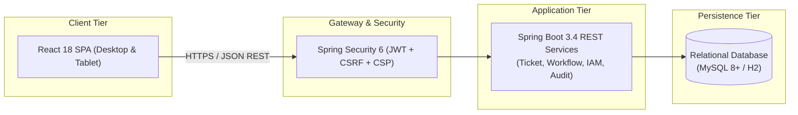
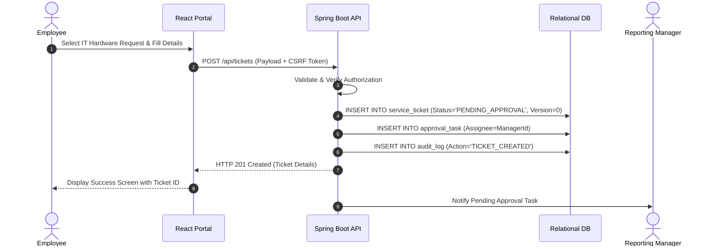
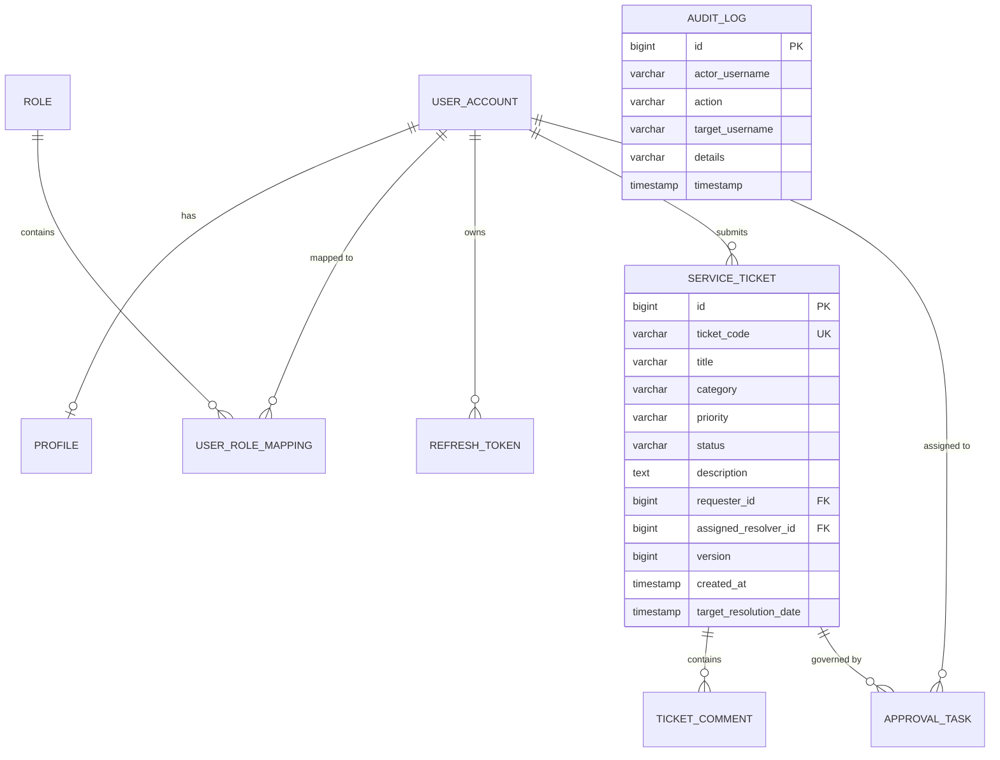

# Software Requirements Specification (SRS 1.0)
## Employee Lifecycle and Service Management Platform (EPAMS)

**Document ID:** EPAMS-SRS-001  
**Version:** 1.1.0  
**Standard:** IEEE 830 / ISO/IEC/IEEE 29148 Compliant  
**Date:** November 2026  
**Status:** Approved  
**Author:** Senior Business Analyst & Enterprise Software Architect  

---

## 1. Introduction

### 1.1 Purpose
This Software Requirements Specification (SRS) defines the functional and non-functional requirements for the **Employee Lifecycle and Service Management Platform (EPAMS)** version 1.0 (MVP). It provides a binding, authoritative technical baseline for engineering, quality assurance, system architecture, and product management.

### 1.2 Document Conventions
* **`FR-xxx`**: Functional Requirement
* **`NFR-xxx`**: Non-Functional Requirement
* **`BR-xxx`**: Business Rule
* **`UC-xxx`**: Use Case Specification
* Priority keywords conform to RFC 2119: **MUST** (Mandatory/P0), **SHOULD** (Recommended/P1), **MAY** (Optional/P2).

### 1.3 Definitions, Acronyms, and Abbreviations
* **EPAMS:** Employee Portal Account Management System / Employee Lifecycle Platform.
* **IAM:** Identity and Access Management.
* **RBAC:** Role-Based Access Control.
* **JWT:** JSON Web Token (RFC 7519).
* **JML:** Joiner, Mover, Leaver (Employee lifecycle phases).
* **SLA:** Service Level Agreement (maximum time allowable to acknowledge or resolve a request).
* **MTTR:** Mean Time to Resolution.
* **PII:** Personally Identifiable Information.
* **CSRF:** Cross-Site Request Forgery.
* **CSP:** Content Security Policy.
* **FSM:** Finite State Machine.

---

## 2. Overall Description

### 2.1 Product Perspective
EPAMS is a web-based, cloud-ready enterprise intranet application. It acts as the single point of entry for all non-payroll employee service transactions, bridging communication between employees, direct supervisors, and corporate departments (HR, IT, Facilities, Finance).

### 2.2 User Classes & Role Hierarchy

| Role ID | Role Name | System Authority | Description |
| :--- | :--- | :--- | :--- |
| **`ROLE_EMP`** | Employee | `ROLE_EMPLOYEE` | Individual contributor; can raise tickets, view personal directory, manage self-profile. |
| **`ROLE_MGR`** | Reporting Manager | `ROLE_MANAGER` | Team lead or manager; inherits `ROLE_EMPLOYEE` plus approvals for direct reports. |
| **`ROLE_DEPT`** | Department Head | `ROLE_DEPT_HEAD` | Department leader; secondary approvals for high-impact tickets and department oversight. |
| **`ROLE_HR`** | People Operations | `ROLE_HR_MANAGER` | Manages employee master data, resolves HR service tickets, monitors lifecycle. |
| **`ROLE_IT`** | IT Specialist | `ROLE_IT_ADMIN` | Resolves hardware, software, and credential tickets. |
| **`ROLE_ADM`** | System Admin | `ROLE_ADMIN` | Full system control, account locking/unlocking, role mappings, system audit ledger. |

---

## 3. Business Rules (BR)

* **`BR-001` (Approval Hierarchy Depth - Single vs. Two-Level):** By default, service requests requiring authorization MUST route exclusively to the requester's direct Reporting Manager (`Single-Level Approval`). If and only if the request is designated as `HIGH_IMPACT` (physical capital hardware like laptops, expense reimbursements exceeding the threshold in `BR-008`, or privileged system access exceptions per `BR-009`), the system MUST automatically mandate a secondary sign-off from the respective Department Head (`Two-Level Approval`) before releasing the ticket to the department fulfillment queue.
* **`BR-002` (Append-Only Hash-Chained Audit Ledger):** Audit log entries are stored in an append-only, cryptographically hash-chained structure (`ADR-011`). The database runtime user is granted `INSERT` and `SELECT` privileges only, with `UPDATE` and `DELETE` revoked at the database user permission level. Each record computes a SHA-256 hash incorporating the previous entry's hash, enabling automated mathematical detection of retroactive alterations. Unsubstantiated claims of hardware WORM immutability are explicitly prohibited.
* **`BR-003` (Account Lockout Policy):** When a user account accumulates 5 consecutive failed authentication attempts within a rolling 15-minute window, the system MUST lock the account for 15 minutes or until an administrator manually unlocks it.
* **`BR-004` (Token Expiration & Refresh):** JWT access tokens MUST expire after 15 minutes. Refresh tokens MUST expire after 7 days and MUST be invalidated immediately upon user logout or password change.
* **`BR-005` (Dual Identity Principle):** A user cannot approve their own service request under any circumstances, even if they possess manager, department head, or administrator privileges.
* **`BR-006` (SLA Calculation Window):** SLA timers only decrement during defined organizational business hours (09:00 to 18:00 IST, Monday through Friday, excluding public holidays).
* **`BR-007` (Mandatory Rejection Rationale):** An approver or ticket resolver who rejects a ticket MUST provide a rejection explanation of at least 15 characters.
* **`BR-008` (Configurable Financial Approval Threshold):** The monetary threshold that triggers secondary Department Head approval MUST be stored in system configuration (`app.workflow.approval.financial-threshold`, default ₹10,000) and MUST be modifiable at runtime by `ROLE_ADMIN` without code redeployment.
* **`BR-009` (Privileged Access Escalation Policy):** Any request categorized as `PRIVILEGED_ACCESS` (administrative role assignment, database credentials, production infrastructure keys) MUST mandate secondary approval from the Department Head and validation by the Security Administrator (`ROLE_ADMIN`).
* **`BR-010` (Strict Anti-Self-Approval Enforcement):** If a manager or department head raises a service request, the system MUST dynamically route the approval task to their immediate organizational supervisor; self-approval is blocked at both service and database constraint levels.

---

## 4. Functional Requirements (FR)

### 4.1 Module 1: Identity & Access Management (IAM)

* **`FR-001` (Stateless User Authentication):** The system MUST authenticate users via username and password, issuing a signed JWT access token and database-backed refresh token in HTTP-only, secure cookies.
* **`FR-002` (Brute-Force Attack Defense):** The system MUST track failed login attempts per account and enforce `BR-003`.
* **`FR-003` (Silent Session Refresh):** The system MUST provide an endpoint (`POST /api/auth/refresh`) allowing clients to exchange a valid refresh token cookie for a new access token without re-prompting credentials.
* **`FR-004` (Cryptographic Session Revocation):** Upon user logout, the system MUST mark the refresh token as revoked in the database and clear client-side authentication cookies.
* **`FR-005` (Administrative Account Unlock):** Users with `ROLE_ADMIN` MUST have the capability to manually unlock locked accounts and reset failed attempt counters.

### 4.2 Module 2: Employee Profile & Organization Directory

* **`FR-006` (Employee Master Record Maintenance):** The system MUST maintain employee records containing `employeeId` (unique), `firstName`, `lastName`, `department`, `designation`, `salary`, `dateOfJoining`, `reportingManager`, and `emergencyContact`.
* **`FR-007` (Paginated Employee Directory Search):** Authenticated users MUST be able to query the employee directory with server-side pagination, sorting, and dynamic keyword filtering by name, employee code, or department.
* **`FR-008` (Self-Service Profile View):** Any authenticated employee MUST be able to view their own comprehensive profile details (`GET /api/profiles/me`).
* **`FR-009` (Sensitive Field Masking):** The system MUST mask compensation (`salary`) and internal notes such that only the employee themselves, their direct department head, and `ROLE_HR_MANAGER` / `ROLE_ADMIN` can view them.

### 4.3 Module 3: Service Request Catalog & Ticketing System

* **`FR-010` (Service Catalog Browsing):** The system MUST display a structured catalog of service request types grouped under HR, IT, Facilities, and Finance categories.
* **`FR-011` (Service Ticket Submission):** Employees MUST be able to create service tickets with title, category, priority (`LOW`, `MEDIUM`, `HIGH`, `URGENT`), and description.
* **`FR-012` (Finite State Machine Lifecycle & Governance Rules):** Tickets MUST strictly transition according to the formal **11-State Finite State Machine (FSM)**:

| Current State | Allowed Next States | Trigger Action | Authorized Role | Mandatory Reason Required? | SLA Clock Behavior | Audit Event |
| :--- | :--- | :--- | :--- | :--- | :--- | :--- |
| **`SUBMITTED`** | `PENDING_APPROVAL`, `ASSIGNED`, `CANCELLED` | Auto-route or Cancel | System / Employee | Optional on cancel | Running | `TICKET_SUBMITTED` |
| **`PENDING_APPROVAL`** | `ASSIGNED`, `PENDING_SECONDARY_APPROVAL`, `REJECTED`, `CANCELLED` | Manager Action / Cancel | Reporting Manager / Employee | **Yes for Rejection ($\ge 15$ chars)** | Running | `MANAGER_APPROVED` / `MANAGER_REJECTED` |
| **`PENDING_SECONDARY_APPROVAL`** | `ASSIGNED`, `REJECTED`, `CANCELLED` | Dept Head Action / Cancel | Department Head / Employee | **Yes for Rejection ($\ge 15$ chars)** | Running | `DEPT_HEAD_APPROVED` / `DEPT_HEAD_REJECTED` |
| **`ASSIGNED`** | `IN_PROGRESS`, `REJECTED`, `CANCELLED` | Specialist Claims Ticket | Department Specialist | **Yes for Rejection** | Running | `TICKET_ASSIGNED` |
| **`IN_PROGRESS`** | `ON_HOLD`, `RESOLVED`, `REJECTED` | Work / Pause / Complete | Assigned Resolver | **Yes for ON_HOLD ($\ge 15$ chars)** | Running | `TICKET_PROGRESS` / `TICKET_HELD` |
| **`ON_HOLD`** | `IN_PROGRESS`, `CANCELLED` | Resume Work / Cancel | Assigned Resolver / Employee | Optional on cancel | **PAUSED (Target extended upon resume)** | `TICKET_RESUMED` / `TICKET_CANCELLED` |
| **`RESOLVED`** | `CLOSED`, `REOPENED` | Confirm or Dispute | Employee / System (48h timer) | **Yes for REOPENED ($\ge 15$ chars)** | **STOPPED (48h verification window)** | `TICKET_RESOLVED` / `TICKET_REOPENED` |
| **`REOPENED`** | `IN_PROGRESS` | Resolver Resumes Work | Assigned Resolver | No | **RESUMED (Extended SLA target)** | `TICKET_REOPEN_ACK` |
| **`CLOSED`** | *(Terminal)* | None | None | N/A | **STOPPED** | `TICKET_CLOSED` / `TICKET_AUTO_CLOSED` |
| **`REJECTED`** | *(Terminal)* | None | None | N/A | **STOPPED** | `TICKET_REJECTED` |
| **`CANCELLED`** | *(Terminal)* | None | None | N/A | **STOPPED** | `TICKET_CANCELLED` |

* **FSM Guard Rules:**
  * **Cancellation Rule:** Employees may cancel a ticket in `SUBMITTED`, `PENDING_APPROVAL`, `PENDING_SECONDARY_APPROVAL`, `ASSIGNED` (prior to active work), or `ON_HOLD`. Once a ticket enters `IN_PROGRESS`, direct employee cancellation is blocked; the employee must request cancellation via the ticket thread.
  * **Reopening Restriction:** A ticket can only be reopened from `RESOLVED` within a strict window of **48 business hours**. The next state MUST be `IN_PROGRESS` to mandate active rework; direct transition back to `RESOLVED` is programmatically blocked.
  * **Auto-Closure Countdown:** Tickets remaining in `RESOLVED` status without employee confirmation or dispute for **48 business hours** automatically transition to `CLOSED` via a background scheduler with audit event `TICKET_AUTO_CLOSED`.
  * **Terminal State Immutability:** `CLOSED`, `REJECTED`, and `CANCELLED` are terminal states; no transitions out of these states are permitted.

* **`FR-013` (Department Queue Filtering):** Department resolvers MUST be able to filter their respective department ticket queues by status, priority, and SLA urgency.
* **`FR-014` (Resolver Ticket Assignment):** Department specialists MUST be able to claim a ticket or reassign it to a peer within the same department.
* **`FR-015` (Threaded Discussion & Activity Log):** Employees and assigned resolvers MUST be able to exchange timestamped comments on a ticket thread.

### 4.4 Module 4: Approval Workflows

* **`FR-016A` (Default Single-Level Manager Routing):** Standard requests requiring approval route exclusively to the direct Reporting Manager (`ROLE_MANAGER`), transitioning directly to `ASSIGNED` upon sign-off.
* **`FR-016B` (Conditional Two-Level Department Head Escalation):** High-impact tickets (`HIGH_IMPACT`, $> \text{threshold}$, privileged access per `BR-001`, `BR-008`, `BR-009`) transition to `PENDING_SECONDARY_APPROVAL` and route to the Department Head (`ROLE_DEPT_HEAD`).
* **`FR-017` (Manager & Department Head Approval Decisions):** Authorized approvers MUST be able to approve or reject pending requests with mandatory decision comments (minimum 15 characters per `BR-007`).
* **`FR-018` (Approval Audit Record):** Every approval or rejection decision MUST record the decider's username, role tier, decision timestamp, and rationale in the immutable audit ledger.

### 4.5 Module 5: Notifications & Escalations

* **`FR-019` (In-App Notification Generation):** The system MUST generate in-app alerts whenever a ticket is submitted, approved, assigned, commented on, or resolved.
* **`FR-020` (Transactional Email Dispatch):** The system SHOULD dispatch email alerts to requesters and approvers upon critical state transitions.
* **`FR-021` (SLA Breach Warning & Escalation):** When a ticket exceeds 80% of its allotted resolution SLA without closure, the system MUST flag the ticket as `SLA_WARNING` and notify the department lead.

---

## 5. Non-Functional Requirements (NFR)

### 5.1 Performance Requirements
* **`NFR-001` (API Response Latency):** 95% of standard transactional REST API requests MUST complete in less than **250 milliseconds** under a concurrent load of 100 active sessions.
* **`NFR-002` (Directory Search Performance):** Full-text employee directory queries across up to 10,000 records MUST return within **150 milliseconds**.
* **`NFR-003` (Cold Start & Build Footprint):** The Spring Boot application MUST complete initialization and expose endpoints in less than **10 seconds** on standard container environments (2 vCPU, 4GB RAM).

### 5.2 Security & Privacy Requirements
* **`NFR-004` (Cryptographic Password Hashing):** All passwords MUST be hashed using `BCryptPasswordEncoder` with a minimum work factor of 10.
* **`NFR-005` (Transport Layer Security):** All client-server communications in production environments MUST be enforced over HTTPS (TLS 1.3 preferred, TLS 1.2 minimum).
* **`NFR-006` (Cross-Site Scripting & Injection Defense):** All user-supplied input MUST be sanitized and validated against Jakarta Bean Validation annotations. Responses MUST enforce `Content-Security-Policy` and `X-Content-Type-Options: nosniff`.
* **`NFR-007` (Data Privacy Compliance Readiness):** Personal employee data handling MUST align with India's Digital Personal Data Protection (DPDP) Act 2023 principles, including explicit purpose limitation and auditability of data modifications.

### 5.3 Reliability, Concurrency & Availability
* **`NFR-008` (Target Service Availability):** The platform MUST achieve **99.5% uptime** during business operating hours (08:00 to 20:00 IST).
* **`NFR-009` (Graceful Error Degradation):** Unhandled system exceptions MUST never expose stack traces or SQL snippets to clients; they MUST return structured RFC 7807 compliant error payloads.
* **`NFR-012` (Optimistic Concurrency & Conflict Handling):** The `ServiceTicket` entity MUST implement JPA `@Version` optimistic locking. Concurrent mutation attempts MUST throw `OptimisticLockException` and return an **HTTP 409 Conflict** error response. Approval operations MUST NEVER be blindly retried automatically; the actor must be prompted to review updated ticket details.

### 5.4 Usability & Integration Testing
* **`NFR-010` (Responsive Design):** The user interface MUST render correctly on screen widths ranging from 768px (tablet portrait) to 2560px (ultra-wide desktop).
* **`NFR-011` (Action Efficiency):** An employee MUST be able to submit a standard service ticket in fewer than **4 user interactions** from the dashboard.
* **`NFR-013` (Email Testing Infrastructure):** In local development and Docker staging environments, outbound emails MUST be captured via an embedded **Mailpit** container (SMTP port 1025, Web UI port 8025) without network dependencies. Unit and integration tests MUST mock the `JavaMailSender` interface.

---

## 6. Detailed Use Cases & Workflows

### 6.1 Use Case 01: Employee Raises Hardware Request

* **Use Case ID:** `UC-01`
* **Actor:** Employee (`ROLE_EMPLOYEE`)
* **Pre-conditions:** Employee is authenticated and holds an active account.
* **Main Workflow:**
  1. Employee navigates to **Service Catalog** $\rightarrow$ **IT Services** $\rightarrow$ **Hardware Request**.
  2. System presents dynamic form with fields: Asset Type (Laptop, Monitor, Peripheral), Business Need, Urgency.
  3. Employee fills out form and clicks **Submit Request**.
  4. System validates inputs, assigns ticket ID (e.g., `TICK-2026-0042`), sets state to `PENDING_APPROVAL`, identifies employee's reporting manager, and records an audit log entry.
  5. System generates an approval notification for the reporting manager.
* **Post-conditions:** Ticket is visible in employee's "My Requests" list with status `PENDING_APPROVAL`.

### 6.2 Use Case 02: Reporting Manager Approves Request

* **Use Case ID:** `UC-02`
* **Actor:** Reporting Manager (`ROLE_MANAGER`)
* **Pre-conditions:** Ticket exists in `PENDING_APPROVAL` status assigned to actor.
* **Main Workflow:**
  1. Manager logs into portal and views **Approvals Dashboard**.
  2. Manager inspects ticket `TICK-2026-0042`, reviewing employee justification and asset type.
  3. Manager enters approval comments ("*Approved for upcoming project delivery*") and clicks **Approve**.
  4. System verifies manager authority, checks ticket version (`@Version`), transitions ticket status to `ASSIGNED` (or `PENDING_SECONDARY_APPROVAL` if high-impact), routes ticket to IT Department Queue, and writes audit record.
  5. System notifies employee of approval and notifies IT Queue of new incoming task.
* **Post-conditions:** Ticket is queued for fulfillment by IT specialists.

---

## 7. Data Requirements & Conceptual Schema

