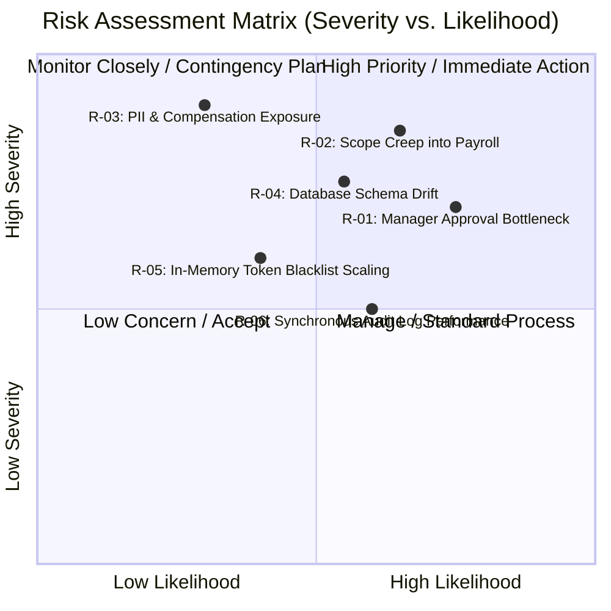

# Assumptions and Risk Analysis

**Document ID:** EPAMS-RSK-001  
**Version:** 1.0.0  
**Date:** November 2026  
**Status:** Approved  
**Author:** Senior Enterprise Architect & Senior Product Manager  

---

## 1. Product & Architecture Assumptions

### 1.1 Organizational & User Behavior Assumptions
* **A-01 (Single Organization Multi-Department Model):** The target organization operates as a single legal entity with departmental divisions (Engineering, HR, Finance, Operations, IT). Multi-subsidiary tenant isolation is not required for the initial MVP.
* **A-02 (Hierarchical Reporting Consistency):** Every employee possesses exactly one primary reporting manager, allowing deterministic approval workflow routing without complex graph cycles.
* **A-03 (Browser Environment):** Users access the portal through modern, evergreen web browsers (Google Chrome 110+, Mozilla Firefox 115+, Microsoft Edge 110+, Safari 16+) with JavaScript enabled.
* **A-04 (English Language Operation):** In Indian enterprise environments, administrative and technical workplace tools operate in English; multi-language localization is not an MVP gating item.

### 1.2 Technical & Operational Assumptions
* **A-05 (Stateless Application Scalability):** The backend API can operate statelessly; JWT tokens and client cookies carry necessary session context, allowing backend instances to scale horizontally behind a reverse proxy.
* **A-06 (Database Persistence Tier):** The application will utilize an in-memory database (H2) for zero-dependency development/testing and a relational RDBMS (MySQL 8.0+) for production deployments.
* **A-07 (Network Connectivity):** Organizations provide reliable intranet or internet access to employees; offline-first synchronization is explicitly out of scope.

---

## 2. Risk Assessment & Mitigation Matrix

| Risk ID | Category | Risk Description | Likelihood | Impact | Severity Score | Mitigation Strategy |
| :--- | :--- | :--- | :--- | :--- | :--- | :--- |
| **`R-01`** | **Operational** | **Manager Approval Bottleneck:** Reporting managers fail to review pending requests promptly, causing SLA breaches and employee dissatisfaction. | High | High | **High** | Implement automated reminder notifications at 50% SLA threshold, with auto-escalation to the Department Head after 48 business hours of inactivity. |
| **`R-02`** | **Product Scope** | **Scope Creep into Payroll/Leave:** Stakeholders attempt to turn EPAMS into a full payroll and biometric engine, derailing project focus. | High | High | **High** | Strictly maintain boundaries defined in `product-scope.md`. Provide standard integration points rather than building payroll math. |
| **`R-03`** | **Security** | **PII & Compensation Data Exposure:** Flawed authorization checks allow employees to view colleagues' salaries or private contact details (Horizontal Privilege Escalation). | Low | Critical | **High** | Enforce field-level DTO projections, method-level Spring Security `@PreAuthorize`, and write automated integration tests verifying 403 Forbidden on peer records. |
| **`R-04`** | **Technical** | **Database Schema Drift in Production:** Relying on `hibernate.ddl-auto=update` in production environments can cause accidental data loss or silent column corruption. | Medium | High | **Medium-High** | Transition from Hibernate auto-DDL to versioned Liquibase or Flyway database migration scripts before production deployment. |
| **`R-05`** | **Architecture** | **Refresh Token Database Bloat:** Unbounded accumulation of expired refresh tokens degrades database index performance. | Medium | Medium | **Medium** | Introduce a scheduled Spring `@Scheduled` background cleanup task to purge expired and revoked tokens older than 30 days. |
| **`R-06`** | **Performance** | **Synchronous Audit Log Bottleneck:** Writing audit logs synchronously in request threads slows down API responsiveness during burst traffic. | Medium | Medium | **Medium** | Transition `AuditLogService` to asynchronous execution (`@Async` with thread pool executor) to decouple audit I/O from client response times. |
| **`R-07`** | **Compliance** | **Non-Compliance with DPDP Act 2023:** Inability to demonstrate who accessed or modified employee personal data during statutory audits. | Low | High | **Medium** | Comprehensive audit trail logging every profile access, update, and role elevation with immutable timestamping. |

---

## 3. Explicit Distinction of Assertions

To maintain academic and professional honesty:

### 3.1 Confirmed Evidence (Direct Source Verification)
1. The existing Spring Boot application successfully starts and serves authenticated endpoints.
2. The current codebase does not have Service Request or Approval entities.
3. Passwords in the database are currently hashed via BCrypt, and brute-force lockout logic is implemented in `UserAccountServiceImpl`.

### 3.2 Assumptions (Design Parameters)
1. Indian SMEs in the target segment will run the application on Linux containers with MySQL backends.
2. Employees and managers have access to corporate email for notification dispatch.

### 3.3 Hypotheses (To Be Validated in User Trials)
1. A structured 4-step service request form will decrease employee support ticket creation time compared to composing an email.
2. Providing real-time ticket stage indicators will reduce manual status check-in emails by over 50%.

