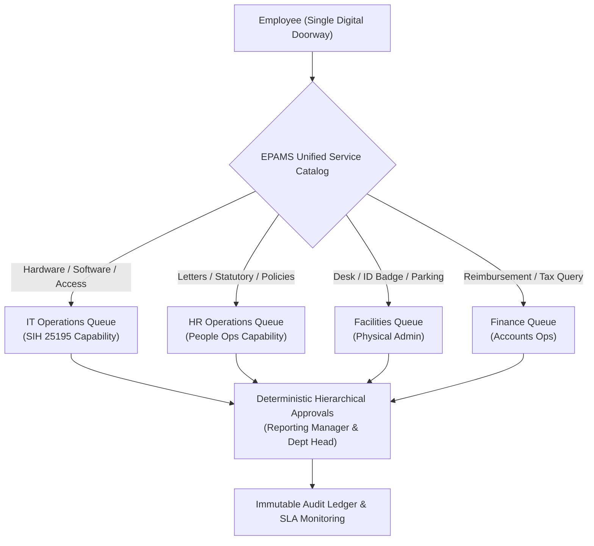

# Comprehensive Competitor & Benchmark Gap Analysis (v2.0)
## Incorporating SIH 2025 Problem Statement 25195 (Smart Helpdesk Ticketing Solution for IT Services)

**Document ID:** EPAMS-CMP-002  
**Version:** 2.0.0  
**Date:** November 2026  
**Status:** Approved  
**Author:** Senior Product Manager & Enterprise Software Architect  

---

## 1. Executive Summary & Benchmark Scope

This document refines the Phase M1 competitive analysis by introducing **SIH 2025 Problem Statement 25195 ("Smart Helpdesk Ticketing Solution for IT Services")** as a direct functional benchmark alongside established commercial enterprise solutions (**Zoho People** and **ServiceNow HR Service Delivery**).

By analyzing where commercial suites become over-engineered and where hackathon-style IT ticketing solutions remain too narrow, we establish a defensible, highly practical product identity for **EPAMS**.

```mermaid
quadrantChart
    title Enterprise Service & Lifecycle Positioning Matrix (v2.0)
    x-axis Narrow IT Helpdesk --> Multi-Department Enterprise Platform
    y-axis Monolithic HRMS Focus --> Dedicated Service & Lifecycle Workflow
    quadrant-1 Tier-1 Enterprise ESM (ServiceNow HRSD)
    quadrant-2 EPAMS Target Niche (Cross-Dept Service & Lifecycle Hub)
    quadrant-3 Monolithic HRMS Suites (Zoho People, Darwinbox)
    quadrant-4 Siloed IT Helpdesk Tools (SIH 2025 PS 25195, Freshdesk)
    "ServiceNow HRSD": [0.88, 0.82]
    "Zoho People": [0.65, 0.25]
    "SIH 2025 PS 25195": [0.20, 0.45]
    "Freshservice": [0.45, 0.55]
    "EPAMS": [0.68, 0.85]
```

---

## 2. Reference Benchmark Profiles

### 2.1 Benchmark A: SIH 2025 Problem Statement 25195 (Smart Helpdesk Ticketing Solution for IT Services)
* **Origin:** Smart India Hackathon (SIH) 2025, National Innovation Challenge.
* **Official Problem Scope:**
  * **Centralized Employee IT Helpdesk:** Provide an intuitive self-service portal where employees can log, track, and manage all workplace IT issues and service requests.
  * **AI-Based Ticket Classification:** Automatic semantic categorization of incoming requests into standard IT domains (Hardware, Software, Network, Access & Security) to eliminate manual triage.
  * **Intelligent Routing & Dispatch:** Automatic assignment of classified tickets to the appropriate IT specialist or technical support queue based on current workload, expertise, and availability.
  * **Self-Service Capabilities:** Built-in searchable knowledge base, interactive FAQ auto-suggestions, and real-time status tracking to facilitate self-resolution of common technical questions.
  * **Priority Management & SLA Escalation:** Standardized prioritization (P1 Critical to P4 Low) with automated supervisor escalation upon impending SLA breach.
* **Comparative Assessment:**
  * *Where SIH 25195 Excels:* Dedicated focus on IT support automation, AI triage, and algorithmic dispatcher logic.
  * *Scope Boundary:* SIH 25195 is deliberately framed as an **IT-specific helpdesk**. In a corporate environment, limiting ticketing to IT creates an operational silo: employees still resort to unmonitored emails for HR services (bonafide letters, PF inquiries), Facilities requests (desk shifts, physical ID badges), and Finance queries (expense approvals). Furthermore, it omits the reporting manager approval hierarchy and cross-departmental Joiner-Mover-Leaver (JML) lifecycle workflows.

### 2.2 Benchmark B: Zoho People (Mid-Market Indian HRMS Suite)
* **Official Verified Capabilities:**
  * Comprehensive cloud HRMS covering biometric attendance, leave policies, shift scheduling, performance appraisals, and payroll integration (Zoho Payroll).
  * **HR Cases Module:** An integrated query module enabling employees to submit HR-related queries, assign them to HR agents, track resolution status, and set basic email-based SLA alerts.
  * **Self-Service Portal:** Web and mobile self-service for personal profile management, document downloads, and company announcements.
* **Comparative Assessment:**
  * *Where Zoho People Excels:* Unbeatable cost-effectiveness and statutory localization for Indian SMEs in core HR (attendance, leaves, payroll).
  * *Scope Boundary:* The Cases module is an auxiliary feature within an administrative HRMS. Routing a ticket across non-HR departments (e.g., coordinating a software license between IT, manager, and finance) is rigid, and multi-tier approval customization often requires proprietary scripting (Zoho Deluge).

### 2.3 Benchmark C: ServiceNow HR Service Delivery (HRSD)
* **Official Verified Capabilities:**
  * Tier-1 Enterprise Employee Service Center providing an omnichannel, unified digital front door across all enterprise functions (HR, IT, Legal, Workplace Services).
  * **Flow Designer & Enterprise Workflow Engine:** Visual, low-code/no-code workflow builder capable of modeling complex, parallel, multi-department lifecycle orchestrations (global transfers, executive onboarding, complex offboarding).
  * **Universal Request & Case Management:** Transparent routing of cases between IT Service Management (ITSM) and HRSD with unified SLA tracking.
  * **Encrypted Document Vault & Compliance:** Enterprise electronic signature capture, retention policies, and SOX/GDPR-compliant audit ledgers.
* **Comparative Assessment:**
  * *Where ServiceNow Excels:* The industry standard for enterprise workflow orchestration, scale, and cross-departmental coordination.
  * *Scope Boundary:* Licensing costs ($50–$100+ per user/month in USD) and implementation cycles (6–12 months with specialized consultancies) make it completely inaccessible and over-engineered for organizations with 100–1,000 employees.

---

## 3. Four-Way Capability Comparison Matrix

| Functional Dimension | SIH 2025 PS 25195 (IT Helpdesk) | Zoho People | ServiceNow HRSD | Proposed EPAMS (v1.0 Architecture) |
| :--- | :--- | :--- | :--- | :--- |
| **Primary Domain Scope** | IT Support & Asset Faults only | Full Monolithic HRMS (Attendance, Payroll) | Enterprise Service Management (Global) | **Employee Lifecycle & Cross-Dept Services** |
| **Department Coverage** | Single Department (IT) | Single Department (HR focus) | Cross-Enterprise (HR, IT, Legal, Facilities) | **Cross-Department (HR, IT, Facilities, Finance)** |
| **Approval Workflows** | None or simple single-stage IT Lead sign-off | Hierarchical HR approvals via custom rules | Multi-stage, parallel, conditional BPMN workflows | **Single-Level default; Conditional Two-Level for high-impact (`ADR-001`)** |
| **Employee Master Data** | Basic username / contact; no employee record | Full employee profile & statutory details | Deep employee profile with historical tenure | **Rich Employee Record (`Profile`) with department, role, reporting line** |
| **Lifecycle Workflows (JML)** | Asset provisioning task only | Onboarding checklists; isolated from IT | Comprehensive cross-department JML orchestration | **Structured JML tasklists spanning HR, IT, and Manager** |
| **Service Catalog Architecture** | IT fault & software catalog | Flat list of HR query types | Dynamic multi-department catalog with nested forms | **Categorized Catalog: IT, HR, Facilities, Finance** |
| **Audit & Compliance** | Basic ticket history log | Standard HR audit trail | Immutable compliance ledger (SOX, GDPR) | **Tamper-evident, queryable audit trail (`AuditLog`)** |
| **Security Architecture** | Standard username/password | Cloud IAM & OAuth | Enterprise SSO, SAML, Zero-Trust | **Stateless JWT, HTTP-only dual cookies, CSRF, BCrypt, Lockout** |
| **Deployment & Footprint** | Lightweight web app | SaaS Cloud Multi-tenant | SaaS Cloud Multi-tenant (Heavy) | **Modular Monolith, Multi-stage Docker, MySQL 8+ (`ADR-003`, `ADR-004`)** |

---

## 4. Refined Product Differentiation for EPAMS

### 4.1 Evolution Beyond SIH 25195: Breaking the IT Silo
While SIH Problem Statement 25195 correctly identifies the need for structured ticketing, limiting a helpdesk strictly to IT creates operational fragmentation. In a 300-person organization, an employee must not be forced to use one system for a laptop repair, a second system for a bonafide letter, and email for an expense query.

**EPAMS unifies these interactions into a Single Digital Front Door:**



### 4.2 Cross-Department Lifecycle Workflows (The Joiner-Mover-Leaver Advantage)
Neither a pure IT helpdesk (SIH 25195) nor a standard HR query box handles the transition when an employee joins, changes departments, or resigns.

In EPAMS:
1. **Onboarding (Joiner):** HR initiates the employee profile $\rightarrow$ triggers parallel onboarding tasks:
   * IT Queue: Provision email, assign developer laptop, configure VPN.
   * Facilities Queue: Allocate desk workstation, issue RFID smart card.
   * Manager Queue: Assign onboarding mentor and schedule orientation.
2. **Department Transfer (Mover):** Department Head signs off $\rightarrow$ reassigns reporting line in `Profile` $\rightarrow$ triggers access revocations in IT and role updates in RBAC.
3. **Offboarding (Leaver):** Resignation logged $\rightarrow$ generates simultaneous clearance checklists for IT (laptop return), HR (exit interview), Finance (final settlement), and Facilities (badge deactivation).

### 4.3 Why This Wins Against Monolithic HRMS Suites
Monolithic tools (Zoho People, Keka, Darwinbox) prioritize attendance tracking and payroll math, treating ticket management as an afterthought. EPAMS deliberately avoids the payroll/biometric trap, focusing 100% on **service delivery speed, approval clarity, and operational transparency**.
