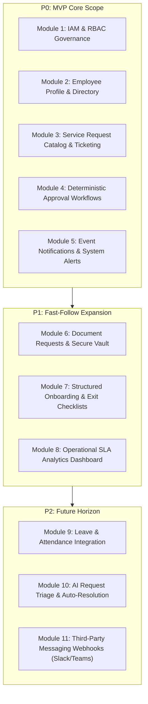

# Product Scope: Employee Lifecycle and Service Management (EPAMS)

**Document ID:** EPAMS-SCP-001  
**Version:** 1.0.0  
**Date:** November 2026  
**Status:** Approved  
**Author:** Senior Product Manager & Enterprise Software Architect  

---

## 1. Scope Strategy & Prioritization Framework

To deliver maximum business value while maintaining technical feasibility, EPAMS utilizes the **MoSCoW / Tiered Priority Framework**:
* **Target Segment Hypothesis:** The primary operational sweet spot is hypothesized as Indian organizations with **100 to 1,000 active employees**. This boundary is treated as a working hypothesis subject to empirical validation via the field research plan (`docs/product-validation/`), not an unassailable market fact.
* **P0 (Must Have - MVP Core):** Essential for a viable product release; non-negotiable architectural baseline.
* **P1 (Should Have - Fast-Follow):** High business value; immediately follows MVP stabilization.
* **P2 (Could Have - Future Horizon):** Valuable expansions dependent on user feedback and scale.
* **Out of Scope (Won't Have):** Explicitly excluded to protect focus and prevent scope creep.

---

## 2. Priority Breakdown

---

## 3. P0: MVP Modules (Detailed Capabilities)

### Module 1: Identity, Access & Role Governance (IAM & RBAC)
* **JWT Authentication:** Dual-token issuance (short-lived access token + long-lived database-backed refresh token with revocation support).
* **Role Hierarchy:** System-enforced roles: `ADMIN`, `HR_MANAGER`, `DEPT_HEAD`, `EMPLOYEE`.
* **Account Defense:** Automatic account locking after 5 consecutive failed login attempts; administrative manual unlock mechanism.
* **Session Management:** Secure HTTP-only cookies, SameSite enforcement, and CSRF token double-submit verification.

### Module 2: Employee Profile & Organization Directory
* **Master Records:** Centralized employee repository storing personal info, job details (`employeeId`, `department`, `designation`, `dateOfJoining`), reporting manager link, and emergency contacts.
* **Organization Directory:** Searchable, filterable directory with pagination allowing authenticated employees to discover colleagues and reporting lines.
* **Self-Service Profile:** Employees can view full personal details and request profile corrections.

### Module 3: Service Request Catalog & Ticketing System
* **Categorized Service Catalog:** Standard request templates across four operational pillars:
  * **IT Services:** Laptop allocation, software license, peripheral request, access permission.
  * **HR Services:** Employment letter, policy query, statutory update, payroll inquiry.
  * **Facilities:** Desk allocation, ID card replacement, parking pass.
  * **Finance:** Expense reimbursement query, tax declaration assistance.
* **Ticket Lifecycle Management:** 11-State Finite State Machine (`SUBMITTED`, `PENDING_APPROVAL`, `PENDING_SECONDARY_APPROVAL`, `ASSIGNED`, `IN_PROGRESS`, `ON_HOLD`, `RESOLVED`, `CLOSED`, `REJECTED`, `CANCELLED`, `REOPENED`) with strict transition guards and audit logging.
* **Conversational Threading:** Two-way audit comments between employee and assigned resolvers.
* **Concurrency Protection:** Optimistic locking via JPA `@Version` returning HTTP 409 Conflict upon simultaneous edits. No blind automatic retries for approvals.

### Module 4: Multi-Step Approval Workflows
* **Hierarchy-Aware Routing:** Automatic routing of requests requiring approval to the employee's direct reporting manager (`Single-Level Approval` by default).
* **Conditional Two-Level Escalation:** High-impact requests (hardware allocation, expense reimbursements above an admin-configurable threshold [default ₹10,000], or privileged system access) mandate secondary Department Head approval.
* **Strict Governance:** Strict anti-self-approval enforcement (`BR-005`, `BR-010`) and mandatory rejection reasoning ($\ge 15$ characters).

### Module 5: Event Notifications & System Alerts
* **In-App Notification Ledger:** Real-time badge and list of pending actions, status changes, and approvals.
* **Transactional Email Alerts:** Standard SMTP email dispatch for ticket creation, approval requests, and resolution notifications (tested locally via Mailpit on port 1025/8025).

---

## 5. P1: Fast-Follow Modules (Post-MVP)

* **Module 6: Document Request & Repository:** Automated generation and secure storage of standardized PDF letters (bonafide letters, internship completion, employment verification).
* **Module 7: Onboarding & Offboarding Checklists:** Task assignment lists for new joiners and departing employees across HR, IT, and Finance teams.
* **Module 8: Operational Analytics Dashboard:** Visual charts illustrating Mean Time to Resolution (MTTR), SLA compliance percentages, and department volume distributions.

---

## 6. P2: Future Horizon Modules

* **Module 9: Attendance & Leave Management Sync:** Read-only calendar views reflecting employee availability during request assignment.
* **Module 10: AI Request Triage & Suggested Resolution:** Semantic analysis of request descriptions to auto-suggest FAQ answers or pre-route tickets to the most relevant specialist.
* **Module 11: Third-Party Enterprise Webhooks:** Interactive approval notifications delivered directly inside Slack and Microsoft Teams.

---

## 7. Explicit Exclusions from MVP Scope

To protect engineering quality and prevent distraction from core workflow mechanics, the following are strictly excluded from the initial release:
1. **Full Payroll Calculation & Disbursement Engine:** EPAMS will not handle tax calculations, direct deposit file generation, or bank API integrations.
2. **Biometric Hardware Integration:** No direct driver communication with physical fingerprint or facial recognition terminals.
3. **Applicant Tracking & Recruitment (ATS):** No candidate pipeline management, resume parsing, or interview scheduling.
4. **Multi-Tenant SaaS Billing & Subscriptions:** The MVP architecture focuses on a dedicated single-tenant or enterprise-internal deployment without credit card billing gateways.

---

## 8. Success Metrics & Key Performance Indicators (KPIs)

| Metric Category | Specific KPI | Target Benchmark | Measurement Method |
| :--- | :--- | :--- | :--- |
| **Operational Efficiency** | Mean Time to Resolution (MTTR) | $< 24$ business hours for tier-1 requests | Calculated from ticket creation to `RESOLVED` timestamp. |
| **Process Adoption** | Employee Self-Service Adoption | $> 85\%$ of all non-urgent employee requests submitted via portal | Ratio of portal tickets vs. direct email inquiries. |
| **Governance & Quality** | SLA Compliance Rate | $> 95\%$ of tickets resolved within defined category target | System audit log evaluation. |
| **Security & Privacy** | Unauthorized Access Breaches | $0$ incidents | Audit log security review and penetration testing. |
| **System Performance** | API 95th Percentile Latency | $< 250\text{ ms}$ for standard transactional endpoints | Application server metrics. |

