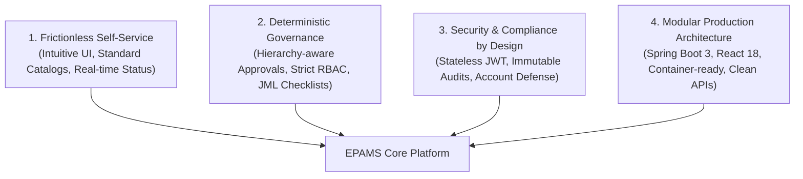
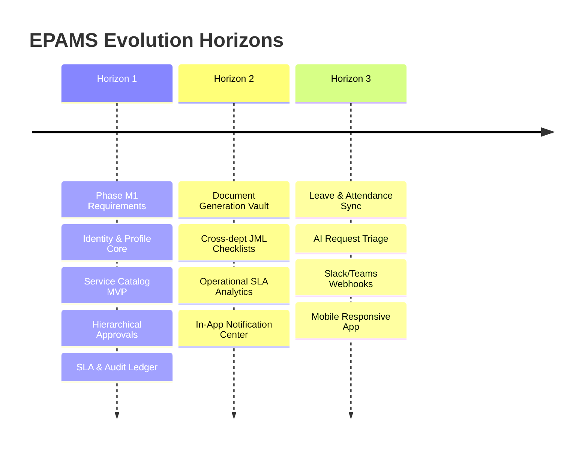

# Product Vision: Employee Lifecycle and Service Management Platform (EPAMS)

**Document ID:** EPAMS-VIS-001  
**Version:** 1.0.0  
**Date:** November 2026  
**Status:** Approved  
**Author:** Senior Product Manager & Enterprise Software Architect  

---

## 1. Product Vision Statement

> **"To empower mid-market organizations with a modern, transparent, and secure digital workplace hub where every employee request, approval, and lifecycle transition is executed with effortless simplicity, deterministic governance, and measurable accountability."**

EPAMS bridges the gap between chaotic, unmonitored communication channels (emails, chat apps, spreadsheets) and overly complex, expensive enterprise platforms. It provides growing companies with the operational discipline of a tier-1 enterprise without the administrative or financial burden.

---

## 2. Core Value Propositions

### 2.1 For Employees: "One Click, Clear Timeline"
* A single, unified self-service portal to submit queries, request assets, and request corporate documentation.
* Real-time visibility into the status of every request with clear SLA timers and assigned resolvers, eliminating awkward status chase-ups.
* Instant access to verified personal profile information and historical records.

### 2.2 For Reporting Managers & Team Leads: "Contextual, Frictionless Approvals"
* Centralized approval dashboard highlighting pending requests requiring action.
* Context-rich decision screens showing employee history, current resource allocations, and business justifications.
* One-click approvals and rejections with mandatory reasoning for accountability.

### 2.3 For People Operations (HR) & Department Specialists: "Deterministic Queue Management"
* Organized department-level queues (HR, IT, Facilities, Finance) with automated assignment.
* Standardized request templates preventing incomplete or ambiguous submissions.
* Automated tracking of onboarding and exit task checklists to ensure zero-defect handoffs.

### 2.4 For Executive Leadership & Compliance Officers: "Governance and Operational Clarity"
* High-level visibility into service turnaround times (Mean Time to Resolution - MTTR), department request volumes, and operational bottlenecks.
* Complete, tamper-evident audit trails recording every profile change, privilege escalation, and approval action to satisfy internal and statutory compliance standards.

---

## 3. Strategic Architectural Pillars

### Pillar 1: Frictionless Self-Service
Every interaction must prioritize cognitive simplicity. Employees should never wonder who to email or where to find a form; the service catalog guides them directly to the appropriate category with pre-validated input schemas.

### Pillar 2: Deterministic Governance
Approvals and assignments must follow clear, predictable business rules rather than ad-hoc human routing. System state transitions must be mathematically unambiguous: submitted $\rightarrow$ pending approval $\rightarrow$ approved $\rightarrow$ in progress $\rightarrow$ resolved $\rightarrow$ closed.

### Pillar 3: Security & Compliance by Design
Given the sensitivity of employee compensation, contact records, and organizational credentials, EPAMS treats security as a foundational property. Every action is authenticated, authorized against role definitions, and recorded in a queryable audit ledger.

### Pillar 4: Modular Production Architecture
The platform is engineered using modern enterprise software engineering standards: strongly-typed Java 25 / Spring Boot 3 backend, component-driven React frontend, stateless REST contracts, and seamless containerization capability for cloud or on-premises deployment.

---

## 4. Multi-Horizon Product Roadmap

* **Horizon 1 (MVP Foundation):** Core identity, employee profile directory, employee service request ticketing, multi-level approvals, and tamper-evident audit logging.
* **Horizon 2 (Fast-Follow Expansion):** Document request and verification vault, structured joiner/mover/leaver (JML) checklists, and real-time operational analytics.
* **Horizon 3 (Ecosystem Integration):** Webhook integrations with communication tools (Slack/Teams), attendance calendar sync, and intelligent request categorization.

