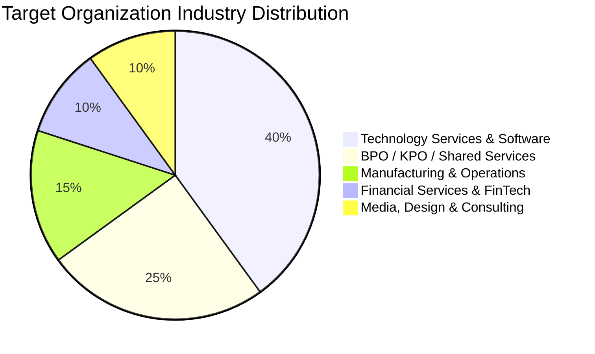
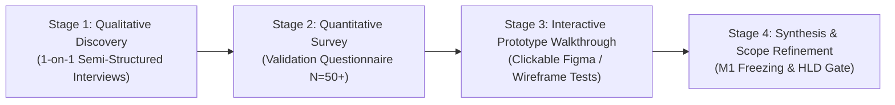
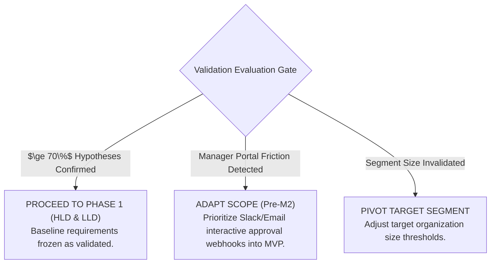

# Product Validation Plan: Employee Operations Workflow Platform (EPAMS)

**Document ID:** EPAMS-VAL-001  
**Version:** 1.0.0  
**Date:** November 2026  
**Status:** Approved for Execution  
**Author:** Senior Product Manager & Lead Business Analyst  

---

## 1. Executive Summary & Validation Objective

The Phase M1 discovery artifacts formulated an architectural and functional foundation for **EPAMS** based on competitive benchmarking (Zoho People, ServiceNow HRSD, SIH 2025 PS 25195) and engineering best practices. 

However, in accordance with disciplined product management principles, **internal assumptions and architectural hypotheses are not market facts**. Before freezing requirements and committing significant engineering capital into Phase 1 (HLD/LLD and implementation), we must execute a structured, evidence-based **Product Validation Plan** to test our core hypotheses against real-world stakeholders in Indian mid-market organizations.

---

## 2. Core Problem Hypotheses Under Investigation

| Hypothesis ID | Hypothesis Statement | Current Status | Risk Impact if Invalid |
| :--- | :--- | :--- | :--- |
| **`HYP-001`** | Organizations with 100–1,000 employees experience severe operational delays and request losses due to reliance on unmonitored emails and chat threads for cross-department services. | **Unvalidated Hypothesis** | High: Target segment might be satisfied with existing email/chat workflows or already have standardized SaaS tools. |
| **`HYP-002`** | Reporting managers are willing to log into a dedicated web portal to review and approve employee requests within a 24-hour turnaround window without requiring direct Slack/WhatsApp action buttons. | **Unvalidated Hypothesis** | Critical: If managers ignore portal notifications, approval queues will stall, destroying overall SLA compliance. |
| **`HYP-003`** | Combining IT, HR, Facilities, and Finance into a single service catalog delivers significantly higher operational efficiency than maintaining separate, best-of-breed department tools. | **Unvalidated Hypothesis** | High: Department heads may insist on retaining specialized departmental silos. |
| **`HYP-004`** | Mid-market Indian enterprises actively seek an on-premises / self-hostable modular platform to avoid per-seat recurring subscription fees (e.g., ServiceNow/Zoho tiers). | **Unvalidated Hypothesis** | Medium: Organizations may prefer zero-maintenance cloud SaaS over self-hosted deployments. |
| **`HYP-005`** | A single-level approval default with conditional two-level escalation for high-impact tickets ($\ge ₹10,000$ or capital assets) matches real-world corporate governance policies. | **Unvalidated Hypothesis** | Medium: Corporate policies may mandate complex multi-tiered financial approval matrices. |

---

## 3. Target Sampling & Interview Demographics

To ensure data integrity and avoid sampling bias, stakeholder validation will target **15 to 20 representative organizations** across India:

### 3.1 Organizational Criteria
* **Headcount Range:** 80 to 1,200 active employees (validating whether the 100–1,000 range is the true "friction threshold").
* **Geographic Spread:** Operating across Tier-1 hubs (Bengaluru, Hyderabad, NCR, Pune, Chennai) with distributed or hybrid teams in Tier-2/3 cities.
* **Current Tooling Profile:** Companies currently utilizing shared email inboxes (`hr@`, `it-help@`), WhatsApp/Slack channels, basic Google Forms, or partial legacy HRMS modules.

### 3.2 Participant Sampling Targets

| Stakeholder Persona | Target Interviewees | Key Investigation Focus |
| :--- | :--- | :--- |
| **HR & People Operations Leads** | 4 – 5 interviews | Onboarding/offboarding handoffs, bonafide letter issuance volume, audit compliance, PII handling. |
| **IT Support & Infrastructure Admins** | 4 – 5 interviews | Asset provisioning delays, license requests, credential management, ticket categorization overhead. |
| **Reporting Managers & Team Leads** | 4 – 5 interviews | Approval fatigue, context switching, mobile approval habits, anti-self-approval awareness. |
| **Individual Contributor Employees** | 5 – 6 interviews | Transparency of request status, follow-up frustration, self-service adoption willingness. |

---

## 4. Multi-Stage Validation Methodology

### 4.1 Stage 1: Qualitative Stakeholder Interviews
* Conduct 45-minute semi-structured interviews guided by [stakeholder-interview-guide.md](file:///c:/Users/Iyyappan%20E/Folders/SDE/Round%203-HR%20Interview/PROJECTS/Projects/EPAMS/docs/product-validation/stakeholder-interview-guide.md).
* Capture raw quotes, exact turnaround times, current workaround mechanisms, and organizational charts.
* Strictly enforce neutrality: Do not pitch EPAMS features; listen to organic workflows and frustrations.

### 4.2 Stage 2: Quantitative Validation Survey
* Distribute a structured 15-question survey to validate the frequency and severity of identified pain points across a broader sample ($N \ge 50$ respondents).
* Quantify metrics: Average days to issue an HR letter, average time to provision a developer laptop, percentage of lost requests per month.

### 4.3 Stage 3: Low-Fidelity Prototype Walkthrough
* Present interactive wireframes of the **Unified Service Catalog**, **Approvals Dashboard**, and **Ticket Discussion Timeline**.
* Evaluate cognitive usability: Task completion time, clarity of the 11 ticket states, and reaction to conditional two-level approvals.

---

## 5. Ethical Guidelines & Data Privacy

1. **Non-Disclosure & Confidentiality:** All company-specific operational metrics, internal salaries, and organizational charts collected during interviews will be sanitized and strictly anonymized.
2. **DPDP Act Compliance:** Explicit participant consent will be obtained prior to recording sessions or taking notes, strictly limiting data usage to product discovery research.
3. **Intellectual Honesty:** Unfavorable findings (e.g., managers stating they refuse to use a web portal without a Slack bot) must be documented transparently without confirmation bias.

---

## 6. Validation Decision Gates

